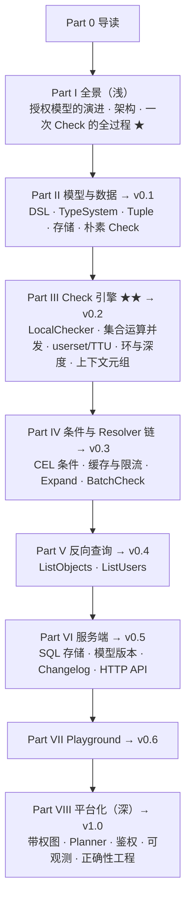

# 第 0 章 本书怎么读

> 本章目标：搭好环境，知道本书的结构、配套代码的版本节奏，以及读 OpenFGA 源码的方法。
> 前置：会写 Go；知道 HTTP/JSON 是什么。不需要任何授权系统的背景。

## 0.1 这本书要解决什么问题

几乎每个应用都要回答同一个问题：**这个用户能不能对这个东西做这件事？**

最开始，答案往往写在业务代码里：`if doc.OwnerID == user.ID || user.IsAdmin`。等系统长大，问题会接连出现：文档可以分享给一个团队，团队可以嵌套团队，文件夹里的文档继承文件夹的权限，被拉黑的人即使在团队里也不能看，临时授权到期要自动失效……再加上“列出我能看的所有文档”“谁能看这份文档”这样的反向查询，`if` 语句很快就写不下去了。

Google 在 2019 年发表的 Zanzibar 论文给出了一套统一的解法：把“谁和什么有什么关系”存成**关系元组**（relationship tuple），把“关系如何推导”写成**授权模型**，再由一个专门的服务回答所有授权问题。[OpenFGA](https://github.com/openfga/openfga) 是这套思想最流行的开源实现之一，CNCF 项目，Auth0、Grafana、Canonical、Docker 等公司在生产中使用。

本书的目标是：

> **读完后，你能从零写出一个前后端都能运行的 ReBAC 授权引擎**：DSL 建模 → 元组存储 → Check / ListObjects / ListUsers → HTTP API → Playground UI → 部署与可观测。

为此，全书边读 OpenFGA 的真实源码，边在 `code/mini-openfga` 里一步步重建一个小号的 OpenFGA。

## 0.2 两份代码

| | 位置 | 说明 |
|---|---|---|
| **OpenFGA** | [openfga/openfga](https://github.com/openfga/openfga) @ `526995eb`（v1.22.0，2026-10-07） | 全书引用的源码版本。约 6.7 万行非测试 Go 代码、11 万行测试代码 |
| **OpenFGA 外部依赖** | `openfga/api`（protobuf 定义）、`openfga/language` v0.3.2（DSL 解析器、带权图） | DSL 的语法和带权图不在主仓库里，第 4、27 章会读到 |
| **mini-openfga** | 本书仓库 `code/mini-openfga/`（独立 git 仓库） | 每个 Part 结束打一个 tag：v0.1 → v1.0，约 1 万行 Go + 一个 React 前端 |

源码引用的写法统一为 `路径:行号`，例如 `internal/graph/check.go:395` 指 OpenFGA 仓库里 `LocalChecker.ResolveCheck` 的起始行。行号都对应 `526995eb` 这个提交，正文里的摘录也都从这个提交原样复制（为了篇幅会删去注释和日志行，删减处不另行标注）。

mini-openfga 的引用写作 `mini: pkg/check/local_checker.go`，并注明是哪个版本。

## 0.3 mini-openfga 的版本节奏

| 版本 | 能力 | 对应 Part | 跑 OpenFGA 矩阵测试的结果 |
|---|---|---|---|
| v0.1 | 手写 DSL 解析器、TypeSystem 与模型校验、Tuple、内存存储、朴素递归 Check、CLI | Part II | Check 325/516 |
| v0.2 | 并发 Check、userset、通配符、环检测、上下文元组 | Part III | Check 720/939 |
| v0.3 | CEL 条件、Resolver 链（缓存 + 限流）、Expand、BatchCheck | Part IV | Check 939/939 |
| v0.4 | ListObjects（反向展开）、ListUsers | Part V | 三类查询 2310/2310 |
| v0.5 | SQLite、Store/模型版本、Read/ReadChanges/Assertions、缓存失效、HTTP API | Part VI | 通过 HTTP + SQLite 跑，2310/2310 |
| v0.6 | Vite + React Playground，Check 解释树 | Part VII | — |
| v1.0 | 带权图、weight2 策略、Thompson Sampling Planner、鉴权、指标、Docker、和真 OpenFGA 做差分测试 | Part VIII | Docker 中 2310/2310；与 OpenFGA 对比 41,250 次查询 0 差异 |

最后一列是本书最重要的“验收标准”。OpenFGA 自己的正确性测试是一组 YAML 文件（`assets/tests/consolidated_1_1_tests.yaml`、`assets/tests/abac_tests.yaml`，共 171 个测试用例），由 `tests/check/check.go` 等运行器在真实服务上逐条执行。mini-openfga 从 v0.1 起就把这两个文件原样复制进 `testdata/openfga/`，用自己写的运行器去跑。v0.1 只能过 63%，到 v0.4 三种查询全部通过，v1.0 再用同一个 HTTP 客户端去跑**真的 OpenFGA 服务**，确认两边的线上协议一致（第 24、31 章）。

每个版本都可以单独检出、单独运行：

```bash
cd code/mini-openfga
git tag                    # v0.1 v0.2 ... v1.0
git checkout v0.2          # 看某一版的完整代码
git diff v0.1 v0.2 --stat  # 看这一版改了什么
git checkout v1.0
```

## 0.4 环境

| 工具 | 版本（本书验证时） | 用途 |
|---|---|---|
| Go | 1.26（v0.1–v0.6 的 `go.mod` 写的是 1.24，v1.0 因为依赖升到 1.26） | 后端 |
| Node.js | 22 | Playground（v0.6 起） |
| Docker | 29 | 部署（Lab 7）、运行 OpenFGA 做对比（可选） |

验证环境：

```bash
cd code/mini-openfga
go test ./...                     # 全部单元测试 + 矩阵测试
go run ./cmd/minifga matrix       # 单独跑 OpenFGA 的矩阵测试
```

v1.0 的预期输出：

```text
Check        assertions: 939 passed, 0 failed, 0 skipped (100.0%); tests: 298/298 fully passed
ListObjects  assertions: 641 passed, 0 failed, 0 skipped (100.0%); tests: 255/255 fully passed
ListUsers    assertions: 730 passed, 0 failed, 0 skipped (100.0%); tests: 255/255 fully passed
```

（298 = 171 个测试的“写入后查询”跑一遍，再加单阶段测试“把元组作为上下文元组传入”再跑一遍，第 13 章细说。）

如果想把 OpenFGA 本身跑起来对照，最简单的是在 OpenFGA 仓库里直接编译：

```bash
cd openfga                         # 克隆的 OpenFGA 仓库，检出 526995eb
go build -o /tmp/openfga ./cmd/openfga
/tmp/openfga run --playground-enabled=false --http-addr 127.0.0.1:18080 --grpc-addr 127.0.0.1:18081
curl -s 127.0.0.1:18080/healthz    # {"status":"SERVING"}
```

## 0.5 全书结构



前三个 Part 是地基：第 3 章用一次 Check 请求把整条链路走一遍，之后每章都会说明“我们现在在这条链路的哪一段”。Part III 是全书的核心（标 ★★），建议精读。Part V 的反向查询在算法上最绕，第 18 章会用图把反向展开一步步画出来。

每章的结构都一样：

1. **问题与概念**：为什么需要它，配一张图；
2. **OpenFGA 是怎么做的**：按调用顺序读源码，`路径:行号` + 关键摘录；
3. **从零实现**：mini-openfga 的代码，和原版的差异表（删了什么、为什么）；
4. **运行与验证**：精确命令 + 真实输出；
5. **练习**：一道巩固、一道扩展、一道读源码（答案在附录 D）；
6. **延伸阅读**。

每个 Part 末尾有一个 Lab，把这一部分的代码串起来做一个可以演示的东西，并给 mini-openfga 打一个新 tag。

## 0.6 怎么读 OpenFGA 的源码

OpenFGA 的代码分层很清楚。第 2 章会详细讲，这里先给一张阅读地图：

| 想了解 | 先看 |
|---|---|
| 服务怎么启动、有哪些配置 | `cmd/run/run.go`（`NewRunCommand`:127、`ServerContext.Run`:956）、`pkg/server/config/config.go` |
| 一个 API 的入口 | `pkg/server/<api>.go`，例如 `pkg/server/check.go:37` |
| API 背后的业务逻辑 | `pkg/server/commands/`，例如 `check_command.go`、`list_objects.go` |
| Check 引擎 | `internal/graph/`（默认的 v1 引擎）、`internal/check/`（实验性的 v2 引擎） |
| 授权模型的索引与校验 | `pkg/typesystem/typesystem.go` |
| 元组的校验 | `internal/validation/validation.go` |
| 存储接口与实现 | `pkg/storage/storage.go`，`pkg/storage/{memory,postgres,mysql,sqlite}` |
| 条件（CEL） | `internal/condition/` |
| 反向查询 | `pkg/server/commands/reverseexpand/`、`internal/listobjects/pipeline/`、`pkg/server/commands/listusers/` |
| 正确性测试 | `assets/tests/*.yaml` + `tests/{check,listobjects,listusers}/` |

几个实用技巧：

- **外部包放在模块缓存里**。DSL 解析器和带权图在 `github.com/openfga/language/pkg/go`，在 OpenFGA 仓库里执行 `go mod download github.com/openfga/language/pkg/go` 之后，到 `$(go env GOMODCACHE)/github.com/openfga/language/pkg/go@v0.3.2/` 下阅读。
- **从测试读起**。OpenFGA 的测试代码比源码还多。看不懂一个函数时，搜它的 `_test.go`，通常能找到一个最小的模型和几条元组，比读注释直观。
- **写一个小程序对照**。本书好几处结论都是这样验证的：在临时目录里写一个 `go.mod`，用 `replace github.com/openfga/openfga => /path/to/openfga` 引用本地仓库，直接调用 `typesystem.NewAndValidate`、`graph.NewWeightedAuthorizationModelGraphBuilder` 等函数，把输出和 mini-openfga 的输出放在一起比较（第 5、24、27 章）。

## 0.7 两条阅读路线

- **只想会用 OpenFGA**：读第 1、3、4、6、14 章和 Lab 1、Lab 3，再看第 23 章的一致性部分。
- **想自己实现一个**：按顺序读，每个 Lab 都动手做。在开始下一个 Part 之前，先用 `git diff` 看看下一版的改动有多大（v0.4 → v0.5 是最大的一次：24 个文件、新增 3138 行，含测试）。

## 0.8 练习

1. （巩固）检出 mini-openfga 的 v0.1，运行 `go run ./cmd/minifga matrix`，确认你看到的数字是 `325 passed, 191 failed`。
2. （扩展）用 `git diff --stat` 统计每两个相邻版本之间改动了多少行，哪一次最大？
3. （读源码）在 OpenFGA 仓库里找到 `assets/assets.go`，看看 YAML 测试文件是怎样被嵌入二进制的，再找出是哪几个测试运行器在用它们。

## 0.9 延伸阅读

- Zanzibar 论文：*Zanzibar: Google's Consistent, Global Authorization System*（USENIX ATC 2019）
- OpenFGA 文档：<https://openfga.dev/docs>
- OpenFGA 的架构说明：仓库内 `docs/architecture/architecture.md`、`docs/check/README.md`
