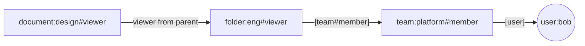

# 第 1 章 授权的几种形态：从 ACL 到 ReBAC

> 本章目标：用同一个“云盘”场景，比较 ACL、RBAC、ABAC、ReBAC 四种授权方式；理解 Zanzibar 的三个核心概念（关系元组、用户集重写、一致性）；把它们对应到 OpenFGA 的 API 上。
> 前置：无。对应代码：无（从第 4 章开始写代码）。

## 1.1 一个贯穿全书的场景

设想一个类似 Google Drive 的云盘：

- 用户可以**拥有**文档，也可以把文档**分享**给别的用户；
- 文档放在**文件夹**里，文件夹可以嵌套，**能看文件夹就能看里面的所有文档**；
- 公司有**团队**，团队可以包含子团队，可以把文件夹分享给整个团队；
- 某些文档可以**公开**给所有人；
- 管理员可以**拉黑**某个人，被拉黑的人即使在团队里也不能看这份文档；
- 外包人员的权限**只在合同期内有效**。

系统要回答三类问题：

| 问题 | 名字 |
|---|---|
| anne 能看 design.doc 吗？ | Check |
| anne 能看哪些文档？ | ListObjects |
| 谁能看 design.doc？ | ListUsers |

下面用四种方式来回答。

## 1.2 ACL：把名单挂在资源上

访问控制列表（Access Control List）为每个资源存一张“谁能做什么”的表：

```text
design.doc:  anne=owner, bob=viewer, carol=viewer
budget.xls:  bob=owner
```

Check 只要查一次表，非常快，也很直观。问题在于**所有的继承关系都要展开成名单**：把文件夹分享给团队时，要把团队的每个成员写到文件夹里每份文档的 ACL 上；有人入职、离职或换团队，要回头改成千上万条 ACL。这种“写放大”在名单变动频繁时无法维护。

## 1.3 RBAC：在用户和权限之间加一层角色

基于角色的访问控制（Role-Based Access Control）先把权限归到角色上，再把角色分给用户：

```text
role editor:  document.read, document.write
role viewer:  document.read
anne -> editor, bob -> viewer
```

角色解决了“权限组合”的复用问题，适合“财务可以看所有报表”这种**全局**规则。但云盘的规则是**按资源**的：anne 是 design.doc 的编辑者，却只是 budget.xls 的读者。要用 RBAC 表达，只能为每份文档造一组角色（`design.doc-editor`、`design.doc-viewer`……），这就是常说的“角色爆炸”。而且“文件夹的读者能读里面的文档”这样的**层级**关系，角色本身表达不了。

## 1.4 ABAC：用属性写规则

基于属性的访问控制（Attribute-Based Access Control）用一个策略引擎（例如 OPA/Rego、AWS IAM、Cedar）对“主体属性 + 资源属性 + 环境属性”求值：

```text
allow if resource.owner == user.id
allow if user.department == resource.department and time < resource.expires_at
```

ABAC 很适合表达“合同期内有效”“只能在公司网络访问”这样的**上下文条件**。它的弱点在于：

- 规则需要的属性得在请求时带上，比如“这份文档所在的文件夹链”“用户所在的所有团队”。属性本身就是一张关系图，策略引擎不负责存它，调用方要自己去查；
- **反向查询很难**：“anne 能看哪些文档”需要对每份文档都求值一遍规则。

## 1.5 ReBAC：把授权看成一张关系图

基于关系的访问控制（Relationship-Based Access Control）直接把“谁和什么有什么关系”作为数据存下来，每条数据是一个**关系元组**：

```text
document:design#owner@user:anne          anne 是 design 的 owner
document:design#parent@folder:eng        design 在 eng 文件夹里
folder:eng#viewer@team:platform#member   platform 团队的成员都是 eng 文件夹的 viewer
team:platform#member@user:bob            bob 是 platform 团队的成员
```

格式是 `object#relation@user`，读作“**user 是 object 的 relation**”。注意第三条的 user 不是一个人，而是 `team:platform#member`，意思是“platform 团队的所有成员”。这种“某对象上某关系的所有主体”叫作 **userset**（用户集），它让一条元组可以代表一群人。

元组只是数据。“文件夹的 viewer 也是文档的 viewer”这样的规则，写在**授权模型**里：

```text
type document
  relations
    define parent: [folder]
    define owner: [user]
    define viewer: [user, team#member] or owner or viewer from parent
```

- `[user, team#member]`：可以直接写元组赋予这个关系，user 可以是一个用户，也可以是团队成员这个 userset；
- `or owner`：document 的 owner 也是 viewer；
- `viewer from parent`：沿着 `parent` 关系找到文件夹，文件夹的 viewer 也是这份文档的 viewer。

于是“bob 能看 design 吗？”变成了一次**图遍历**：



ReBAC 天然支持按资源的权限、层级继承和团队嵌套，写放大也小：bob 换团队只需要改一条元组。反向查询也有了思路：从 bob 出发**反着走**这张图（第 18 章）。

ReBAC 的代价是：一次 Check 可能要读很多次存储，正确而高效地遍历这张图并不简单，这正是本书 Part III 到 Part VIII 要处理的问题。

## 1.6 四种方式放在一起

| | ACL | RBAC | ABAC | ReBAC |
|---|---|---|---|---|
| 按资源授权 | ✓ | 角色爆炸 | ✓（靠属性） | ✓ |
| 层级继承（文件夹 → 文档） | 展开名单 | ✗ | 调用方给出层级 | ✓ `X from parent` |
| 团队嵌套 | 展开名单 | 角色继承 | 调用方给出 | ✓ userset |
| 上下文条件（时间、IP） | ✗ | ✗ | ✓ | OpenFGA 用 **条件**（CEL）补上 |
| “我能看哪些” | 扫描所有 ACL | 好做 | 难 | ✓ 反向展开 |
| 变更成本 | 高 | 中 | 低（规则）/ 取决于属性来源 | 低（改一条元组） |

它们并不互斥。RBAC 在 ReBAC 里只是一种特殊的模型：

```text
type role
  relations
    define assignee: [user]
type report
  relations
    define viewer: [role#assignee]
```

ABAC 则由 OpenFGA 的**条件元组**补上：元组上挂一个 CEL 表达式，Check 时用请求带来的上下文求值（第 14 章）：

```text
define viewer: [user with non_expired]
condition non_expired(current_time: timestamp, expires_at: timestamp) {
  current_time < expires_at
}
```

## 1.7 Zanzibar 的三个关键设计

Zanzibar 是 Google 内部为 Drive、YouTube、Cloud 等几百个服务提供授权的系统，论文描述了它的设计。OpenFGA 继承了其中三点。

**1. 关系元组是唯一的数据形式。**
所有服务都用同一种格式 `object#relation@user` 存储授权数据，`user` 可以是一个用户，也可以是一个 userset。这让一个授权服务就能服务所有业务。

**2. 用重写规则描述关系如何推导（userset rewrite）。**
论文里每个 namespace（相当于 OpenFGA 的 type）为每个关系配置一个重写规则，规则由几个原语组合而成：

| Zanzibar 原语 | 含义 | OpenFGA DSL | OpenFGA 的 protobuf 类型 |
|---|---|---|---|
| `_this` | 直接写在这个关系上的元组 | `[user, team#member]` | `Userset_This` |
| `computed_userset` | 同一对象上的另一个关系 | `owner` | `Userset_ComputedUserset` |
| `tuple_to_userset` | 沿某个关系找到另一个对象，取它的某个关系 | `viewer from parent` | `Userset_TupleToUserset` |
| union / intersection / exclusion | 集合运算 | `or` / `and` / `but not` | `Userset_Union` / `Userset_Intersection` / `Userset_Difference` |

这 6 种节点的定义在 `openfga/api` 模块的 `openfga/v1/authzmodel.pb.go:761`（`Userset`）到 `:882`（`Userset_Difference`）。全书的 Check 引擎、反向查询、带权图，本质上都是在这 6 种节点上做递归。

**3. 一致性：避免“新敌人”问题。**
论文举的例子：Alice 把 Bob 从文件夹的权限里移除，然后往文件夹里放了一份新文档。如果授权服务用的是旧数据，Bob 仍然可以看到新文档。Zanzibar 用 *zookie*（一个时间戳令牌）让客户端要求“至少和某次写入一样新”的读取。OpenFGA 简化成了一个请求参数 `consistency`：默认 `MINIMIZE_LATENCY`，允许使用缓存；`HIGHER_CONSISTENCY` 绕过缓存，直接读存储（第 23 章）。

论文里还有两个大规模部署才需要的设计：分布式的 Spanner 存储，以及为深度嵌套的组预先计算成员关系的 Leopard 索引。OpenFGA 没有实现 Leopard，而是通过带权图选择更快的求值策略（第 27 章）。

## 1.8 OpenFGA 的概念对照

| 概念 | 是什么 | 本书章节 |
|---|---|---|
| Store | 一个隔离的命名空间：一组模型 + 一组元组，常用来区分租户或环境 | 22 |
| Authorization Model | 用 DSL 写的类型和关系定义，**不可修改**，每次写入产生一个新版本（ID 是 ULID） | 4、5、22 |
| Relationship Tuple | `object#relation@user`，可以带条件 | 6 |
| Check | user 对 object 有 relation 吗 | 3、8–13 |
| ListObjects / ListUsers | 反向查询 | 18–20 |
| Expand | 把某个关系展开一层，给人看 | 16 |
| Contextual Tuples | 只在本次请求中生效、不落库的元组 | 13 |
| Condition | 元组上的 CEL 表达式 | 14 |
| Assertions | 和模型绑定的测试用例 | 23 |
| ReadChanges | 元组变更日志，可以用来同步数据，也用来让缓存失效 | 23 |

## 1.9 小结

- ACL 简单但写放大，RBAC 表达不了按资源的层级，ABAC 擅长上下文但不擅长关系和反向查询；
- ReBAC 把授权数据变成一张关系图，规则写在模型里，查询就是在图上遍历；
- Zanzibar 给了三样东西：统一的元组、6 种重写原语、一致性令牌。OpenFGA 照搬了前两样，把第三样简化成 `consistency` 参数，又用条件补上了 ABAC 的能力。

## 1.10 练习

1. （巩固）用 `object#relation@user` 写出 1.1 节场景中“platform 团队包含 infra 子团队”的元组，并说明模型中 `team#member` 应该怎样定义才能让嵌套生效。
2. （扩展）用 RBAC 的方式在 OpenFGA 中建模“系统管理员可以看所有文档”：需要哪些类型和关系？为什么不能写 `document:*`？（提示：第 6 章会讲到，通配符只能出现在 user 一侧。）
3. （读源码）打开 `openfga/api` 模块的 `authzmodel.pb.go`，找到 `TupleToUserset` 结构体，它有哪两个字段？分别对应 DSL `viewer from parent` 里的哪个词？

## 1.11 延伸阅读

- Zanzibar 论文第 2 节（模型）和第 3 节（一致性）
- OpenFGA 文档 *Concepts* 一节：<https://openfga.dev/docs/concepts>
- OpenFGA 文档 *Modeling Guides*：常见模式（角色、组织、层级、黑名单、条件）的建模方法
