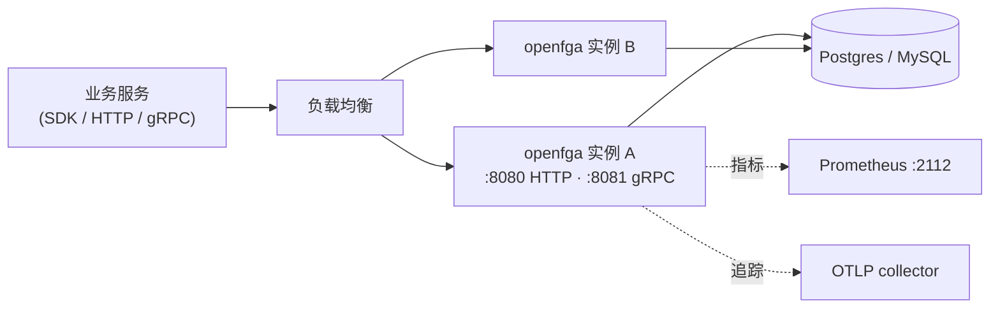
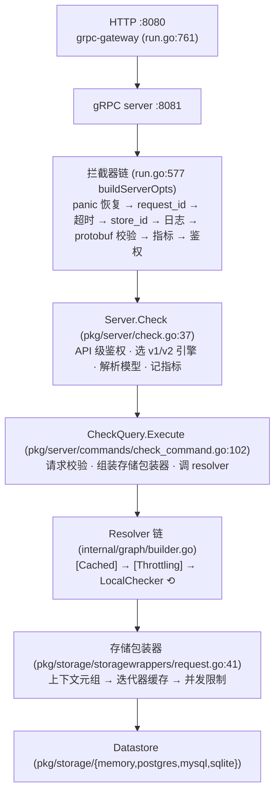

# 第 2 章 OpenFGA 架构鸟瞰

> 本章目标：画出 OpenFGA 的分层结构和运行时拓扑，知道每一层的代码在哪；建立 OpenFGA 包和 mini-openfga 包之间的对应关系。
> 前置：第 1 章。对应代码：mini-openfga v1.0 的目录结构。

## 2.1 一个进程，四个端口

OpenFGA 是一个单独的 Go 二进制。`openfga run` 启动后，默认会监听这些地址（`pkg/server/config/config.go:893` 起的默认配置）：

| 地址 | 内容 | 默认 |
|---|---|---|
| `0.0.0.0:8081` | gRPC API（`openfgav1.OpenFGAService`） | 开 |
| `0.0.0.0:8080` | HTTP API（grpc-gateway 把 REST 转成 gRPC） | 开 |
| `0.0.0.0:2112` | Prometheus `/metrics` | 开 |
| `:3000` | 内置 Playground（只在 `authn=none` 时可用） | 关 |
| `:3001` | pprof | 关 |

部署时，它前面通常有一个负载均衡，后面接一个数据库（Postgres、MySQL 或 SQLite；内存存储只用于开发和测试）。多个 OpenFGA 实例共享同一个数据库，实例本身是**无状态**的：缓存都在各自的内存里，丢了只影响性能，不影响正确性。



一个值得注意的细节：**HTTP 请求在进程内也会走一遍 gRPC**。`cmd/run/run.go:761` 的 `runHTTPServer` 用 grpc-gateway 创建 `ServeMux`，再通过 `openfgav1.RegisterOpenFGAServiceHandler(ctx, mux, grpcConn)`（:785）把每个 REST 路由转发给 gRPC 客户端连接；这个连接连的是本进程监听的一个 Unix domain socket（`createUDS`，:923）。好处是所有中间件（鉴权、校验、日志、指标）只需要在 gRPC 侧实现一遍。代价是 HTTP 请求多了一次序列化和本地 socket 往返。mini-openfga 只有 HTTP，没有这一层。

## 2.2 请求经过的层

以一次 `POST /stores/{id}/check` 为例：



每一层只做一件事。下面分层看。

### 2.2.1 拦截器链

`buildServerOpts`（`cmd/run/run.go:577`）把一串 gRPC 拦截器按固定顺序串起来：

```go
grpc.ChainUnaryInterceptor(
    []grpc.UnaryServerInterceptor{
        grpc_recovery.UnaryServerInterceptor( // panic middleware must be 1st in chain
            grpc_recovery.WithRecoveryHandlerContext(
                recovery.PanicRecoveryHandler(s.Logger),
            ),
        ),
        grpc_ctxtags.UnaryServerInterceptor(), // needed for logging
        requestid.NewUnaryInterceptor(),       // add request_id to ctxtags
    }...,
),
```

之后依次追加：请求超时（`RequestTimeout > 0` 时）、`storeid` + 日志 + `validator`（:612，按 protobuf 里的 `validate` 规则检查字段长度、格式）、Prometheus 指标（:637）、鉴权（:645，`authn.Authenticator`，支持 none、预共享密钥、OIDC）。

顺序是有讲究的：panic 恢复必须最先，才能兜住后面所有层的 panic；日志要在校验之前，才能记录下被拒绝的非法请求；鉴权放在最后，被拒绝的请求也会被计入指标。

### 2.2.2 Server：API 门面

`pkg/server/` 下每个 API 一个文件：`check.go`、`list_objects.go`、`write.go`……它们实现 gRPC 接口 `OpenFGAServiceServer`，`Server` 结构体（`pkg/server/server.go:167`）里装着所有配置：数据存储、各种上限（`resolveNodeLimit`、`listObjectsMaxResults`……）、缓存、特性开关客户端。

这一层的职责是“API 级别的事”：

- 访问控制：`s.checkAuthz`（`pkg/server/check.go:63`），用于“OpenFGA 用自己来保护自己的 API”（实验功能，第 29 章）；
- 解析要用哪个模型：`s.resolveTypesystem`（`pkg/server/server.go:1080`），没给 `authorization_model_id` 就用最新的；
- 根据特性开关选择 v1 还是 v2 引擎（`check.go:78`）；
- 记录指标、追踪属性、把内部错误翻译成 API 错误码。

### 2.2.3 Commands：业务逻辑

`pkg/server/commands/` 是和传输层解耦的业务逻辑，一个 API 一个命令对象，例如 `CheckQuery`（`check_command.go`）、`ListObjectsQuery`（`list_objects.go`）、`WriteCommand`（`write.go`）。命令对象只依赖存储接口和 TypeSystem，不依赖 gRPC，所以既能被 gRPC Server 调用，也能在测试里直接构造。`CheckQuery.Execute`（:102）做三件事：校验请求，组装这次请求专用的存储包装器，调用 resolver 链。

### 2.2.4 引擎

| 包 | 内容 |
|---|---|
| `internal/graph/` | **默认的 Check 引擎（v1）**：`LocalChecker`、集合运算、缓存与限流 resolver、resolver 链构建器、Shadow resolver |
| `internal/check/` | **v2 Check 引擎**，基于带权图选择策略，需要打开特性开关 `ExperimentalWeightedGraphCheck`，失败时回退到 v1 |
| `internal/planner/` | Thompson Sampling 策略选择器 |
| `pkg/server/commands/reverseexpand/` | 经典的 ListObjects 反向展开 |
| `internal/listobjects/pipeline/` | 基于带权图的 ListObjects 流水线（v1.22 默认开启，用于具体用户） |
| `pkg/server/commands/listusers/` | ListUsers |
| `internal/condition/` | CEL 条件的编译与求值 |

### 2.2.5 TypeSystem 与校验

`pkg/typesystem/typesystem.go` 把授权模型索引成便于查询的结构：某个类型有哪些关系、某个关系允许哪些直接类型、某个关系是不是 tupleset、从某种用户到某个关系有没有路径……它还负责模型校验（`NewAndValidate`，:1170）。`internal/validation/validation.go` 用 TypeSystem 校验元组和请求。几乎每一层都会用到这两个包。

### 2.2.6 存储

`pkg/storage/storage.go` 定义了 `OpenFGADatastore` 接口（:409），它由几个小接口组成：读写元组、读写模型、管理 store、读写 assertions、读 changelog。四种实现各在一个目录里。

在 datastore 和引擎之间，每次请求还会套上几层包装器（`pkg/storage/storagewrappers/request.go:41` `NewRequestStorageWrapperWithCache`）：

```go
instrumented := NewBoundedTupleReader(ds, op) // to rate-limit reads
var tupleReader storage.RelationshipTupleReader
tupleReader = instrumented
if op.Method == apimethod.Check && dataResourceConfiguration.CacheSettings.ShouldCacheCheckIterators() {
    // Reads tuples from cache where possible
    tupleReader = NewCachedDatastore(...)
}
...
combinedTupleReader := NewCombinedTupleReader(tupleReader, requestContextualTuples) // to read the contextual tuples
```

由外到内依次是：上下文元组（第 13 章）、共享迭代器、迭代器缓存（第 15 章）、并发读限制与计数。引擎看到的只是一个 `RelationshipTupleReader`，并不知道底下包了几层。

## 2.3 v1、v2 与特性开关

读 OpenFGA 源码时容易困惑的一点是：**同一件事经常有两套实现**。这是它的演进方式：新算法先放在特性开关后面，用 Shadow 模式对照新旧结果，稳定后再变成默认。

| 实验特性（`--experimentals`） | 作用 | 本书 |
|---|---|---|
| `enable-check-optimizations` | 历史上用来开启 v1 引擎的 weight2/recursive 快速路径；**自 v1.9.3（2025-08-11，#2609）起这些快速路径已默认开启**，当前代码里 `LocalChecker.optimizationsEnabled` 只被赋值、不再被读取 | 第 27 章 |
| `weighted_graph_check` | 整个 Check 改走 v2 引擎（`internal/check`） | 第 27 章 |
| `shadow_check` | 同时跑两个 LocalChecker，比较结果并记日志 | 第 31 章 |
| `pipeline_list_objects` | ListObjects 用带权图流水线（默认已开启，`openfga run` 无法关闭，见下文） | 第 19 章 |
| `inline_expressions` | 允许元组携带 `$expression` 条件 | 第 14 章 |

开关名在 `pkg/server/config/config.go` 里定义，`Server` 通过 `featureFlagClient.Boolean(name, storeID)` 查询，可以按 store 开启。

“默认开启”是怎么实现的值得一看：默认配置里 `Experimentals` 就是 `[pipeline_list_objects]`（`config.go:871`），而 `openfga run` 启动时会把默认列表**拼在**用户给的列表前面（`cmd/run/run.go:986`，注释写着“暂时的做法，让我们默认开启实验特性，且不允许用户关闭”）。所以 `--experimentals inline_expressions` 的实际效果是 `[pipeline_list_objects inline_expressions]`。本书用 `openfga run` 启动的对照服务都开着流水线；第 19 章需要关闭它时，是直接在 Go 代码里构造 `server.Server` 完成的。

本书的主线是 **v1 引擎**：它是默认路径，结构也更适合学习。v2 和流水线放在第 19、27 章作为进阶内容。

## 2.4 mini-openfga 的对应结构

| mini-openfga（v1.0） | 对应 OpenFGA | 说明 |
|---|---|---|
| `cmd/minifga` | `cmd/openfga`、`cmd/run` | 子命令：`serve`、`check`、`list-objects`、`list-users`、`expand`、`fmt`、`matrix` |
| `pkg/httpapi` | grpc-gateway + 拦截器 | 直接用 `net/http` 实现同样的 REST 路由和 JSON |
| `pkg/server` | `pkg/server` + `pkg/server/commands` | 合成一层：每个 API 一个方法，与传输无关 |
| `pkg/check` | `internal/graph` | LocalChecker、集合运算、缓存/限流 resolver、策略、Explain |
| `pkg/listobjects`、`pkg/listusers`、`pkg/expand` | `reverseexpand`、`listusers`、`commands/expand.go` | |
| `pkg/condition` | `internal/condition` | CEL |
| `pkg/planner` | `internal/planner` | Thompson Sampling |
| `pkg/typesystem` | `pkg/typesystem` | 含模型校验、带权（第 27 章） |
| `pkg/validation` | `internal/validation` | |
| `pkg/dsl`、`pkg/model` | `openfga/language`、`openfga/api` | 手写的 DSL 解析器和普通 Go 结构体，代替 ANTLR 与 protobuf |
| `pkg/storage/{memory,sqlite,storagetest}` | `pkg/storage/{memory,sqlite,test}` | 存储接口、两种实现、一致性测试套件 |
| `internal/matrix` | `tests/{check,listobjects,listusers}` | YAML 矩阵测试运行器 |
| `web/` | `assets/playground` | React 写的 Playground |

刻意简化的地方：

- **没有 gRPC / protobuf**。线上协议用和 OpenFGA 相同的 REST 路由与 JSON（第 24 章会用同一个客户端去跑两边）。
- **Server 和 Commands 合并**。OpenFGA 分两层是因为 gRPC Server 上有大量和指标、追踪、特性开关相关的代码；mini 规模小，一层足够。
- **没有 v2 引擎**。v1.0 在 v1 引擎里加入了带权图剪枝和 weight2 策略（OpenFGA 默认开启的快速路径之一），但为了教学，mini 把它放在 `-check-optimizations` 开关后面，默认关闭，好让前几章先看到最朴素的算法。

## 2.5 运行与验证

在 mini-openfga v1.0 里查看各包的规模：

```bash
cd code/mini-openfga
for d in pkg/* internal/* cmd/*; do printf "%5d %s\n" $(cat $d/*.go 2>/dev/null | wc -l) $d; done | sort -rn
```

在 OpenFGA 里统计非测试代码（不含自动生成的 mock）：

```bash
cd openfga
git ls-files '*.go' | grep -v _test.go | grep -v internal/mocks | xargs cat | wc -l   # 66509
git ls-files '*_test.go' | xargs cat | wc -l                                      # 110759
```

测试代码比源码多出近一倍。这也说明了 OpenFGA 怎样保证“正确性第一”：一个授权引擎错一次，就是一次越权。

## 2.6 小结

- OpenFGA 是一个无状态的单进程服务：gRPC 和 HTTP 两个入口，HTTP 在进程内转成 gRPC；
- 一次请求依次经过：拦截器链 → Server（API 门面）→ Command（业务逻辑）→ Resolver 链（引擎）→ 存储包装器 → Datastore；
- 新算法先放在特性开关后面，所以同一件事常有两套实现，本书以默认路径为主线；
- mini-openfga 保留了所有“授权语义”相关的层，去掉了 gRPC 和大部分可观测性代码。

## 2.7 练习

1. （巩固）在 `cmd/run/run.go` 里找出 HTTP 服务的 CORS 设置，默认允许哪些来源？
2. （扩展）如果把 `validator.UnaryServerInterceptor()` 放到日志拦截器前面，被拒绝的请求会发生什么变化？
3. （读源码）`pkg/server/server.go` 里 `Server` 结构体有 `maxConcurrentReadsForCheck` 字段，它最终在哪一层起作用？顺着 `WithCheckCommandMaxConcurrentReads` 找到 `NewBoundedTupleReader`。

## 2.8 延伸阅读

- `docs/architecture/architecture.md`（含部署图和内部结构图）
- grpc-gateway 文档：REST 与 gRPC 的映射规则
- OpenFGA 的 `.github/` 下的 CI 配置：它在 CI 里跑哪些测试
