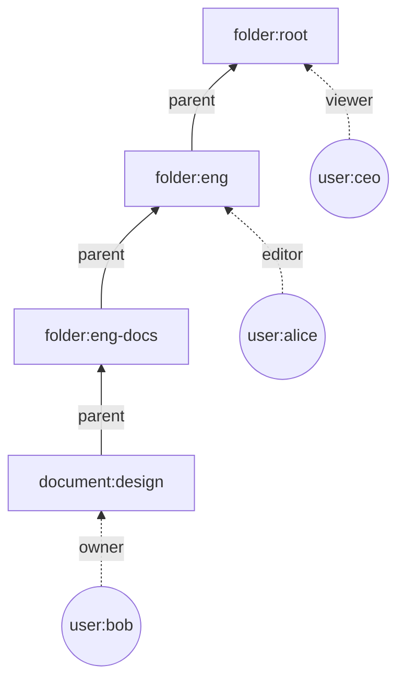
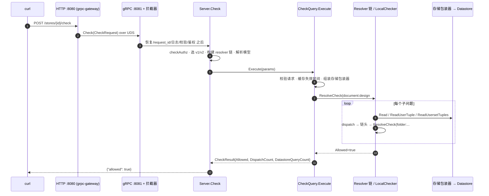
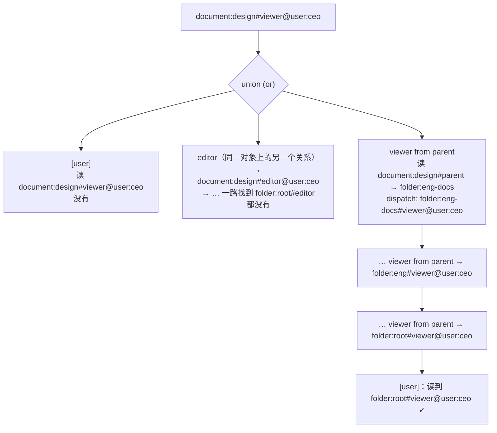

# 第 3 章 一次 Check 的完整生命周期 ★

> 本章目标：跟着一个真实的 Check 请求，从 `curl` 一直走到返回 `{"allowed": true}`，认识沿途每个函数；之后各章都会回到这张图上来。
> 前置：第 1、2 章。对应代码：OpenFGA `526995eb`；mini-openfga v1.0（用于对照）。

## 3.1 场景：CEO 能看这份设计文档吗

本章（以及 Lab 1）使用的“云盘”模型在 mini-openfga 的 `examples/drive/model.fga`：

```text
model
  schema 1.1

type user

type folder
  relations
    define owner: [user]
    define parent: [folder]
    define editor: [user] or owner or editor from parent
    define viewer: [user] or editor or viewer from parent

type document
  relations
    define parent: [folder]
    define owner: [user]
    define editor: [user] or owner or editor from parent
    define viewer: [user] or editor or viewer from parent
    define blocked: [user]
    define can_view: viewer but not blocked
    define can_share: owner and can_view
```

数据（`examples/drive/tuples.txt`）是一棵三层的文件夹树，CEO 是根目录的读者：

```text
folder:eng#parent@folder:root
folder:eng-docs#parent@folder:eng
document:design#parent@folder:eng-docs

folder:root#viewer@user:ceo
folder:eng#editor@user:alice
document:design#owner@user:bob
document:design#viewer@user:carol
document:design#blocked@user:dave
folder:root#viewer@user:dave
```



问题是：`document:design#viewer@user:ceo` 成立吗？直觉上成立：CEO 能看 root，root 下面的一切都能看。

把模型和元组写进**真实的 OpenFGA**（第 0 章那样从源码编译、内存存储、默认配置），然后发起 Check：

```bash
F=http://127.0.0.1:18080
curl -s -X POST $F/stores/$STORE/check \
  -d '{"tuple_key":{"user":"user:ceo","relation":"viewer","object":"document:design"}}'
```

```json
{"allowed":true,"resolution":""}
```

OpenFGA 以 JSON 格式输出日志时（`--log-format=json --log-level=info`），这次请求留下了一行日志（摘录）：

```json
{
  "msg": "grpc_req_complete",
  "grpc_method": "Check",
  "raw_request": {"tuple_key": {"user": "user:ceo", "relation": "viewer", "object": "document:design"},
                  "authorization_model_id": "", "consistency": "UNSPECIFIED"},
  "raw_response": {"allowed": true, "resolution": ""},
  "dispatch_count": 4,
  "datastore_query_count": 27,
  "datastore_item_count": 8,
  "authorization_model_id": "01M4F1B2ZHGRA681WX6X1DSJ5W",
  "peer.address": "/tmp/openfga-3378712-371027730/grpc.sock",
  "grpc_code": 0
}
```

这几个字段正好是本章的线索：

- `peer.address` 是一个 Unix socket：HTTP 请求在进程内被转成了 gRPC（2.1 节）；
- `authorization_model_id` 是自动补上的：请求里没给，Server 用了最新的模型；
- `dispatch_count: 4`：引擎“跳”了 4 次到别的对象上去求值；
- `datastore_query_count: 27`：为了回答这一个问题，读了 27 次存储。同一个请求重复 5 次，这个数在 24 到 28 之间变化，后面会解释为什么。

## 3.2 全景



下面按编号逐段看。

## 3.3 HTTP 到 gRPC

`cmd/run/run.go:761` 的 `runHTTPServer` 用 grpc-gateway 生成的 `RegisterOpenFGAServiceHandler`（:785）把 REST 路由注册到一个 `ServeMux` 上，所有路由都转给 `grpcConn`。这个连接连到一个临时目录里的 `grpc.sock`（`createUDS`，:923），也就是本进程的 gRPC 服务器。路由与 JSON 的映射规则写在 `openfga/api` 的 protobuf 注解里：`POST /stores/{store_id}/check`，请求体映射成 `CheckRequest`，`store_id` 从路径取。

## 3.4 拦截器

进入 gRPC 后，请求依次经过 `buildServerOpts`（`run.go:577`）组装的拦截器（2.2.1 节）。和这次请求相关的有两个：

- `requestid`：生成 `request_id`，之后的日志都带上它；
- `validator`：按 protobuf 上的 `validate` 规则检查字段，比如 `store_id` 必须匹配 26 位 ULID 的正则，`object` 是 2 到 256 个非空白字符，`relation` 是 1 到 50 个不含 `:#@` 的字符（`openfga/api` 的 `openfga_service.pb.validate.go`）。这里只检查**格式**，“document 类型有没有 viewer 关系”这种**语义**检查要等拿到模型以后才能做。

## 3.5 Server.Check：API 门面

`pkg/server/check.go:37`：

```go
func (s *Server) Check(ctx context.Context, req *openfgav1.CheckRequest) (*openfgav1.CheckResponse, error) {
	const methodName = "check"
	startTime := time.Now()
	tk := req.GetTupleKey()
	ctx, span := tracer.Start(ctx, apimethod.Check.String(), trace.WithAttributes(...))
	defer span.End()

	if !validator.RequestIsValidatedFromContext(ctx) {
		if err := req.Validate(); err != nil {
			return nil, status.Error(codes.InvalidArgument, err.Error())
		}
	}
	...
	err := s.checkAuthz(ctx, req.GetStoreId(), apimethod.Check)
```

`RequestIsValidatedFromContext` 是一个小优化：拦截器已经校验过就不再重复（Server 也可以作为 Go 库直接调用，那时没有拦截器）。`checkAuthz`（:63）是“用 OpenFGA 保护 OpenFGA 的 API”的功能，默认关闭。

接着是一个分叉（:78）：如果这个 store 打开了 `weighted_graph_check` 特性，先走 v2 引擎，失败再回退到 v1。默认不开，所以直接到 `// v1 Check`（:164）：

```go
	checkResolver, checkResolverCloser, err := s.getCheckResolverBuilder(storeID).Build()
	...
	defer checkResolverCloser()

	typesys, err := s.resolveTypesystem(ctx, storeID, req.GetAuthorizationModelId())
	...
	req.AuthorizationModelId = typesys.GetAuthorizationModelID() // the resolved model id

	checkQuery := commands.NewCheckCommand(
		s.datastore,
		checkResolver,
		typesys,
		commands.WithCheckCommandLogger(s.logger),
		commands.WithCheckCommandMaxConcurrentReads(s.maxConcurrentReadsForCheck),
		commands.WithCheckCommandCache(s.sharedDatastoreResources, s.cacheSettings),
		...
	)

	resp, err := checkQuery.Execute(ctx, &commands.CheckCommandParams{
		StoreID:          storeID,
		TupleKey:         req.GetTupleKey(),
		ContextualTuples: req.GetContextualTuples(),
		Context:          req.GetContext(),
		Consistency:      req.GetConsistency(),
	})
```

三件事：

1. **构建 resolver 链**。`getCheckResolverBuilder`（:455）按配置决定链上有没有缓存层、限流层、Shadow 层（第 15 章）。链在**每次请求**构建一次，但它们共享的缓存、planner 都是 Server 级别的，所以构建很便宜。
2. **解析模型**。`resolveTypesystem`（`pkg/server/server.go:1080`）调用 `typesystem.MemoizedTypesystemResolverFunc`（`pkg/typesystem/resolver.go:35`）：没给模型 ID 时用 `FindLatestAuthorizationModel` 查最新模型（并发的相同查询用 singleflight 合并），然后用 LRU 缓存已经校验并建好索引的 `TypeSystem`。模型不可修改，所以按 ID 缓存永远不会过期。
3. **交给命令对象执行**。

## 3.6 CheckQuery.Execute：组装一次求值

`pkg/server/commands/check_command.go:102`：

```go
func (c *CheckQuery) Execute(ctx context.Context, params *CheckCommandParams) (*CheckResult, error) {
	err := validateCheckRequest(c.typesys, params.TupleKey, params.ContextualTuples, params.Context)
	if err != nil {
		return nil, err
	}

	cacheInvalidationTime := time.Time{}
	if params.Consistency != openfgav1.ConsistencyPreference_HIGHER_CONSISTENCY {
		cacheInvalidationTime = c.sharedCheckResources.CacheController.DetermineInvalidationTime(ctx, params.StoreID)
	}

	resolveCheckRequest, err := graph.NewResolveCheckRequest(graph.ResolveCheckRequestParams{...})

	datastoreWithTupleCache := storagewrappers.NewRequestStorageWrapperWithCache(
		c.datastore,
		params.ContextualTuples.GetTupleKeys(),
		...
	)

	ctx = typesystem.ContextWithTypesystem(ctx, c.typesys)
	ctx = storage.ContextWithRelationshipTupleReader(ctx, datastoreWithTupleCache)

	startTime := time.Now()
	resp, err := c.checkResolver.ResolveCheck(ctx, resolveCheckRequest)
```

- `validateCheckRequest`（:186）现在有了模型，可以做语义校验：`user`、`object`、`relation` 都要在模型里存在（第 6 章）；上下文元组则要像写入一样严格校验（第 13 章）。我们的请求如果把 relation 写成 `nope`，就会在这里失败：

  ```json
  {"code":"validation_error","message":"invalid relation: relation 'document#nope' not found"}
  ```

- `DetermineInvalidationTime`：缓存失效时间，第 23 章再讲；
- `NewResolveCheckRequest`：把 API 请求转成引擎内部的请求对象 `ResolveCheckRequest`（`internal/graph/resolve_check_request.go`），带上深度计数器、已访问路径集合、调度计数器；
- 存储包装器（2.2.6 节）；
- **把 TypeSystem 和存储放进 `context`**。引擎里的函数不通过参数传递它们，而是用 `typesystem.TypesystemFromContext(ctx)`、`storage.RelationshipTupleReaderFromContext(ctx)` 取出。这让 resolver 的接口保持简单：`ResolveCheck(ctx, req)`。

## 3.7 LocalChecker.ResolveCheck：每个子问题的入口

resolver 链的最后一环是 `LocalChecker`，真正的求值发生在这里。`internal/graph/check.go:395`（删去了追踪代码）：

```go
func (c *LocalChecker) ResolveCheck(ctx context.Context, req *ResolveCheckRequest) (resp *ResolveCheckResponse, err error) {
	if ctx.Err() != nil {
		return nil, ctx.Err()
	}
	if req.GetRequestMetadata().Depth == c.maxResolutionDepth {
		return nil, ErrResolutionDepthExceeded
	}
	cycle := c.hasCycle(req)
	if cycle {
		return &ResolveCheckResponse{Allowed: false, ResolutionMetadata: ResolveCheckResponseMetadata{CycleDetected: true}}, nil
	}
	tupleKey := req.GetTupleKey()
	object := tupleKey.GetObject()
	relation := tupleKey.GetRelation()

	if tuple.IsSelfDefining(req.GetTupleKey()) {
		return &ResolveCheckResponse{Allowed: true}, nil
	}

	typesys, ok := typesystem.TypesystemFromContext(ctx)
	...
	objectType, _ := tuple.SplitObject(object)
	rel, err := typesys.GetRelation(objectType, relation)
	...
	hasPath, err := typesys.PathExists(tupleKey.GetUser(), relation, objectType)
	...
	if !hasPath {
		return &ResolveCheckResponse{Allowed: false}, nil
	}

	resp, err = c.CheckRewrite(ctx, req, rel.GetRewrite())(ctx)
```

这个函数会被调用很多次：最初的问题一次，之后每“跳”到一个新对象上（`folder:eng-docs#viewer@user:ceo`……）又一次。每次都按同样的顺序检查：

| 行 | 检查 | 作用 | 章节 |
|---|---|---|---|
| :415 | 深度到上限（默认 25） | 防止无限深的链拖垮服务 | 12 |
| :419 | 同一个子问题在当前路径上出现过 | 数据里有环，比如 A 组包含 B 组、B 组又包含 A 组 | 12 |
| :434 | `group:1#member@group:1#member` | 任何 userset 都是它自己的成员，直接为真 | 11 |
| :455 | 模型里根本没有从这种用户到这个关系的路径 | 不读存储，直接为假 | 27 |
| :465 | 按重写规则求值 | 真正的工作 | 8–11 |

`CheckRewrite`（:1041）是一个按重写类型分派的 `switch`：

```go
func (c *LocalChecker) CheckRewrite(ctx context.Context, req *ResolveCheckRequest, rewrite *openfgav1.Userset) CheckHandlerFunc {
	switch rw := rewrite.GetUserset().(type) {
	case *openfgav1.Userset_This:
		return c.checkDirect(ctx, req)
	case *openfgav1.Userset_ComputedUserset:
		return c.checkComputedUserset(ctx, req, rewrite)
	case *openfgav1.Userset_TupleToUserset:
		return c.checkTTU(ctx, req, rewrite)
	case *openfgav1.Userset_Union:
		return c.checkSetOperation(ctx, req, unionSetOperator, union, rw.Union.GetChild()...)
	case *openfgav1.Userset_Intersection:
		return c.checkSetOperation(ctx, req, intersectionSetOperator, intersection, rw.Intersection.GetChild()...)
	case *openfgav1.Userset_Difference:
		return c.checkSetOperation(ctx, req, exclusionSetOperator, exclusion, rw.Difference.GetBase(), rw.Difference.GetSubtract())
	...
```

第 1 章那 6 种 Zanzibar 原语在这里各对应一个处理函数。注意它返回的不是结果，而是一个 `CheckHandlerFunc`（一个还没执行的闭包）。集合运算拿到一组闭包后自己决定怎么并发执行、何时提前结束，第 10 章细讲。

## 3.8 递归展开：这个问题是怎么被回答的

`document:design#viewer` 的重写规则是 `[user] or editor or viewer from parent`，即一个 union，下面三个分支：



三个分支是**并发**执行的。`viewer from parent`（TTU）每找到一个父文件夹，就把“这个文件夹的 viewer 里有没有 ceo”作为一个新问题 **dispatch** 出去：`dispatch`（:381）把深度加一，再交给 resolver 链的**链头**（链是环形的，第 15 章）。新问题回到 3.7 节的 `ResolveCheck`，从头再走一遍。

三层文件夹，所以 viewer 这条路要 dispatch 3 次。editor 那条路也会顺着 `editor from parent` dispatch，但它是另一个分支，并发进行；只要 viewer 那条路先得到 `true`，union 就立即返回，并取消还在进行的其他分支。**有多少 editor 分支的工作在取消前已经做完，取决于调度时机**，这就是 `datastore_query_count` 每次都不一样的原因。

mini-openfga v0.6 加入了一个 Explain 接口（第 26 章），它**不提前结束**、顺序地把每一步都记下来。对同一个请求，它给出的树中“为真”的那条路径如下（删去了所有为假的分支）：

```text
relation  document:design#viewer@user:ceo  => true
  union     or  => true
    ttu       viewer from parent  => true
      tuple     document:design#parent@folder:eng-docs  => true
        relation  folder:eng-docs#viewer@user:ceo  => true
          union     or  => true
            ttu       viewer from parent  => true
              tuple     folder:eng-docs#parent@folder:eng  => true
                relation  folder:eng#viewer@user:ceo  => true
                  union     or  => true
                    ttu       viewer from parent  => true
                      tuple     folder:eng#parent@folder:root  => true
                        relation  folder:root#viewer@user:ceo  => true
                          union     or  => true
                            direct    [user]  => true
                              tuple     folder:root#viewer@user:ceo  => true
```

完整的树有 100 行，其中大部分是 editor 那条路上每一层都要检查的 `[user]`、`owner`、`editor from parent`。真实的引擎没有走完这些分支，因为 union 提前结束了。

## 3.9 回程

`ResolveCheck` 返回到 `Execute` 后（`check_command.go:150` 之后），命令对象从存储包装器里取出 `DatastoreQueryCount`、从请求元数据里取出 `DispatchCounter`，装进 `CheckResult`。如果出错且曾被限流，把超时错误包装成 `ThrottledError`，好让 API 返回更准确的错误码。

回到 `Server.Check`，它把这些数字记到 Prometheus 直方图和日志字段里（3.1 节那行日志的来源），把错误翻译成 API 错误码（`CheckCommandErrorToServerError`），最后返回 `&openfgav1.CheckResponse{Allowed: res.Allowed}`。grpc-gateway 把它序列化成 `{"allowed":true,"resolution":""}`（`resolution` 字段目前总是空的）。

## 3.10 对照：同一个请求在 mini-openfga 里

mini-openfga v1.0 用默认配置启动（`minifga serve`），写入同样的模型和元组后，对同一个请求连续发 3 次：

```json
{"allowed":true,"resolution":"","resolution_metadata":{"dispatch_count":9,"datastore_query_count":34}}
{"allowed":true,"resolution":"","resolution_metadata":{"dispatch_count":8,"datastore_query_count":32}}
{"allowed":true,"resolution":"","resolution_metadata":{"dispatch_count":7,"datastore_query_count":28}}
```

（`resolution_metadata` 是 mini 的扩展字段，OpenFGA 只把这些数字写进日志和指标。）

结果一样，但 mini 的调度次数比 OpenFGA 多，而且每次不同。原因在 3.7 节表格的倒数第二行和本书第 27 章：OpenFGA 的 v1 引擎从 v1.9.3 起默认启用了基于带权图的“快速路径”。对 `viewer from parent` 这种**递归**的 TTU，它会选择专门的 recursive 策略，把整条父链在一次求值里处理掉，而不是每层 dispatch 一次；同时 editor 分支也少做了很多工作。mini 的默认配置只有最基本的算法，v1.0 的 `-check-optimizations` 加入了 PathExists 剪枝和 weight2 策略，但没有实现 recursive 策略（第 27 章的练习）。

这正是本书的读法：先把最直接的算法写对（Part II、III），再一层层看 OpenFGA 为了性能加了什么（Part IV、VIII），每加一层都用同一套矩阵测试确认答案没有变。

## 3.11 mini-openfga 里的同一条链路

| OpenFGA | mini-openfga v1.0 |
|---|---|
| grpc-gateway + 拦截器 | `pkg/httpapi`：`net/http` 路由、`PresharedKeyAuth`、`Observe`（第 24、29、30 章） |
| `Server.Check` + `CheckQuery.Execute` | `pkg/server/server.go` 的 `Server.Check` |
| `resolveTypesystem` | `Server.typesystem`：按 ID 缓存 TypeSystem |
| `NewRequestStorageWrapperWithCache` | `CountingReader` + `CombinedTupleReader` |
| resolver 链 | `check.BuildChain`（第 15 章） |
| `LocalChecker.ResolveCheck` / `CheckRewrite` | `pkg/check/local_checker.go`，同名函数 |

## 3.12 小结

- 一次 Check 依次经过：HTTP→gRPC → 拦截器 → `Server.Check`（选引擎、建链、解析模型）→ `CheckQuery.Execute`（语义校验、组装存储、放入 context）→ `LocalChecker.ResolveCheck`；
- `ResolveCheck` 是每个子问题的入口：依次检查深度、环、自定义、路径，然后按 6 种重写规则分派；
- 跨对象的子问题通过 **dispatch** 回到链头，所以缓存、限流能作用在每一层子问题上；
- union 并发执行、找到一条为真的路就停，所以调度次数和查询次数不是确定的。

## 3.13 练习

1. （巩固）按 3.8 节的方法，手工推导 `document:design#can_view@user:dave` 的求值过程。dave 能看 root，为什么结果是 false？`but not` 的两边谁先返回会影响 `datastore_query_count` 吗？
2. （扩展）把请求里的 `user` 改成 `folder:eng#viewer`（一个 userset）。OpenFGA 返回什么？是哪一行代码让它返回这个结果？
3. （读源码）`ResolveCheck` 的深度检查用的是 `==` 而不是 `>=`（:415）。找到 `Depth` 被加一的地方，论证为什么 `==` 也足够。

## 3.14 延伸阅读

- `docs/check/README.md`：OpenFGA 官方的 Check 实现说明，有更多集合运算的例子
- `internal/graph/resolve_check_request.go`：请求对象和 `clone()` 的细节
- `pkg/server/commands/check_command.go` 中 `CheckResult` 的字段，以及 `pkg/server/check.go` 中对应的 Prometheus 指标
