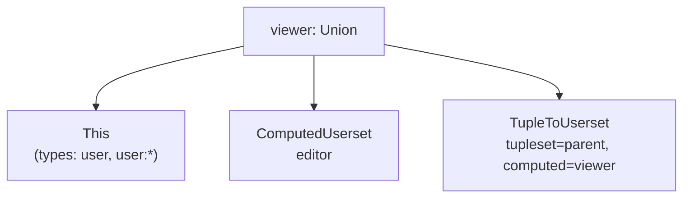

# 第 4 章 授权模型 DSL：从文本到重写树

> 本章目标：读懂 OpenFGA 建模语言的语法；看 OpenFGA 如何用 ANTLR 把 DSL 变成 protobuf；自己手写一个词法分析器 + 递归下降解析器，把 DSL 变成 mini-openfga 的 `model.Model`。
> 前置：第 1 章。对应代码：mini-openfga **v0.1** `pkg/model/model.go`、`pkg/dsl/lexer.go`、`pkg/dsl/parser.go`。

## 4.1 DSL 长什么样

一个完整的模型包含三部分：头部、类型定义、条件定义。

```text
model
  schema 1.1                                      # 头部：只支持 1.1

type user                                         # 没有关系的类型：只能当“用户”

type document
  relations
    define parent: [folder]                       # 直接赋值，只允许 folder
    define owner: [user]
    define editor: [user, team#member] or owner   # 直接赋值 + 同对象上的另一个关系
    define viewer: [user, user:*] or editor or viewer from parent
    define can_view: viewer but not blocked       # 排除
    define can_share: owner and can_view          # 交集
    define blocked: [user with non_expired]       # 带条件的直接赋值

condition non_expired(current_time: timestamp, expires_at: timestamp) {
  current_time < expires_at
}
```

`define` 冒号右边的表达式由下面几种“项”组成：

| 写法 | 名字 | 对应 `Userset` |
|---|---|---|
| `[user, user:*, team#member, user with c]` | 直接赋值（type restriction） | `This`，类型限制存在 `metadata` 里 |
| `editor` | computed userset | `ComputedUserset` |
| `viewer from parent` | tuple to userset（TTU） | `TupleToUserset` |
| `a or b or c` | 并集 | `Union` |
| `a and b` | 交集 | `Intersection` |
| `a but not b` | 差集 | `Difference` |
| `(…)` | 分组 | — |

有一条容易踩的语法规则：**同一层里不能混用运算符**。`a or b and c` 是语法错误，必须写成 `a or (b and c)` 或 `(a or b) and c`。这避免了“`and` 和 `or` 谁优先”的歧义。`but not` 的右边只能是一个项。

另一条规则：`[...]` 在一个关系里最多出现一次，`define a: [user] or [group]` 不合法。

## 4.2 解析的目标：一棵重写树

DSL 只是写给人看的。OpenFGA 内部使用的是 protobuf 定义的 `AuthorizationModel`，它的 JSON 形式（第 24 章的 HTTP API 也用它）如下，以 `define viewer: [user, user:*] or editor or viewer from parent` 为例：

```json
"viewer": {
  "union": {
    "child": [
      {"this": {}},
      {"computedUserset": {"relation": "editor"}},
      {"tupleToUserset": {"tupleset": {"relation": "parent"}, "computedUserset": {"relation": "viewer"}}}
    ]
  }
}
```

类型限制 `[user, user:*]` 不在重写树里，而是放在类型定义的 `metadata.relations.viewer.directly_related_user_types` 中：

```json
"directly_related_user_types": [{"type": "user"}, {"type": "user", "wildcard": {}}]
```

这样设计是因为一个关系最多只有一个 `This` 节点，类型限制属于整个关系，而不属于树上的某个位置。



## 4.3 OpenFGA 是怎么做的：ANTLR + Listener

OpenFGA 的 DSL 解析器不在主仓库里，而在 `github.com/openfga/language/pkg/go`（本书用 v0.3.2）。语法用 ANTLR 的 `.g4` 文件描述（`OpenFGALexer.g4`、`OpenFGAParser.g4`，在 openfga/language 仓库中，不随 Go 模块发布），由 ANTLR 生成 Go 代码放在 `gen/` 下：`gen/openfga_parser.go` 有 6772 行，`gen/openfga_lexer.go` 有 525 行。生成的解析器包含这些语法规则（`gen/openfga_parser.go:57`）：

```text
main, modelHeader, moduleHeader, typeDefs, typeDef, relationDeclaration,
relationName, relationDef, relationDefNoDirect, relationDefPartials,
relationDefGrouping, relationRecurse, relationRecurseNoDirect,
relationDefDirectAssignment, relationDefRewrite, relationDefTypeRestriction,
relationDefTypeRestrictionBase, conditions, condition, conditionName,
conditionParameter, parameterName, parameterType, multiLineComment,
identifier, extended_identifier, conditionExpression
```

手写的部分是 `transformer/dsltojson.go`（610 行）。入口 `ParseDSL`（:515）先做一次**预处理**，把注释删掉：

```go
for _, line := range strings.Split(data, "\n") {
	cleanedLine := ""
	switch {
	case len(strings.TrimLeft(line, " ")) == 0:
		// do nothing, it's an empty line
	case strings.TrimLeft(line, " ")[0:1] == "#":
		cleanedLine = ""
	default:
		cleanedLine = strings.TrimRight(strings.Split(line, " #")[0], " ")
	}
	cleanedLines = append(cleanedLines, cleanedLine)
}
```

注意 `" #"` 前面的空格：`team#member` 里的 `#` 是分隔符，只有“行首或空格后的 `#`”才是注释。删掉的注释行被替换为空行而不是直接丢弃，这样后面报错时行号仍然对得上。

然后是标准的 ANTLR 流程：词法分析器 → token 流 → 语法分析器 → 用一个 **Listener** 遍历语法树：

```go
lexer := parser.NewOpenFGALexer(inputStream)
...
fgaParser := parser.NewOpenFGAParser(stream)
...
listener := newOpenFgaDslListener()
antlr.ParseTreeWalkerDefault.Walk(listener, fgaParser.Main())
```

`OpenFgaDslListener`（:37）在遍历时维护“当前类型”“当前关系”和一个**重写栈**。几个关键回调：

- `ExitRelationDefDirectAssignment`（:309）：遇到 `[...]`，往当前关系的 `Rewrites` 里放一个 `This`；
- `ExitRelationDefTypeRestriction`（:315）：每个类型限制变成一个 `RelationReference`（类型、可选的关系或通配符、可选的条件名），追加到 `TypeInfo`；
- `ExitRelationDefRewrite`（:354）：`editor` 或 `viewer from parent`，有没有 `from` 决定生成 `ComputedUserset` 还是 `TupleToUserset`；
- `EnterRelationDefPartials`（:418）：记录这一层用的是哪个运算符；
- `EnterRelationRecurseNoDirect` / `ExitRelationRecurseNoDirect`（:391、:402）：进入括号时把当前的 `Rewrites` 和运算符压栈，出括号时把括号里的内容折叠成一个节点，再弹栈接回外层。

折叠用的是 `ParseExpression`（:54）：

```go
func ParseExpression(rewrites []*openfgav1.Userset, operator RelationDefinitionOperator) *openfgav1.Userset {
	if len(rewrites) == 0 {
		return nil
	}
	if len(rewrites) == 1 {
		relationDef = rewrites[0]
	} else {
		switch operator {
		case RELATION_DEFINITION_OPERATOR_OR:
			relationDef = &openfgav1.Userset{Userset: &openfgav1.Userset_Union{Union: &openfgav1.Usersets{Child: rewrites}}}
		case RELATION_DEFINITION_OPERATOR_AND:
			relationDef = &openfgav1.Userset{Userset: &openfgav1.Userset_Intersection{...}}
		case RELATION_DEFINITION_OPERATOR_BUT_NOT:
			relationDef = &openfgav1.Userset{Userset: &openfgav1.Userset_Difference{
				Difference: &openfgav1.Difference{Base: rewrites[0], Subtract: rewrites[1]}}}
		}
	}
	return relationDef
}
```

一层里的所有项先收集到一个列表，最后按这一层的运算符一次性折叠。这和“同一层不能混用运算符”的语法规则互相配合：既然一层只有一个运算符，折叠就不需要考虑优先级。

语法错误由 `OpenFgaDslErrorListener`（:471）收集，带行号和列号。

**这里解析只管语法**。`define viewer: editor` 里的 `editor` 是否存在、有没有环，是第 5 章 TypeSystem 校验的事。

## 4.4 mini-openfga：手写一个解析器

OpenFGA 选 ANTLR 是因为它要同时维护 Go、JavaScript、Java 三种语言的解析器，一份 `.g4` 可以生成三份代码。mini-openfga 只需要 Go，而且这门语言很小，手写一个**递归下降解析器**更合适：没有代码生成步骤，错误信息可以写得更具体，代码也能完整读下来（词法 138 行 + 语法 327 行）。

### 4.4.1 数据结构

先定义解析的产物。`pkg/model/model.go` 用普通的 Go 结构体代替 protobuf：

```go
type RewriteKind int

const (
	This         RewriteKind = iota // [user, group#member]  direct assignment
	Computed                        // editor                same object, other relation
	TTU                             // viewer from parent    tuple to userset
	Union                           // a or b
	Intersection                    // a and b
	Difference                      // a but not b
)

type Rewrite struct {
	Kind     RewriteKind
	Relation string     // Computed: 同对象上的关系；TTU: 在父对象上求值的关系
	Tupleset string     // TTU: 指向父对象的关系
	Children []*Rewrite // Union/Intersection: ≥2 个；Difference: [base, subtract]
}

type RelationRef struct {      // 类型限制里的一项：user / user:* / group#member / user with c
	Type, Relation string
	Wildcard       bool
	Condition      string
}

type Relation struct {
	Name        string
	Rewrite     *Rewrite
	DirectTypes []RelationRef
}
```

和 protobuf 的结构一一对应，只是把 6 种 `oneof` 合并成一个带 `Kind` 的结构体，Go 里用 `switch rw.Kind` 处理起来更方便。

### 4.4.2 词法分析：按需产生 token

`pkg/dsl/lexer.go` 只认识两类 token：标识符（字母、数字、`_ - . $`）和单字符标点（`: [ ] , ( ) # * { } < >`）。关键字（`model`、`type`、`define`、`or`……）都是标识符，由解析器按文本判断。

注释的判断和 OpenFGA 一致，只是在词法层做，不做预处理：

```go
// skipSpaceAndComments skips whitespace and `#` comments. A `#` starts a
// comment only at the beginning of a line or after whitespace, because
// `group#member` uses `#` as a separator.
func (l *lexer) skipSpaceAndComments() {
	for l.pos < len(l.src) {
		c := l.src[l.pos]
		if c == ' ' || c == '\t' || c == '\r' || c == '\n' {
			l.advance()
			continue
		}
		if c == '#' && (l.pos == 0 || strings.ContainsRune(" \t\r\n", rune(l.src[l.pos-1]))) {
			for l.pos < len(l.src) && l.src[l.pos] != '\n' {
				l.advance()
			}
			continue
		}
		return
	}
}
```

词法器不是一次把全部输入切成 token 列表，而是由解析器调用 `next()` 逐个取。这样做是为了条件体：`condition f(x: int) { x < 10 && y.startsWith("}") }` 的花括号里是 CEL 表达式，有自己的词法规则（字符串里可以有 `}`）。解析器读到 `{` 时，让词法器直接截取原文直到配对的 `}`：

```go
// rawBlock is called right after the parser consumed `{`. It returns the text
// up to the matching `}` (string literals may contain braces) and consumes it.
func (l *lexer) rawBlock() (string, error) {
	depth, start := 1, l.pos
	var quote byte
	for l.pos < len(l.src) {
		c := l.src[l.pos]
		switch {
		case quote != 0:
			if c == '\\' {
				l.advance()
			} else if c == quote {
				quote = 0
			}
		case c == '"' || c == '\'':
			quote = c
		case c == '{':
			depth++
		case c == '}':
			depth--
			if depth == 0 {
				body := l.src[start:l.pos]
				l.advance()
				return strings.TrimSpace(body), nil
			}
		}
		l.advance()
	}
	return "", fmt.Errorf("line %d: condition body is missing a closing '}'", line)
}
```

CEL 的语法检查留给第 14 章的 CEL 编译器。

### 4.4.3 语法：一个函数对应一条规则

`pkg/dsl/parser.go` 开头用注释写出了文法，每条规则对应一个方法：

```go
// Grammar (informal):
//
//	model      := "model" "schema" VERSION (typeDef | condition)*
//	typeDef    := "type" NAME ["relations" ("define" NAME ":" expr)+]
//	expr       := term ( ("or" term)+ | ("and" term)+ | "but" "not" term )?
//	term       := "[" typeRef ("," typeRef)* "]" | NAME ["from" NAME] | "(" expr ")"
//	typeRef    := NAME [":" "*" | "#" NAME] ["with" NAME]
//	condition  := "condition" NAME "(" param ("," param)* ")" "{" CEL "}"
//	param      := NAME ":" NAME ["<" NAME ">"]
```

核心是 `expr` 和 `term` 两个方法。`parseExpr` 先读一个项，再看后面跟的是哪种运算符：

```go
func (p *parser) parseExpr() (*model.Rewrite, error) {
	first, err := p.parseTerm()
	if err != nil {
		return nil, err
	}
	switch {
	case p.isKeyword("or"), p.isKeyword("and"):
		op := p.tok.text
		children := []*model.Rewrite{first}
		for p.isKeyword(op) {
			p.advance()
			t, err := p.parseTerm()
			if err != nil {
				return nil, err
			}
			children = append(children, t)
		}
		if p.isKeyword("or") || p.isKeyword("and") || p.isKeyword("but") {
			return nil, p.errorf("cannot mix '%s' with '%s' without parentheses", op, p.tok.text)
		}
		if op == "or" {
			return model.NewUnion(children...), nil
		}
		return model.NewIntersection(children...), nil
	case p.isKeyword("but"):
		p.advance()
		if err := p.expectKeyword("not"); err != nil {
			return nil, err
		}
		sub, err := p.parseTerm()
		...
		return model.NewDifference(first, sub), nil
	}
	return first, nil
}
```

“同一层只能有一种运算符”在这里体现得很直接：循环只接受**同一个** `op`，遇到别的运算符就报错。和 ANTLR 版的“先收集再折叠”效果相同。

`parseTerm` 处理三种项：

```go
func (p *parser) parseTerm() (*model.Rewrite, error) {
	switch {
	case p.isPunct("("):
		p.advance()
		e, err := p.parseExpr() // 括号：递归回到 expr，这就是“递归下降”
		...
		return e, p.expectPunct(")")
	case p.isPunct("["):
		if p.seenDirect {
			return nil, p.errorf("type restrictions '[...]' may appear only once per relation")
		}
		p.seenDirect = true
		p.advance()
		for { // typeRef ("," typeRef)*
			ref, err := p.parseTypeRef()
			...
			p.direct = append(p.direct, ref)
			if p.isPunct(",") { p.advance(); continue }
			break
		}
		return model.NewThis(), p.expectPunct("]")
	case p.tok.kind == tIdent && !p.isKeyword("or") && !p.isKeyword("and") && !p.isKeyword("but"):
		rel := p.tok.text
		p.advance()
		if p.isKeyword("from") { // viewer from parent
			p.advance()
			tupleset, err := p.expectIdent("tupleset relation after 'from'")
			...
			return model.NewTTU(tupleset, rel), nil
		}
		return model.NewComputed(rel), nil
	}
	return nil, p.errorf("expected '[', '(' or a relation name, got %s", p.tok)
}
```

类型限制被收集到解析器的 `p.direct` 里，`parseType` 在每个 `define` 开始时清空它，结束时存进 `Relation.DirectTypes`。这对应 OpenFGA 把类型限制放进 `metadata` 而不是重写树。

所有错误都带上当前 token 的位置：

```go
type SyntaxError struct {
	Line, Col int
	Msg       string
}

func (e *SyntaxError) Error() string { return fmt.Sprintf("syntax error at line %d:%d: %s", e.Line, e.Col, e.Msg) }
```

Playground（第 25 章）用 `Line` 在编辑器里把出错的行标红。

### 4.4.4 反过来：把模型打印回 DSL

`model.Model.DSL()` 把重写树打印回文本：顶层表达式不加括号，嵌套的集合运算加括号；`This` 打印成它所属关系的类型限制。有了它就能做一个很强的测试：**解析 → 打印 → 再解析 → 再打印，两次打印的结果必须相同**（round trip）。`pkg/dsl/parser_test.go` 的 `TestParseDrive` 就是这么做的。

### 4.4.5 与 OpenFGA 的差异

| | OpenFGA（openfga/language） | mini-openfga |
|---|---|---|
| 实现 | ANTLR 语法 + 生成代码 + Listener | 手写词法器 + 递归下降 |
| 产物 | protobuf `AuthorizationModel` | `model.Model` 结构体（第 24 章再提供与 OpenFGA JSON 互转） |
| 注释 | 预处理删除 | 词法器跳过 |
| 行列号 | 从 0 开始 | 从 1 开始 |
| 模块化模型（`module`、`extend type`、`fga.mod`） | 支持 | 不支持 |
| 条件参数类型 | `map<T>`、`list<T>` 一层泛型 | 相同 |

## 4.5 运行与验证

格式化一个模型（解析再打印）：

```bash
cd code/mini-openfga          # git checkout v0.1
go run ./cmd/minifga fmt examples/drive/model.fga
```

单元测试覆盖了正常解析、条件体里含花括号的字符串、四种语法错误：

```bash
go test ./pkg/dsl/
```

```text
ok  	github.com/luxiang0412/mini-openfga/pkg/dsl	0.002s
```

用同样三份输入对比 OpenFGA 的解析器和 mini 的解析器（OpenFGA 一侧用 0.6 节的方法写一个小程序，调用 `transformer.TransformDSLToJSON`）：

| 输入 | OpenFGA | mini-openfga |
|---|---|---|
| `define c: a or b and a`（第 8 行） | `syntax error at line=7, column=20: no viable alternative at input ' '` | `syntax error at line 8:22: cannot mix 'or' with 'and' without parentheses` |
| `define a [user]`（第 6 行） | `syntax error at line=5, column=13: missing ':' at '['` | `syntax error at line 6:14: expected ':', got "["` |
| `define c: (a or a) and a` | 合法，`intersection[union[a, a], a]` | 合法，打印回 `define c: (a or a) and a` |

两边接受和拒绝的输入一致；手写解析器在第一种情况下能说出“为什么”。

v0.5 加入了 OpenFGA JSON 格式的转换（`pkg/model/openfgajson.go`），测试 `pkg/dsl/openfgajson_test.go` 用 OpenFGA 自己的转换器生成了一份“标准答案”（`testdata/golden/model.openfga.json`），mini 解析同一份 DSL 后生成的 JSON 必须与它**逐字段相同**。

## 4.6 小结

- DSL 由 `type`、`define`、6 种项和 `condition` 组成；同一层只能用一种集合运算符；
- 解析的产物是每个关系的一棵**重写树**加一份**类型限制**；
- OpenFGA 用 ANTLR 生成解析器，用 Listener 和一个栈把语法树翻译成 protobuf；
- mini-openfga 用不到 500 行手写代码做到同样的事，并用“解析→打印→解析”的 round trip 和 OpenFGA 的 JSON 作为测试的参照。

## 4.7 练习

1. （巩固）给下面的关系画出重写树：`define x: ([user] or a) but not (b and c)`。
2. （扩展）OpenFGA 的 DSL 允许在一行末尾写注释（`define a: [user] # 注释`）。mini 的词法器用“前一个字符是空白”判断注释，构造一个两者行为不同的输入（提示：制表符）。
3. （读源码）在 `transformer/dsltojson.go` 里，`ExitRelationDeclaration`（:270）是怎么发现“同一个类型里重复定义了同名关系”的？mini 是在哪里检查的？

## 4.8 延伸阅读

- openfga/language 仓库的 `OpenFGAParser.g4`、`OpenFGALexer.g4`
- OpenFGA 文档 *Configuration Language*：<https://openfga.dev/docs/configuration-language>
- *Crafting Interpreters* 第 6 章（递归下降解析）
