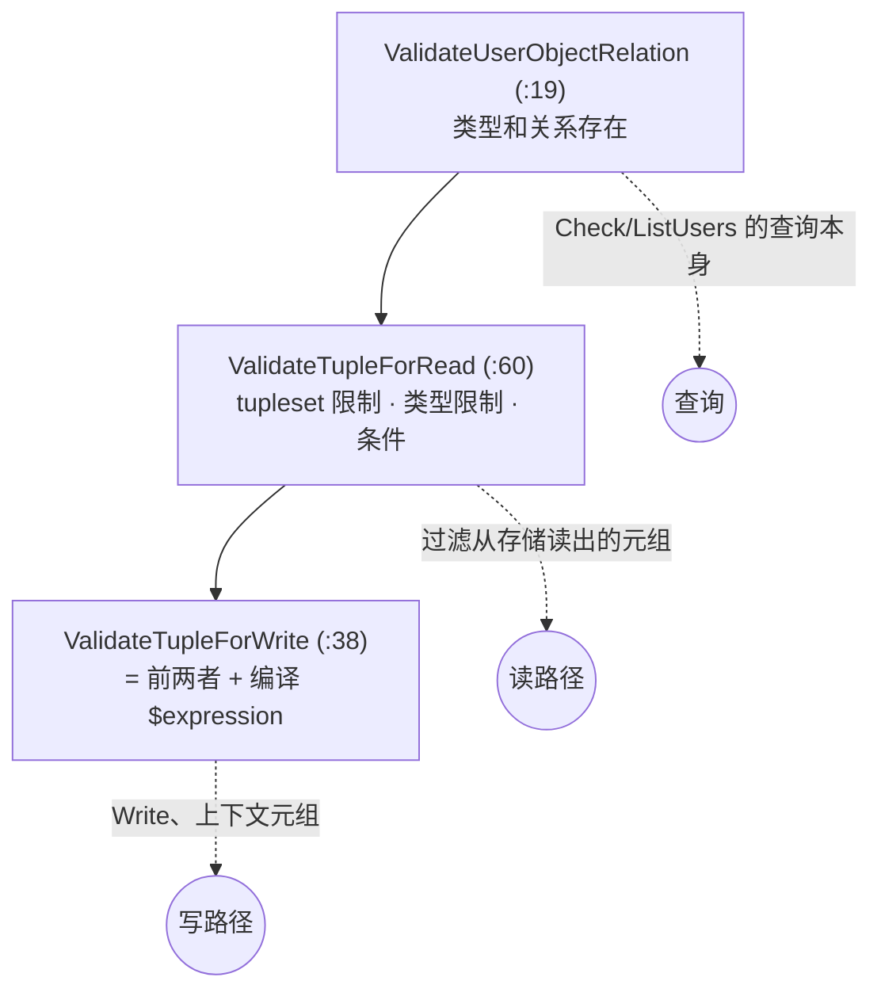

# 第 6 章 关系元组：数据的形状与三层校验

> 本章目标：掌握元组 `object#relation@user` 的三种 user 形态；理解 OpenFGA 对元组做的三个层次的校验，以及“模型变了，旧元组怎么办”；实现 mini-openfga 的 `tuple` 和 `validation` 包。
> 前置：第 4、5 章。对应代码：mini-openfga **v0.1** `pkg/tuple/tuple.go`、`pkg/validation/validation.go`。

## 6.1 元组的格式

一条关系元组有三个必填字段，外加一个可选的条件：

```json
{"object": "document:design", "relation": "viewer", "user": "user:anne",
 "condition": {"name": "non_expired", "context": {"expires_at": "2026-12-31T00:00:00Z"}}}
```

文本形式写作 `document:design#viewer@user:anne`。`object` 总是 `类型:ID`；`user` 有三种形态：

| 形态 | 例子 | 含义 |
|---|---|---|
| 对象 | `user:anne` | 一个具体的主体 |
| 类型通配符 | `user:*` | 所有 `user` 类型的主体 |
| userset | `group:eng#member` | `group:eng` 的所有 `member` |

`user` 不一定是“人”：`document:design#parent@folder:eng` 的 user 是一个文件夹。“user” 只是表示元组右边的那个位置。

几条容易出错的规则：

- 通配符只能出现在 user 一侧，`document:*#viewer@user:anne` 不合法（“anne 能看所有文档”要用模型表达，比如一个全局角色）；
- userset 的对象不能是通配符：`group:*#member` 不合法；
- 一条元组不能“指向自己”：`group:eng#member@group:eng#member` 叫作**隐式元组**（implicit tuple），它恒为真，写入会被拒绝（6.5 节）。

## 6.2 格式校验：`pkg/tuple`

OpenFGA 的 `pkg/tuple/tuple.go` 用逐字符扫描（而不是正则）判断格式，例如 `IsValidObject`（:417）：

```go
func IsValidObject(s string) bool {
	var state, idLen int
	for ndx, chr := range s {
		if unicode.IsControl(chr) {
			return false
		}
		switch chr {
		case '#', ' ':
			return false
		case ':':
			if state > 0 || ndx == 0 {
				return false
			}
			state = 1
		default:
			idLen += state
		}
	}
	return idLen > 0
}
```

一个 `:`、不能在开头、`:` 之后至少一个字符、不含 `#`、空格和控制字符。`IsValidUser`（:515）接受四种情况：`*`（1.0 模型遗留的无类型通配符）、用户 ID、对象、userset。`IsSelfDefining`（:629）判断隐式元组。

这一层只看字符串格式，不知道模型。

## 6.3 三个层次的语义校验

语义校验需要模型，在 `internal/validation/validation.go`。它分三个层次，用在不同的地方：



### 第一层：查询本身（宽松）

`ValidateUserObjectRelation`（:19）检查 user、object、relation 在模型里存在：

```go
func ValidateUserObjectRelation(typesys *typesystem.TypeSystem, tk *openfgav1.TupleKey) error {
	if err := ValidateUser(typesys, tk.GetUser()); err != nil {
		return err
	}
	if err := ValidateObject(typesys, tk); err != nil {
		return err
	}
	if err := ValidateRelation(typesys, tk); err != nil {
		return err
	}
	return nil
}
```

Check 请求的 tuple_key 只做这一层。原因是：**查询一个不可能成立的关系是合法的问题，答案就是 false**。“user:anne 是 document:1 的 parent 吗？”在模型里 parent 只允许 folder，但这个问题本身没有错，返回 false 即可，不必报错。

### 第二层：从存储读出的元组（`ValidateTupleForRead`，:60）

这一层检查元组是否符合**当前**模型的约束：

```go
func ValidateTupleForRead(typesys *typesystem.TypeSystem, tk *openfgav1.TupleKey) error {
	if err := validateTuplesetRestrictions(typesys, tk); err != nil {
		return &tuple.InvalidTupleError{Cause: err, TupleKey: tk}
	}
	objectType := tuple.GetType(tk.GetObject())
	relation := tk.GetRelation()
	hasTypeInfo, err := typesys.HasTypeInfo(objectType, relation)
	...
	if hasTypeInfo {
		err := validateTypeRestrictions(typesys, tk)
		if err != nil {
			return &tuple.InvalidTupleError{Cause: err, TupleKey: tk}
		}
		if err := validateCondition(typesys, tk); err != nil {
			return err
		}
	}
	return nil
}
```

三项检查：

1. **tupleset 限制**（`validateTuplesetRestrictions`，:95）：如果 `parent` 是某个 `X from parent` 的 tupleset，那么 `document:1#parent@...` 的 user 必须是一个具体对象，不能是通配符或 userset；
2. **类型限制**（`validateTypeRestrictions`，:142）：user 的形态必须出现在 `[...]` 里。`doc#reader@person:bob` 要求有 `person`；`doc#reader@group:abc#member` 要求有 `group#member`；`doc#reader@person:*` 要求有 `person:*`；
3. **条件**（`validateCondition`，:213）：类型限制写了 `with c`，元组就必须带条件 `c`；没写，就不能带。条件名必须存在，元组上携带的 context 参数必须能转成条件声明的类型。

第 3 项里有个细节，叫 **facet 匹配**（`restrictionFacetMatches`，:194）：

```text
define viewer: [user, user:* with business_hours]
```

这里 `user` 不带条件，`user:*` 带条件。那么 `doc:1#viewer@user:anne`（不带条件）合法，`doc:1#viewer@user:* with business_hours` 合法，但 `doc:1#viewer@user:anne with business_hours` **不合法**：条件是绑在通配符这个“面”上的，不能借给具体用户用。matrix 测试里专门有一个 `condition_bound_to_correct_type_restriction_facet` 用例测这件事。

#### 为什么“读”也要校验

模型可以更新，而元组不会随之改变。假设旧模型是 `define parent: [folder, folder:*]`，有人写入了 `document:1#parent@folder:*`；新模型改成了 `define parent: [folder]`、并新增 `define viewer: member from parent`。这条旧元组在新模型下已经不合法了，如果 Check 照常使用它，`folder:*` 就会被当作父对象去求值。

所以 OpenFGA 在**每一个从存储读元组的地方**都套了一个过滤器（`FilterInvalidTuples`，:379），把不符合当前模型的元组静默丢掉：

```go
func FilterInvalidTuples(typesys *typesystem.TypeSystem) storage.TupleKeyFilterFunc {
	return func(tupleKey *openfgav1.TupleKey) bool {
		err := ValidateTupleForRead(typesys, tupleKey)
		return err == nil
	}
}
```

第 3 章看到的 `checkTTU` 读完父对象后，就是先用 `storage.NewFilteredTupleKeyIterator(..., validation.FilterInvalidTuples(typesys))` 过滤再求值的。matrix 测试 `ttu_orphan_public_wildcard_parent` 正是上面这个场景。

### 第三层：写入（`ValidateTupleForWrite`，:38）

```go
func ValidateTupleForWrite(typesys *typesystem.TypeSystem, tk *openfgav1.TupleKey) error {
	if err := ValidateUserObjectRelation(typesys, tk); err != nil {
		return &tuple.InvalidTupleError{Cause: err, TupleKey: tk}
	}
	if err := ValidateTupleForRead(typesys, tk); err != nil {
		return err
	}
	// Inline expressions are compiled only on write so that malformed
	// expressions are rejected at write time.
	if condition.IsInlineExpression(tk.GetCondition().GetName()) {
		...
	}
	return nil
}
```

写入时两层都要过，外加编译 `$expression`。**上下文元组**（第 13 章）虽然不落库，但效果等同于写入，所以也用这一层校验。

## 6.4 错误码：同一个错误，不同的 API 报得不一样

校验函数返回的是 Go 错误类型：`InvalidTupleError`、`InvalidConditionalTupleError`、`TypeNotFoundError`、`RelationNotFoundError`。各个 API 再把它们翻译成错误码，**翻译规则因 API 而异**：

| 场景 | 错误码 |
|---|---|
| Check 的 tuple_key 不合法（关系不存在等） | `validation_error`（2000） |
| Check 的上下文元组不合法 | `invalid_tuple`（2027），不论原因 |
| ListObjects / Expand 的上下文元组不合法 | 按原因：`invalid_tuple`（2027）、条件问题为 `validation_error`（2000）、`type_not_found`（2021）…… |
| ListObjects 请求的 type 不存在 | `type_not_found`（2021） |
| Write 中的元组不合法 | `validation_error`（2000），不论原因 |

Check 那两行来自 `CheckCommandErrorToServerError`（`pkg/server/commands/errors.go`）：上下文元组的错误先被包成命令层的 `InvalidTupleError`，再统一交给 `HandleTupleValidateError`（`pkg/server/errors/errors.go:147`）按 `invalid_tuple` 处理。Write 那一行来自 `validateWriteRequest`（`pkg/server/commands/write.go:117`），它对 `ValidateTupleForWrite` 的任何错误都调用 `serverErrors.ValidationError(err)`。

矩阵测试会检查错误码，所以 mini 必须逐个 API 复刻这些规则（第 26 章的 Explain 接口就因为照抄了 ListObjects 的规则，在矩阵里挂了 2 个用例）。

## 6.5 隐式元组

`WriteCommand.validateNotImplicit`（`pkg/server/commands/write.go:218`）：

```go
// validateNotImplicit ensures the tuple to be written (not deleted) is not of the form `object:id # relation @ object:id#relation`.
func (c *WriteCommand) validateNotImplicit(tk *openfgav1.TupleKey) error {
	userObject, userRelation := tupleUtils.SplitObjectRelation(tk.GetUser())
	if tk.GetRelation() == userRelation && tk.GetObject() == userObject {
		return serverErrors.ValidationError(&tupleUtils.InvalidTupleError{
			Cause:    fmt.Errorf("cannot write a tuple that is implicit"),
			TupleKey: tk,
		})
	}
	return nil
}
```

`group:eng#member@group:eng#member` 的意思是“group:eng 的 member 都是 group:eng 的 member”，恒为真，Check 在 `ResolveCheck` 开头就用 `IsSelfDefining` 直接返回 true（第 3 章的表格）。存它没有意义，所以禁止写入。

> **踩坑记录**：mini-openfga 直到 v1.0 才补上这条规则。它是被第 31 章的差分测试发现的：随机生成的元组里出现了 `group:g2#member@group:g2#member`，mini 接受了写入，OpenFGA 返回 `cannot write a tuple that is implicit`。同时还发现 mini 对 Write 的部分校验错误报的是 2027，而 OpenFGA 一律报 2000。

## 6.6 mini-openfga 的实现

### `pkg/tuple`

```go
type Condition struct {
	Name    string         `json:"name" yaml:"name"`
	Context map[string]any `json:"context,omitempty" yaml:"context"`
}

type Key struct {
	Object    string     `json:"object" yaml:"object"`
	Relation  string     `json:"relation" yaml:"relation"`
	User      string     `json:"user" yaml:"user"`
	Condition *Condition `json:"condition,omitempty" yaml:"condition"`
}
```

JSON 标签和 OpenFGA API 的字段名一致，YAML 标签让矩阵测试文件能直接反序列化成 `tuple.Key`。格式判断用正则实现，比逐字符扫描慢，但更容易读：

```go
var (
	objectRe   = regexp.MustCompile(`^[^\s:#@*]+:[^\s#@]+$`)
	relationRe = regexp.MustCompile(`^[^\s:#@*]+$`)
)
```

另外几个小工具：`Parse("document:1#viewer@user:anne")`、`SplitObjectRelation`、`IsUserset`、`IsWildcard`、`IsSelfDefining`。

### `pkg/validation`

函数名、层次和 OpenFGA 一一对应（`ValidateUserObjectRelation` / `ValidateTupleForRead` / `ValidateTupleForWrite` / `IsValidForRead`），facet 匹配也照搬：

```go
// facetMatches: a restriction `user:* with c` must not validate `user:anne with c`.
func facetMatches(ref model.RelationRef, user, userRel string) bool {
	if ref.Wildcard {
		return tuple.IsWildcard(user)
	}
	if ref.Relation != "" {
		return ref.Relation == userRel
	}
	return !tuple.IsWildcard(user) && userRel == ""
}
```

条件参数的类型检查在 v0.1 还做不了（还没有 CEL），v0.3 接入 `condition.For(cond).ValidateTupleContext(...)`。

`ToAPIError` 把校验错误翻译成错误码；各个 API 是否使用它、还是统一报某个码，由 `pkg/server` 决定，规则见 6.4 节的表。

## 6.7 运行与验证

元组校验没有单独的命令行入口，它的正确性体现在矩阵测试的错误码断言上。两个 YAML 文件里，Check 有 43 条断言期望的是错误而不是 true/false（34 条 2000、8 条 2027、1 条 2002）；ListObjects 和 ListUsers 的断言里还有 2021、2022。v0.3 起 Check 的这些断言全部通过。可以只跑相关的测试看看：

```bash
cd code/mini-openfga
go run ./cmd/minifga matrix -filter error -api Check
go run ./cmd/minifga matrix -filter facet
```

```text
Check        assertions: 2 passed, 0 failed, 0 skipped (100.0%); tests: 2/2 fully passed
Check        assertions: 6 passed, 0 failed, 0 skipped (100.0%); tests: 1/1 fully passed
ListObjects  assertions: 3 passed, 0 failed, 0 skipped (100.0%); tests: 1/1 fully passed
ListUsers    assertions: 2 passed, 0 failed, 0 skipped (100.0%); tests: 1/1 fully passed
```

## 6.8 小结

- `user` 有三种形态：对象、类型通配符、userset；通配符只能在 user 一侧；
- 三层校验：查询本身只查存在性，读路径过滤不符合**当前**模型的旧元组，写路径（含上下文元组）两者都要；
- 模型更新不会改动元组，读路径的过滤保证旧元组不会被误用；
- 错误码的翻译因 API 而异，要逐个复刻；隐式元组禁止写入。

## 6.9 练习

1. （巩固）模型 `define viewer: [user, group#member]`，判断下列元组能否写入：`doc:1#viewer@user:*`、`doc:1#viewer@group:a#owner`、`doc:1#viewer@group:a`、`doc:1#viewer@group:a#member`。
2. （扩展）为什么 tupleset 关系不允许 userset 作为 user？构造一个反例：如果允许 `document:1#parent@folder:x#viewer`，`viewer from parent` 应该怎么求值才合理？
3. （读源码）`ValidateTupleForRead` 里有一个 `HasTypeInfo` 判断（:72 附近）。什么样的模型会让它返回 false？（提示：schema 1.0。）

## 6.10 延伸阅读

- OpenFGA 文档 *Relationship Tuples*：<https://openfga.dev/docs/concepts#what-is-a-relationship-tuple>
- `internal/validation/validation_test.go`
- 矩阵测试中名字包含 `facet`、`orphan`、`error` 的用例
