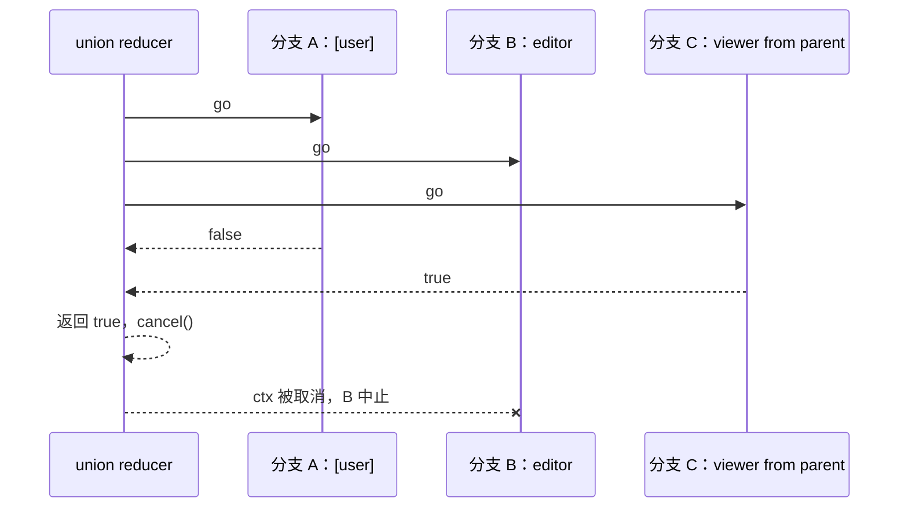

# 第 10 章 集合运算的并发求值：union、intersection、exclusion 的提前结束 ★★

> 本章目标：读懂 OpenFGA 三个 reducer 的并发结构：有界并发、按完成顺序消费结果、一旦能确定答案就取消其余工作；理解 `CycleDetected` 在三种运算里的不同处理；实现 mini 的 reducer，并证明它们不泄漏 goroutine、与参照实现答案一致。
> 前置：第 8、9 章。对应代码：mini-openfga **v0.2** `pkg/check/reducers.go`。

## 10.1 为什么要并发

`define viewer: [user] or editor or viewer from parent`。朴素版本按顺序算三个分支：直接元组（一次读）、editor（可能又是几层递归）、父文件夹（几次 dispatch）。如果答案在最后一个分支，前两个分支的时间全白花了；如果第一个分支要等一个慢查询，后面能立刻返回 true 的分支也得等着。

并发求值的思路：

- 所有分支**同时开始**；
- 结果按**完成的顺序**处理，不按声明顺序；
- 一旦结果确定（union 遇到一个 true，intersection 遇到一个 false），**立刻返回，并取消还在运行的分支**；
- 并发数**有上限**（`resolveNodeBreadthLimit`，默认 10），防止一个很宽的节点（比如一个文件夹下有上千个 userset）一下子开出上千个 goroutine。



## 10.2 union

`internal/graph/check.go:160`：

```go
func union(ctx context.Context, concurrencyLimit int, handlers ...CheckHandlerFunc) (resp *ResolveCheckResponse, err error) {
	if ctx.Err() != nil {
		return nil, ctx.Err()
	}
	cancellableCtx, cancel := context.WithCancel(ctx)
	defer cancel()

	pool := concurrency.NewPool(cancellableCtx, concurrencyLimit)
	out := make(chan checkOutcome, len(handlers))

	for _, handler := range handlers {
		h := handler
		pool.Go(func(ctx context.Context) error {
			concurrency.TrySendThroughChannel(cancellableCtx, runHandler(ctx, h), out)
			return nil
		})
	}

	go func() {
		_ = pool.Wait()
		close(out)
	}()

	var finalErr error
	finalResult := &ResolveCheckResponse{Allowed: false}

	for i := 0; i < len(handlers); i++ {
		select {
		case <-ctx.Done():
			return nil, ctx.Err()
		case outcome, ok := <-out:
			if !ok {
				break
			}
			if outcome.err != nil {
				finalErr = outcome.err
				continue // Continue to see if we find an 'Allowed: true'
			}
			if outcome.resp.GetResolutionMetadata().CycleDetected {
				finalResult.ResolutionMetadata.CycleDetected = true
			}
			if outcome.resp.Allowed {
				// Short-circuit success. defer cancel() will clean up workers.
				return outcome.resp, nil
			}
		}
	}
	if finalErr != nil {
		return nil, finalErr
	}
	return finalResult, nil
}
```

逐段看：

**有界并发**。`concurrency.NewPool`（`internal/concurrency/concurrency.go`）是 `sourcegraph/conc` 的 `ContextPool`，`WithMaxGoroutines(concurrencyLimit)`：`pool.Go` 在已有 `concurrencyLimit` 个任务运行时会**阻塞**，直到有一个结束。注意 `pool.Go` 是在一个普通的 `for` 循环里调用的，所以当 handler 很多时，这个循环本身会阻塞在 `pool.Go` 上，直到有空位。

**结果通道有足够的缓冲**。`out` 的容量等于 handler 数量，任何一个 worker 发送结果都不会阻塞。即使 reducer 已经返回、不再读 `out`，worker 也能把结果放进缓冲区然后退出。`TrySendThroughChannel` 还加了一层保险：ctx 被取消时放弃发送。

**谁关闭通道**。一个单独的 goroutine 等 `pool.Wait()` 返回（所有 worker 都结束）后关闭 `out`。reducer 本身绝不关闭它，因为 reducer 可能提前返回，而那时 worker 还在写。

**提前结束与清理**。找到 true 就 `return`，`defer cancel()` 取消 `cancellableCtx`，所有 worker 的 ctx 都派生自它，正在进行的存储读取、正在等待的 dispatch 会尽快收到取消信号。被取消的 worker 返回的结果（通常是 `context.Canceled` 错误）会写进缓冲通道，然后被垃圾回收。

**错误**。按第 8 章的规则：错误先记下，继续等其他分支，没有 true 才返回错误。

**环**。一个分支因为“遇到环”而返回 false（`CycleDetected`），union 继续看其他分支；最终是 false 的话，把 `CycleDetected` 标志传上去。这个标志告诉缓存层：这个 false 是“这条路径上恰好有环”导致的，不是数据里真的没有，**不能缓存**（第 15 章）。

## 10.3 intersection

`check.go:222`，结构与 union 相同，判断条件反过来：

```go
if outcome.err != nil {
	// Store the first error we see, but don't exit yet.
	// A definitive 'false' result from another handler can override this.
	if finalErr == nil {
		finalErr = outcome.err
	}
	continue
}
if outcome.resp.GetResolutionMetadata().CycleDetected || !outcome.resp.Allowed {
	// Short-circuit failure. defer cancel() will clean up workers.
	finalResult.Allowed = false
	finalResult.ResolutionMetadata.CycleDetected = outcome.resp.GetResolutionMetadata().CycleDetected
	return finalResult, nil
}
```

两点不同：

- 任何一个 false 就结束；全部 true 才是 true；
- **遇到环当作 false**。交集里一项因为环而无法确定，整个交集就不能为真。

开头还有一个检查：`len(handlers) < 2` 返回错误。交集至少要两个操作数，这是模型校验已经保证的，这里是防御性检查。

## 10.4 exclusion

`check.go:295`。`a but not b` 只有两个操作数，没有用 pool，而是开两个 goroutine、两个通道：

```go
baseChan := make(chan checkOutcome, 1)
subChan := make(chan checkOutcome, 1)

go func() {
	concurrency.TrySendThroughChannel(ctx, runHandler(ctx, handlers[0]), baseChan)
	close(baseChan)
}()
go func() {
	concurrency.TrySendThroughChannel(ctx, runHandler(ctx, handlers[1]), subChan)
	close(subChan)
}()

var baseErr, subErr error
resultsReceived := 0
for resultsReceived < 2 {
	select {
	case <-ctx.Done():
		return nil, ctx.Err()
	case res, ok := <-baseChan:
		if !ok {
			baseChan = nil // Stop selecting this case.
			continue
		}
		resultsReceived++
		if res.err != nil {
			baseErr = res.err
			continue
		}
		// Short-circuit: If base is false, the whole expression is false.
		if res.resp.GetCycleDetected() || !res.resp.GetAllowed() {
			return &ResolveCheckResponse{Allowed: false, ...}, nil
		}
	case res, ok := <-subChan:
		if !ok {
			subChan = nil // Stop selecting this case.
			continue
		}
		resultsReceived++
		if res.err != nil {
			subErr = res.err
			continue
		}
		// Short-circuit: If subtract is true, the whole expression is false.
		if res.resp.GetCycleDetected() || res.resp.GetAllowed() {
			return &ResolveCheckResponse{Allowed: false, ...}, nil
		}
	}
}
```

两个方向都能提前结束：base 为 false，或 subtract 为 true。

**subtract 一侧遇到环，当作 true**，于是整个表达式为 false。这是一个“宁可拒绝”的选择：`viewer but not blocked` 中，如果“是否被拉黑”因为数据里的环而无法确定，就按被拉黑处理。

还要注意 `baseChan = nil` 这一行。通道被关闭后，`<-baseChan` 会**立即**返回零值和 `ok=false`，而且每次都是。如果不把变量置为 `nil`，`select` 会不停地选中这个分支，变成一个吃满 CPU 的空转循环。对 `nil` 通道的接收永远阻塞，所以置 `nil` 等于“从 select 里删掉这个分支”。

> 这不是假想的问题。本书所用的 OpenFGA 提交 `526995eb` 本身就是修这个 bug 的：*“Fixed `recursiveFastPath` and `weight2` in Check spinning at full CPU on a closed producer channel until the other producer finished, which also made the planner avoid the `weight2` strategy.”*（#3299）。weight2 策略（第 27 章）里有两个生产者通道，一个先关闭后，代码设置了 `leftOpen = false`，却忘了 `leftChan = nil`，于是空转到另一个生产者结束。修复就是补上四行 `xxxChan = nil`。空转让这个策略看起来很慢，planner（第 28 章）据此学会了少用它：一个并发 bug 变成了一个性能退化。

## 10.5 三种运算的对照

| | union | intersection | exclusion |
|---|---|---|---|
| 提前结束于 | 任一 true | 任一 false | base false 或 sub true |
| 分支遇到环 | 继续，最后带上标志 | 当作 false | base：当作 false；sub：当作 true |
| 错误 | 没有 true 时才返回 | 没有 false 时才返回 | 两边都“不能决定”时才返回 |
| 并发结构 | pool + 一个缓冲通道 | 同左 | 两个 goroutine + 两个通道 |

## 10.6 mini-openfga 的实现

mini 不依赖 `sourcegraph/conc`，用一个信号量通道和 `sync.WaitGroup` 写了一个流式的扇出函数：

```go
// fanOutStream runs handlers as they arrive, with at most `limit` in flight,
// and streams their outcomes. The outcome channel is closed once every
// launched handler has finished, so ranging over it never leaks goroutines.
// When ctx is cancelled (a reducer short-circuited) no new handler starts.
func fanOutStream(ctx context.Context, limit int, in <-chan HandlerFunc) <-chan outcome {
	out := make(chan outcome, limit)
	go func() {
		defer close(out)
		sem := make(chan struct{}, limit)
		var wg sync.WaitGroup
		defer wg.Wait()
		for {
			var h HandlerFunc
			var ok bool
			select {
			case h, ok = <-in:
				if !ok {
					return
				}
			case <-ctx.Done():
				return
			}
			select {
			case sem <- struct{}{}:
			case <-ctx.Done():
				return
			}
			wg.Add(1)
			go func() {
				defer func() { <-sem; wg.Done() }()
				o := runHandler(ctx, h)
				select {
				case out <- o:
				case <-ctx.Done():
				}
			}()
		}
	}()
	return out
}
```

输入是一个 handler **通道**而不是切片，这样第 11 章读迭代器时可以“边读边派发”，用的是同一个函数。`defer` 的执行顺序是先 `wg.Wait()` 再 `close(out)`：所有 worker 结束后才关闭输出通道。

`union` 用 `for o := range fanOut(...)` 消费结果：

```go
func union(ctx context.Context, limit int, handlers ...HandlerFunc) (*Response, error) {
	if err := ctx.Err(); err != nil {
		return nil, err
	}
	ctx, cancel := context.WithCancel(ctx)
	defer cancel() // short-circuit: stop the remaining operands

	var finalErr error
	result := &Response{}
	for o := range fanOut(ctx, limit, handlers) {
		if o.err != nil {
			finalErr = o.err
			continue
		}
		if o.resp.CycleDetected {
			result.CycleDetected = true
		}
		if o.resp.Allowed {
			return o.resp, nil
		}
	}
	if err := ctx.Err(); err != nil {
		return nil, err // the caller gave up; outcomes may be missing
	}
	if finalErr != nil {
		return nil, finalErr
	}
	return result, nil
}
```

循环结束后的 `ctx.Err()` 检查很重要：如果是**调用方**取消了（比如外层 union 已经找到了 true），worker 在取消后可能没把结果写出来就退出了，这时“没看到 true”不代表答案是 false，必须返回错误而不是 false。

`exclusion` 只有两个操作数，结构和 OpenFGA 相同（两个 goroutine、两个容量为 1 的通道），但 mini 的 goroutine 只发送一次、不关闭通道，所以不存在“select 已关闭通道”的问题。

## 10.7 运行与验证

**提前结束确实发生了**。`TestUnionShortCircuits` 构造一个“直接分支立即为 true、TTU 分支的读取永远阻塞直到被取消”的场景，要求 2 秒内返回，并且返回后 goroutine 数量回到原来的水平（没有泄漏）：

```go
// viewer: [user] or viewer from parent. The direct branch is true at
// once; the TTU branch blocks forever. Union must not wait for it.
e := newEnv(t, groupsModel, keys("folder:x#viewer@user:anne"))
before := runtime.NumGoroutine()
...
ctx = storage.ContextWithReader(ctx, slowReader{e.ds})  // Read 一直阻塞到 ctx 取消
```

**答案和参照实现一致**。`TestDifferential` 随机生成 40 组数据（包括组的嵌套和环、文件夹的嵌套和环、通配符、拉黑），对每组数据把文档和文件夹上的每个关系、每个用户都问一遍，比较 `LocalChecker` 和第 8 章那个顺序执行的 `Reference` 的答案：

```bash
cd code/mini-openfga && git checkout v0.2
go test -race ./pkg/check/ -run 'TestUnionShortCircuits|TestDifferential' -v
```

```text
--- PASS: TestUnionShortCircuits (0.00s)
    local_checker_test.go:284: 3000 checks compared, 0 mismatches
--- PASS: TestDifferential (1.18s)
```

`-race` 很关键：并发代码的 bug 往往不会让测试失败，只会偶尔产生数据竞争。第 14 章就有一个只有 `-race` 才抓得到的例子。

**取消让工作量变得不确定**。Lab 6 在浏览器里对同一个 `but not` 请求连查两次，第一次报告 2 次 dispatch、14 次查询，第二次是 0 次 dispatch、6 次查询：`blocked` 这边一次直接读就得出 true，base 那边被取消前做了多少，取决于调度。第 3 章 OpenFGA 的 `datastore_query_count` 在 24 到 28 之间浮动，也是这个原因。

## 10.8 小结

- 三个 reducer 的共同结构：同时启动、按完成顺序消费、能确定就返回、`defer cancel()` 清理；
- 结果通道要有足够的缓冲（或带 ctx 的发送），保证提前返回后 worker 不会阻塞、goroutine 不泄漏；
- 关闭的通道在 `select` 里会被不停选中，必须置为 `nil`；
- 环在三种运算里处理不同：union 忽略并传递标志，intersection 当 false，exclusion 的 subtract 当 true；
- 取消使调度次数和查询次数变得不确定，但答案是确定的（由差分测试保证）。

## 10.9 练习

1. （巩固）`union` 的结果通道容量如果是 0，会发生什么？构造一个会泄漏 goroutine 的场景。
2. （扩展）OpenFGA 的 `exclusion` 总是同时启动 base 和 subtract。如果 subtract 通常很便宜（比如 `blocked: [user]`）而 base 很贵，“先算 subtract，为 true 就不算 base”会更快吗？什么时候会更慢？（OpenFGA 的 ListObjects 流水线为 subtract 一侧也有专门的优化开关：实验特性 `pipeline_optimizations` 打开 `FlagOptimizeSubtract`，注释是 “an optimization for subtract edges with high cardinality”，见 `internal/listobjects/pipeline/config.go:6`。）
3. （读源码）`git show 526995eb` 看 #3299 的修复和它的两个回归测试。测试是怎么“看出”空转的？

## 10.10 延伸阅读

- `github.com/sourcegraph/conc/pool`：`ContextPool`、`WithCancelOnError`、`WithFirstError` 的语义
- Go 博客 *Go Concurrency Patterns: Pipelines and cancellation*
- OpenFGA issue #3299 与对应的修复提交
