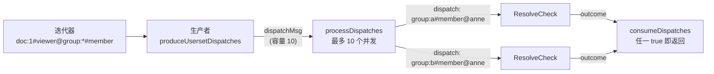

# 第 11 章 Userset、通配符与 TTU：经过数据的间接关系

> 本章目标：把直接赋值 `[user, user:*, group#member]` 拆成三种独立的查询；理解“边读迭代器边派发子问题”的生产者-消费者结构；实现 TTU 的派发。
> 前置：第 9、10 章。对应代码：mini-openfga **v0.2** `pkg/check/local_checker.go`（`checkDirect`、`checkDirectUsersetTuples`、`checkTTU`、`consumeDispatches`）。

## 11.1 直接赋值不止一次读

v0.1 的直接赋值只做一件事：看 `object#relation@user` 这条元组是否存在。但类型限制 `[user, user:*, group#member]` 允许三种元组，每种需要不同的查询：

| 类型限制 | 存储里的元组 | 要回答的问题 | 读法 |
|---|---|---|---|
| `user` | `doc:1#viewer@user:anne` | 有这条元组吗 | `ReadUserTuple`（精确查找） |
| `user:*` | `doc:1#viewer@user:*` | 有通配符元组吗 | `ReadUsersetTuples`，只要 `user:*` |
| `group#member` | `doc:1#viewer@group:eng#member` | 有哪些组被授权，anne 在其中某个组里吗 | `ReadUsersetTuples`，只要 `group#member`，然后对每个组**派发**一个子问题 |

第三种就是 userset：元组的 user 是一群人，要判断 anne 是否属于这群人，就得对每个组问一个新问题 `group:eng#member@user:anne`。这个问题在另一个对象上，可能又经过别的组（组的嵌套），所以要 dispatch，深度加一。

## 11.2 checkDirect：三路并行

`internal/graph/check.go:799`：

```go
func (c *LocalChecker) checkDirect(parentctx context.Context, req *ResolveCheckRequest) CheckHandlerFunc {
	return func(ctx context.Context) (*ResolveCheckResponse, error) {
		typesys, _ := typesystem.TypesystemFromContext(parentctx) // note: use of 'parentctx' not 'ctx' - this is important
		reqTupleKey := req.GetTupleKey()
		objectType := tuple.GetType(reqTupleKey.GetObject())
		relation := reqTupleKey.GetRelation()

		// directlyRelatedUsersetTypes could be "group#member"
		directlyRelatedUsersetTypes, _ := typesys.DirectlyRelatedUsersets(objectType, relation)

		var checkFuncs []CheckHandlerFunc
		if shouldCheckDirectTuple(ctx, req.GetTupleKey()) {
			checkFuncs = []CheckHandlerFunc{c.checkDirectUserTuple(parentctx, req)}
		}
		if shouldCheckPublicAssignable(ctx, reqTupleKey) {
			checkFuncs = append(checkFuncs, c.checkPublicAssignable(parentctx, req))
		}
		if len(directlyRelatedUsersetTypes) > 0 {
			checkFuncs = append(checkFuncs, c.checkDirectUsersetTuples(parentctx, req))
		}

		resp, err := union(ctx, c.concurrencyLimit, checkFuncs...)
		...
	}
}
```

三种查询各自成为一个 handler，交给 `union` 并发执行。每种查询之前都先问模型“有没有必要”：

- `shouldCheckDirectTuple`（:599）：请求里的 user 的形态（`user`，或 userset `group#member`）是否出现在类型限制里。查 `doc:1#viewer@group:eng#member` 时，如果类型限制里有 `group#member`，也走这条路：精确查找这条 userset 元组本身；
- `shouldCheckPublicAssignable`（:614）：请求的 user 不是 userset，并且类型限制里有 `该类型:*`；
- 类型限制里有任何 userset 才去读 userset 元组。

`checkPublicAssignable`（:490）用 `ReadUsersetTuples` 读 `user:*` 而不是用 `ReadUserTuple` 精确查找，源码注释解释了原因：这样能利用存储包装器里的迭代器缓存。

## 11.3 读 userset：生产者与消费者

`checkDirectUsersetTuples`（:648）读出所有符合类型限制的 userset 元组，然后交给一个策略执行。不考虑第 27 章的优化策略时，用的是 `defaultUserset`（`internal/graph/default_resolver.go:65`）：

```go
func (c *LocalChecker) defaultUserset(_ context.Context, req *ResolveCheckRequest, _ []*openfgav1.RelationReference, iter storage.TupleKeyIterator, selectedStrategy string) CheckHandlerFunc {
	return func(ctx context.Context) (*ResolveCheckResponse, error) {
		dispatchChan := make(chan dispatchMsg, c.concurrencyLimit)
		cancellableCtx, cancelFunc := context.WithCancel(ctx)
		pool := concurrency.NewPool(cancellableCtx, 1)
		defer func() {
			cancelFunc()
			// We need to wait always to avoid a goroutine leak.
			_ = pool.Wait()
		}()
		pool.Go(func(ctx context.Context) error {
			c.produceUsersetDispatches(ctx, req, dispatchChan, iter, selectedStrategy)
			return nil
		})
		return c.consumeDispatches(ctx, c.concurrencyLimit, dispatchChan)
	}
}
```

一个**生产者** goroutine 读迭代器、把每个组变成一个派发消息；**消费者**收到消息就启动子问题（最多 `concurrencyLimit` 个同时进行），并收集结果。



为什么不先把迭代器读完再并发？因为 userset 可能非常多。流式处理的好处：

- 读到第一个组就开始求值，不用等全部读完；
- 某个组得到 true 后，消费者取消 ctx，生产者停止读迭代器，剩下的行根本不会从数据库读出来；
- 通道容量是 `concurrencyLimit`，生产者最多领先消费者 10 条，内存占用有界。

生产者（`produceUsersetDispatches`，:96）里还有一个短路：

```go
usersetObject, usersetRelation := tuple.SplitObjectRelation(t.GetUser())
// if the user value is a typed wildcard and the type of the wildcard
// matches the target user objectType, then we're done searching
if tuple.IsTypedWildcard(usersetObject) && typesystem.IsSchemaVersionSupported(typesys.GetSchemaVersion()) {
	wildcardType := tuple.GetType(usersetObject)
	if tuple.GetType(reqTupleKey.GetUser()) == wildcardType {
		concurrency.TrySendThroughChannel(ctx, dispatchMsg{shortCircuit: true}, dispatches)
		break
	}
}
if usersetRelation != "" {
	tupleKey := tuple.NewTupleKey(usersetObject, usersetRelation, reqTupleKey.GetUser())
	concurrency.TrySendThroughChannel(ctx, dispatchMsg{dispatchParams: &dispatchParams{parentReq: req, tk: tupleKey, strategy: selectedStrategy}}, dispatches)
}
```

如果读到的是一个类型匹配的通配符，不用派发，直接短路为 true。

消费端 `processDispatches`（:237）在主循环里给 `DispatchCounter` 加一，然后在 pool 里执行 `c.dispatch(ctx, childRequest)`；`consumeDispatches`（:190）收集结果，第一个 true 就 `break` 并 `cancel()`。

## 11.4 TTU：同样的结构

`checkTTU`（:862）读 tupleset（`document:1#parent@*`），用 `FilterInvalidTuples` 和条件过滤包装迭代器，然后交给 `defaultTTU`（`default_resolver.go:133`），结构和 `defaultUserset` 一模一样，只是生产者换成 `produceTTUDispatches`（:158）：

```go
userObj, _ := tuple.SplitObjectRelation(t.GetUser())
if _, err := typesys.GetRelation(tuple.GetType(userObj), computedRelation); err != nil {
	if errors.Is(err, typesystem.ErrRelationUndefined) {
		continue // skip computed relations on tupleset relationships if they are undefined
	}
}
tupleKey := &openfgav1.TupleKey{
	Object:   userObj,
	Relation: computedRelation,
	User:     reqTupleKey.GetUser(),
}
concurrency.TrySendThroughChannel(ctx, dispatchMsg{dispatchParams: &dispatchParams{parentReq: req, tk: tupleKey, strategy: selectedStrategy}}, dispatches)
```

对每个父对象派发 `父对象#computedRelation@user`。父类型上没有这个关系时跳过（第 8 章说过的规则）。

userset 和 TTU 本质上是同一个模式：**读一组指向别的对象的元组，对每个目标对象派发一个子问题，任一为真即为真**。区别只在“读什么”和“派发什么”：

| | 读 | 派发 |
|---|---|---|
| userset `[group#member]` | `doc:1#viewer@group:X#member` | `group:X#member@user` |
| TTU `viewer from parent` | `doc:1#parent@folder:X` | `folder:X#viewer@user` |

## 11.5 user 本身是 userset 时

Check 的 user 也可以是一个 userset：“eng 组的成员能看 doc:1 吗？”即 `doc:1#viewer@group:eng#member`。这时：

- `shouldCheckDirectTuple` 检查类型限制里有没有 `group#member`，有就精确查找这条元组；
- 通配符分支被跳过（userset 不会匹配 `user:*`）；
- userset 分支照常读其他组，派发 `group:X#member@group:eng#member`，“eng 组的成员是不是 X 组的成员”，也就是 eng 是不是嵌套在 X 里；
- 递归下去，最终问到 `group:eng#member@group:eng#member` 时，`ResolveCheck` 开头的 `IsSelfDefining` 直接返回 true。

矩阵测试里的 `userset_as_user` 就是测这个场景。第 6 章“隐式元组不能写入”的规则也来自这里：自己包含自己本来就恒为真。

## 11.6 mini-openfga 的实现

`checkDirect` 的三路结构照搬：

```go
func (c *LocalChecker) checkDirect(ctx context.Context, req *Request) HandlerFunc {
	ts, _ := typesystem.FromContext(ctx)
	k := req.TupleKey
	objectType := tuple.GetType(k.Object)
	userType, userRel := typesystem.UserShape(k.User)

	var handlers []HandlerFunc
	if ts.IsDirectlyRelated(objectType, k.Relation, userType, userRel) {
		handlers = append(handlers, c.checkDirectUserTuple(req))
	}
	if userRel == "" && ts.IsPubliclyAssignable(objectType, k.Relation, userType) {
		handlers = append(handlers, c.checkPublicAssignable(req, userType))
	}
	if usersets := ts.DirectlyRelatedUsersets(objectType, k.Relation); len(usersets) > 0 {
		handlers = append(handlers, c.checkDirectUsersetTuples(req, usersets))
	}
	return func(ctx context.Context) (*Response, error) {
		return union(ctx, c.concurrency, handlers...)
	}
}
```

userset 和 TTU 共用一个“读迭代器 → 转换成 handler → 流式扇出”的函数 `consumeDispatches`，两者的区别只在传入的 `toHandler`：

```go
// defaultUsersets: object#relation@group:x#member -> dispatch group:x#member@user
return c.consumeDispatches(ctx, it, func(t *tuple.Key) HandlerFunc {
	usersetObject, usersetRel := tuple.SplitObjectRelation(t.User)
	if usersetRel == "" {
		return nil
	}
	child := req.clone()
	child.TupleKey = tuple.New(usersetObject, usersetRel, k.User)
	return c.dispatch(child)
})

// defaultTTU: object#parent@folder:x -> dispatch folder:x#viewer@user
return c.consumeDispatches(ctx, it, func(t *tuple.Key) HandlerFunc {
	parent, _ := tuple.SplitObjectRelation(t.User)
	if _, err := ts.Relation(tuple.GetType(parent), rw.Relation); err != nil {
		return nil // `viewer from parent` skips parent types without viewer
	}
	child := req.clone()
	child.TupleKey = tuple.New(parent, rw.Relation, k.User)
	return c.dispatch(child)
})
```

`consumeDispatches` 里，生产者 goroutine 读迭代器、把 handler 送进通道；第 10 章的 `fanOutStream` 消费这个通道：

```go
handlers := make(chan HandlerFunc, c.concurrency)
go func() {
	defer close(handlers)
	defer it.Stop()
	for {
		t, err := it.Next(ctx)
		if err != nil {
			if !errors.Is(err, storage.ErrIteratorDone) && ctx.Err() == nil {
				handlers <- func(context.Context) (*Response, error) { return nil, err }
			}
			return
		}
		if h := toHandler(t); h != nil {
			select {
			case handlers <- h:
			case <-ctx.Done():
				return
			}
		}
	}
}()

for o := range fanOutStream(ctx, c.concurrency, handlers) {
	... // 与 union 相同：任一 true 即返回
}
```

迭代器的错误被包装成一个“返回该错误的 handler”送进同一个通道，于是错误处理和普通结果走同一条路：没有 true 才报告错误。

mini 没有 OpenFGA 生产者里的“读到通配符就短路”，因为 mini 的 userset 查询只请求 `group#member` 这样的类型（`AllowedTypes` 不含通配符），通配符由 `checkPublicAssignable` 单独处理，两条路在 `checkDirect` 的 union 里并行。

所有从存储读出的元组都经过 `validTuples`：

```go
// validTuples drops tuples that no longer fit the model and tuples whose
// condition is not met.
func validTuples(ctx context.Context, req *Request, it storage.Iterator) storage.Iterator {
	ts, _ := typesystem.FromContext(ctx)
	return storage.NewFilteredIterator(it, func(t *tuple.Key) (bool, error) {
		if !validation.IsValidForRead(ts, t) {
			return false, nil
		}
		return conditionMet(ctx, req, t)
	})
}
```

## 11.7 运行与验证

v0.2 加上 userset 和通配符之后，只看“写入后查询”的变体（与 v0.1 可比）：

```bash
cd code/mini-openfga && git checkout v0.2
go run ./cmd/minifga matrix -contextual=false
```

```text
Check assertions: 402 passed, 114 failed, 0 skipped (77.9%); tests: 124/157 fully passed
```

v0.1 是 325。剩下的 114 个失败全部与条件有关。

`TestLocalCheckerUsersetsWildcardsCycles` 覆盖了本章的每种情况：嵌套组、公开文档、通配符组成员、userset 作为 user、自定义：

```text
document:1#viewer@user:alice         true   经过两层嵌套的组
document:2#viewer@user:anyone        true   公开（user:*）
document:4#can_edit@user:zoe         true   editor 来自一个包含 user:* 的组
group:all#member@group:eng#member    true   userset 作为 user
group:eng#member@group:eng#member    true   自定义
document:1#viewer@group:eng#member   true   userset 一路传到文档
```

## 11.8 小结

- 直接赋值拆成三种查询：精确查找、通配符、userset；先问模型有没有必要，再读存储；
- userset 和 TTU 是同一个模式：读一组指向别的对象的元组，对每个目标派发子问题；
- 派发采用生产者-消费者结构，流式读迭代器、有界并发、任一为真即取消；
- user 可以是 userset，递归到自身时由 `IsSelfDefining` 结束。

## 11.9 练习

1. （巩固）模型 `define viewer: [user, user:*, group#member]`，数据 `doc:1#viewer@user:*`、`doc:1#viewer@group:a#member`。分别求 `doc:1#viewer@user:bob` 和 `doc:1#viewer@group:a#member`，各走了哪几个分支？
2. （扩展）OpenFGA 在 `checkPublicAssignable` 里用 `ReadUsersetTuples` 而不是 `ReadUserTuple(user:*)`。给 mini 写一个 benchmark：一个对象上有 1 万个 userset 元组和 1 条通配符元组，比较两种写法。
3. （读源码）`processDispatches`（`default_resolver.go:237`）在派发前检查 `msg.dispatchParams.parentReq == nil`，什么情况下会发生？它返回的 `ErrPanic` 合适吗？

## 11.10 延伸阅读

- `internal/graph/default_resolver.go` 全文
- 矩阵测试中的 `userset_*`、`ttu_*`、`*_wildcard*` 用例
- OpenFGA 文档 *Modeling: User Groups*、*Parent-Child Objects*、*Public Access*
