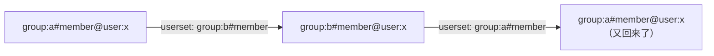
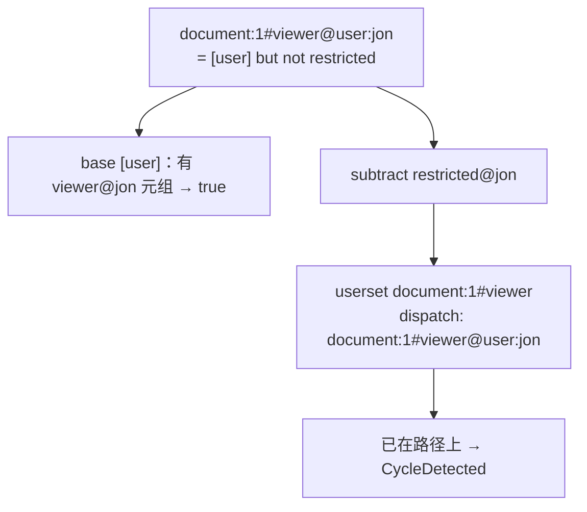

# 第 12 章 环、深度与广度：别让授权图拖垮服务

> 本章目标：区分“模型里的环”和“数据里的环”；理解 OpenFGA 用“路径上已访问的子问题”检测环、用深度和广度限制约束代价；看懂一个“自相矛盾”的模型为什么返回 false。
> 前置：第 5、9–11 章。对应代码：mini-openfga **v0.2** `LocalChecker.hasCycle`、`ResolveCheck`。

## 12.1 两种环

第 5 章在写入模型时拒绝了一种环：只靠计算关系转圈（`define a: b`、`define b: a`），它和数据无关，必然死循环。

另一种环是**数据**造成的。模型 `define member: [user, group#member]` 完全合法（组可以包含组），但数据可以写成：

```text
group:a#member@group:b#member
group:b#member@group:a#member
```

a 包含 b，b 又包含 a。问 `group:a#member@user:x`：



模型无法禁止这种数据（写入第二条元组时，要判断它会不会成环，代价太高），所以必须在**查询时**处理。

## 12.2 检测：当前路径上见过这个子问题吗

`LocalChecker.ResolveCheck` 在做任何事之前先调用 `hasCycle`（`internal/graph/check.go:475`）：

```go
// hasCycle returns true if a cycle has been found. It modifies the request object.
func (c *LocalChecker) hasCycle(req *ResolveCheckRequest) bool {
	key := tuple.TupleKeyToString(req.GetTupleKey())
	if req.VisitedPaths == nil {
		req.VisitedPaths = map[string]struct{}{}
	}
	_, cycleDetected := req.VisitedPaths[key]
	if cycleDetected {
		return true
	}
	req.VisitedPaths[key] = struct{}{}
	return false
}
```

`VisitedPaths` 记录的是**从根到当前节点这条路径**上出现过的子问题。第 9 章看过，克隆请求时它被复制（`maps.Clone`），所以兄弟分支互不影响：两个并发的分支都经过 `group:c#member@user:x` 不算环，只有同一条路径上出现两次才算。

检测到环时返回的是 `Allowed: false` 加上 `CycleDetected: true`，**不是错误**：

```go
cycle := c.hasCycle(req)
if cycle {
	return &ResolveCheckResponse{Allowed: false, ResolutionMetadata: ResolveCheckResponseMetadata{CycleDetected: true}}, nil
}
```

道理是：在环上绕一圈不会找到新的成员。如果 x 是 a 的成员，那么一定存在一条**不绕圈**的路径能证明它（某个组直接包含 x），而其他分支会去找那条路径。

## 12.3 “环”这个标志怎么往上传

第 10 章的表格里，三种集合运算对 `CycleDetected` 的处理不同。这里用 OpenFGA 矩阵测试里的一个用例 `true_butnot_cycle_return_false` 体会一下为什么要这样设计：

```text
type document
  relations
    define restricted: [user, document#viewer]
    define viewer: [user] but not restricted

document:1#viewer@user:jon
document:1#restricted@document:1#viewer
```

“document:1 的 viewer 都被限制了”，而 viewer 的定义又是“直接的 viewer 减去被限制的”。jon 是 viewer 吗？



subtract 一侧遇到了环。如果把环当作 false，结果是 `true but not false = true`；如果当作 true，结果是 false。从逻辑上看，这个定义是自相矛盾的：jon 是 viewer 当且仅当 jon 不是 viewer。OpenFGA 的 `exclusion` 选择**把 subtract 一侧的环当作 true**，于是答案是 false，测试期望的也是 false。在不确定的时候拒绝访问，这是授权系统的基本原则。

### 12.3.1 一个例外：只通过自身递归的关系

> 这一节是写第 31 章时补上的。本章最初的版本把“环”一律当作“不确定”，第 31 章的差分测试在随机数据上发现 mini 和 OpenFGA 的 Check 结果不同，追查下来是这一节的内容。

上面的例子里，环穿过了 `but not`：jon 是不是 viewer，取决于 jon 是不是 viewer，确实无法判定。但很多环根本不涉及 `and`/`but not`：

```text
define member: [user, user:*, group#member]
group:g2#member@group:g0#member
group:g0#member@group:g2#member        （g0、g2 互相包含，没有任何用户）
document:d1#blocked@group:g2#member
document:d1#owner@user:u0              （u0 是 owner，因而是 viewer）
define can_view: viewer but not blocked
```

`member` 是一个**只通过自身递归**、只用 union 组成的关系，它的含义是一个最小不动点：g2 的成员 = g2 直接包含的用户 ∪ g2 包含的组的成员。g0 和 g2 互相包含，没有任何用户，那它们的成员就是空集。这里不存在“不确定”：u0 **不是** g2 的成员，`blocked` 为 false，u0 能看 d1。

按本章前面的规则（环 → CycleDetected，subtract 一侧的环当作 true），mini 的答案是 false。OpenFGA 的答案是 true，查 100 次都是 true。原因在第 27 章：OpenFGA 对这种形状的关系（`UsersetUseRecursiveResolver` / `TTUUseRecursiveResolver` 为 true）使用 **recursive 策略**，它用集合运算求成员，根本不会产生“环”这个标志。所以 OpenFGA 实际的行为是：

- 只通过自身递归、其余分支都一跳可达的关系（`member: [user, group#member]`、`editor: [user] or owner or editor from parent`），环 = 没有新成员 = false；
- 其他情况（环穿过 `and`/`but not`，或在不同关系之间形成元组环），环 = 不确定，按本章前面的规则处理。

mini v1.0 照此修改（第 31 章有完整的过程）。这里有一个陷阱值得记住：深度优先遍历时把“回到路径上已有的节点”当作 false，对**进入递归的那个节点**来说结果是精确的，但递归内部的节点可能被低估。比如 a 包含 b 和 c，b 包含 a，c 包含 u：从 a 出发时，b 的“回到 a”被当作 false，b 的结果是 false，可实际上 b 包含 a，a 包含 c，u 是 b 的成员。如果 b 的这个 false 被第 15 章的缓存记住，之后单独查 b 就会得到错误答案。所以 mini 给这类结果加了一个 `PathDependent` 标志：语义上是 false，但永远不缓存。

## 12.4 深度：一条路径最多跳几次

环检测只能发现**重复**的子问题。一条很长但不重复的链也会让查询代价无限增长：比如一个系统自动生成了几百层的文件夹嵌套，或者第 8 章那个 27 层的 userset 链（`resolution_too_complex_throws_error`）。

`ResolveCheck` 的第一项检查（:415）：

```go
if req.GetRequestMetadata().Depth == c.maxResolutionDepth {
	return nil, ErrResolutionDepthExceeded
}
```

默认 25（`--resolve-node-limit`）。每次 dispatch 深度加一；computed 不加。超过限制是一个**错误**（API 上是 2002 `authorization_model_resolution_too_complex`），不是 false：深度不够时并不知道答案是什么，返回 false 可能会冤枉一个本该有权限的人，返回错误让调用方知道“这个问题太复杂了”。

但在 union 里，一个分支超深的错误会被另一个分支的 true 覆盖（第 8 章的错误规则）。所以只有当**所有**能证明 true 的路径都超深时，用户才会看到这个错误。

## 12.5 广度：一个节点最多同时展开几个子问题

深度限制的是路径长度，**广度**限制的是每个节点同时展开的子问题数：`--resolve-node-breadth-limit`，默认 10，即第 10 章 reducer 和第 11 章 `processDispatches` 里的 `concurrencyLimit`。一个文档有 1 万个组，引擎不会同时发起 1 万个子查询，而是最多 10 个在飞，其余在生产者通道里排队。

注意广度限制是**每个节点**的。一棵深 5 层、每层 10 个分支的树，最坏情况下仍然可能同时有很多查询在进行。为了从总量上保护数据库，OpenFGA 在存储包装器里还有一层：`BoundedTupleReader`（`pkg/storage/storagewrappers/bounded_datastore.go:72`）用一个容量为 `maxConcurrentReads` 的通道做信号量，限制**一次请求**同时进行的存储读取：

```go
func (b *BoundedTupleReader) bound(ctx context.Context, op string) error {
	startTime := time.Now()
	if err := b.waitForLimiter(ctx); err != nil {
		return err
	}
	...
	reads := b.increaseReads()
	if b.throttlingEnabled && b.threshold > 0 && reads > b.threshold {
		b.throttled.Store(true)
		select {
		case <-ctx.Done():
			...
		case <-time.After(b.throttleTime):
			break
		}
		...
	}
	return nil
}
```

Check、ListObjects、ListUsers 三者的默认值都是 `math.MaxUint32`（`pkg/server/config/config.go:29` 起，即不限制），需要时用 `--max-concurrent-reads-for-check` 等参数设置。打开实验特性 `datastore_throttling` 后，一次请求的读取次数超过阈值，之后的每次读取都会先睡一会儿。第 15 章还会看到另一层按**调度次数**限流的机制。

## 12.6 四道防线

| 防线 | 位置 | 限制的是 | 超出时 |
|---|---|---|---|
| 模型校验 | 写模型 | 只靠 computed 关系成环 | 拒绝写入 |
| 环检测 | `ResolveCheck` | 同一路径上重复的子问题 | false + CycleDetected |
| 深度 | `ResolveCheck` | 路径长度（默认 25） | 错误 2002 |
| 广度 / 并发读 / 限流 | reducer、存储包装器、resolver 链 | 同时进行的工作量 | 排队、变慢 |

## 12.7 mini-openfga 的实现

和 OpenFGA 逐行对应：

```go
func (c *LocalChecker) ResolveCheck(ctx context.Context, req *Request) (*Response, error) {
	if err := ctx.Err(); err != nil {
		return nil, err
	}
	if req.Metadata.Depth >= c.maxDepth {
		return nil, ErrResolutionDepthExceeded
	}
	if c.hasCycle(req) {
		return &Response{CycleDetected: true}, nil
	}
	...
}

// hasCycle records the current tuple key on the path and reports whether it
// was already there, e.g. group:a#member -> group:b#member -> group:a#member.
func (c *LocalChecker) hasCycle(req *Request) bool {
	key := req.TupleKey.String()
	if _, seen := req.VisitedPaths[key]; seen {
		return true
	}
	req.VisitedPaths[key] = struct{}{}
	return false
}
```

深度用 `>=` 而不是 `==`，效果相同（深度每次只加一），只是更不容易出错。

`check.Response` 有一个 `CycleDetected` 字段，三个 reducer 按第 10 章的表处理它。mini 的 `Reference` 实现（第 8 章的朴素版本）在 v0.2 也补上了同样的环检测，差分测试会随机生成成环的组和文件夹，比较两者。

## 12.8 运行与验证

`TestLocalCheckerUsersetsWildcardsCycles` 里有一组 a、b 互相包含的组：

```text
group:a#member@group:b#member
group:b#member@group:a#member
document:3#viewer@group:a#member
```

```go
{"document:3#viewer@user:alice", false, false},
```

期望 `allowed=false`。v1.0 之前这一行期望的是 `cycle=true`；按 12.3.1 节，`member` 只通过自身递归，a、b 之间的环意味着“没有新成员”，所以现在是不带环标志的 false。`TestDepthExceeded` 构造 30 层文件夹链，期望 `ErrResolutionDepthExceeded`；20 层期望 true。

矩阵测试中与环和深度相关的用例：

```bash
go run ./cmd/minifga matrix -filter cycle
go run ./cmd/minifga matrix -filter resolution_too_complex
```

## 12.9 小结

- 模型层的环在写入时拒绝，数据层的环在查询时检测；
- 环检测基于“当前路径上已访问的子问题”，每条路径一份，遇到环返回 false 并带上标志；
- 环标志在 exclusion 的 subtract 一侧被当作 true：不确定时拒绝；
- 例外：只通过自身递归的 union 关系里，环只意味着“没有新成员”（OpenFGA 的 recursive 策略），这种 false 不能缓存；
- 深度超限是错误而不是 false；广度、并发读和限流从不同角度限制一次请求的总代价。

## 12.10 练习

1. （巩固）数据：`group:a#member@group:b#member`、`group:b#member@group:a#member`、`group:b#member@user:x`。问 `group:a#member@user:x`，画出子问题树，标出哪个节点检测到环，最终答案是什么。
2. （扩展）如果把 `VisitedPaths` 改成整个请求共享（不克隆），找一个会给出**错误答案**的例子。
3. （读源码）`cycle_and_cycle_return_false`（`consolidated_1_1_tests.yaml:8163`）测的是 `and` 两边都成环的情况。按 intersection 的规则推导它的答案。

## 12.11 延伸阅读

- `docs/check/README.md` 的 *Cycle Detection* 和 *Concurrency Control* 两节
- `pkg/storage/storagewrappers/bounded_datastore.go`
- OpenFGA 文档 *Production best practices*：`resolveNodeLimit`、`resolveNodeBreadthLimit` 的调优建议
