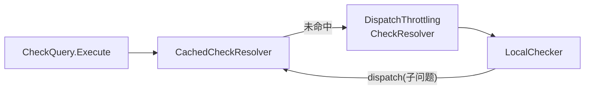

# 第 15 章 Resolver 链：在每个子问题前面插入缓存与限流 ★

> 本章目标：理解 resolver 为什么串成一个**环**；读懂子问题缓存（键怎么构造、什么不能缓存、怎样失效）和按调度次数的限流；在 mini-openfga 里实现同样的链，并证明它们不改变任何答案。
> 前置：第 9–13 章。对应代码：mini-openfga **v0.3** `pkg/check/builder.go`、`cached_resolver.go`、`throttling_resolver.go`、`pkg/cache/lru.go`。

## 15.1 为什么是一个环

第 9 章留下了一个设计：`LocalChecker` 遇到跨对象的子问题时，不调用自己，而是调用 `delegate.ResolveCheck`。`internal/graph/builder.go:73` 的 `Build` 把几个 resolver 串起来：

```go
func (c *CheckResolverOrderedBuilder) Build() (CheckResolver, CheckResolverCloser, error) {
	c.resolvers = []CheckResolver{}
	if c.cachedCheckResolverEnabled {
		cachedCheckResolver, err := NewCachedCheckResolver(c.cachedCheckResolverOptions...)
		...
		c.resolvers = append(c.resolvers, cachedCheckResolver)
	}
	if c.dispatchThrottlingCheckResolverEnabled {
		c.resolvers = append(c.resolvers, NewDispatchThrottlingCheckResolver(c.dispatchThrottlingCheckResolverOptions...))
	}
	if c.shadowResolverEnabled {
		main := NewLocalChecker(c.localCheckerOptions...)
		shadow := NewLocalChecker(c.shadowLocalCheckerOptions...)
		c.resolvers = append(c.resolvers, NewShadowChecker(main, shadow, c.shadowResolverOptions...))
	} else {
		c.resolvers = append(c.resolvers, NewLocalChecker(c.localCheckerOptions...))
	}
	for i, resolver := range c.resolvers {
		if i == len(c.resolvers)-1 {
			resolver.SetDelegate(c.resolvers[0])
			continue
		}
		resolver.SetDelegate(c.resolvers[i+1])
	}
	return c.resolvers[0], c.close, nil
}
```

源码注释说 resolver 要“按资源消耗从低到高”排列：先查缓存（一次 map 查找），再决定是否限流（一个计数器比较），最后才真正求值。最后一个指回第一个：



这个环的效果是：**不只是最初的问题，每一个 dispatch 出来的子问题都会先经过缓存和限流**。`document:1#viewer@user:anne` 和 `document:2#viewer@user:anne` 都在 `folder:x` 里，第一个请求求值过的 `folder:x#viewer@user:anne` 会被第二个请求直接从缓存里拿到。

（computed 关系不经过链，第 9 章说过它直接调用 `c.ResolveCheck`。）

## 15.2 子问题缓存

`internal/graph/cached_resolver.go:136`（删去日志和追踪）：

```go
func (c *CachedCheckResolver) ResolveCheck(ctx context.Context, req *ResolveCheckRequest) (*ResolveCheckResponse, error) {
	tk := req.GetTupleKey()
	cacheKey := storage.CheckCacheKey(req.GetStoreID(), tk.GetObject(), tk.GetRelation(), tk.GetUser(), req.GetInvariantCacheKey())

	tryCache := req.Consistency != openfgav1.ConsistencyPreference_HIGHER_CONSISTENCY
	if tryCache {
		if cachedResp := c.cache.Get(cacheKey); cachedResp != nil {
			res := cachedResp.(*CheckResponseCacheEntry)
			isValid := res.LastModified.After(req.LastCacheInvalidationTime)
			if isValid {
				return res.CheckResponse.clone(), nil
			}
		}
	}

	resp, err := c.delegate.ResolveCheck(ctx, req)
	if err != nil {
		return nil, err
	}
	if resp.GetCycleDetected() {
		// not saving to cache due to cycle
		return resp, nil
	}
	clonedResp := resp.clone()
	c.cache.Set(cacheKey, &CheckResponseCacheEntry{LastModified: time.Now(), CheckResponse: clonedResp},
		storage.JitteredTTL(c.cacheTTL, c.jitterPercentage))
	return resp, nil
}
```

### 15.2.1 键：子问题 + 请求的“不变部分”

`CheckCacheKey`（`pkg/storage/cache.go:312`）由 store、object、relation、user 和一个 `invariant` 哈希组成。后者在请求创建时算一次，被所有子问题共享（`InvariantCacheKey`，:332）：

```go
// InvariantCacheKey hashes the per-request parts of a Check that don't change
// in sub-problems: storeID, modelID, context, and contextual tuples.
func InvariantCacheKey(storeID, modelID string, ctx *structpb.Struct, contextualTuples ...*openfgav1.TupleKey) uint64 {
	...
	builder.EncodeString(storeID)
	builder.EncodeString(modelID)
	sortedTuples := make(tuple.TupleKeys, len(contextualTuples))
	copy(sortedTuples, contextualTuples)
	sort.Sort(sortedTuples)
	...
	value := (*keys.PbValue)(structpb.NewStructValue(ctx))
	builder.Serialize(value)
	...
}
```

为什么这些都要进键：

- **模型 ID**：同一个子问题在不同模型下答案不同；
- **上下文元组**：带上 `group:eng#member@user:anne` 的请求和不带的，答案不同（第 13 章）。先排序，顺序不同的同一组上下文元组得到同一个键；
- **请求 context**：条件求值依赖它（第 14 章）。

### 15.2.2 不能缓存的东西

- **错误**不缓存（`err != nil` 直接返回）；
- **`CycleDetected` 的结果**不缓存。第 12 章说过，“遇到环而得到的 false”取决于**到达这个子问题的路径**：从 a 出发经过 b 再回到 a 时，a 那个节点被判为环；但从别的地方直接问 a，答案可能是 true。如果把路径相关的结果按子问题缓存起来，就会在别的路径上给出错误的 false。这正是第 10 章那些 reducer 要一路传递 `CycleDetected` 标志的原因。

### 15.2.3 什么时候绕过、什么时候失效

- **`HIGHER_CONSISTENCY`**：请求明确要求最新数据时不读缓存（但仍然写缓存）；
- **`LastCacheInvalidationTime`**：缓存条目记录了写入时间 `LastModified`，只有晚于“这个 store 最近一次写入的时间”的条目才有效。这个时间由 cache controller 从 changelog 里得出（第 23 章）；没开 cache controller 时它是零值，缓存只靠 TTL 过期；
- **TTL**：默认 10 秒（`--check-query-cache-ttl`），可以加随机抖动（jitter），避免大量条目同时过期造成的“缓存雪崩”；
- **容量**：LRU，默认 10000 条（`--check-cache-limit`）。

缓存默认是**关闭**的（`--check-query-cache-enabled=false`）。打开它意味着接受“写入后最多 TTL 秒内读到旧答案”。对于“刚把 bob 移出团队，他马上就不能访问了吗？”这种场景，要么用 `HIGHER_CONSISTENCY`，要么打开 cache controller，第 23 章细讲。

OpenFGA 还有另一层缓存：**迭代器缓存**（`--check-iterator-cache-enabled`，`pkg/storage/storagewrappers/cached_datastore.go`），缓存的是存储读取的结果（某个 object#relation 上的元组列表），而不是 Check 的答案。两层缓存互补：子问题缓存命中时连读都不用读；没命中时，迭代器缓存还能省掉一次数据库查询。mini 没有实现迭代器缓存。

## 15.3 按调度次数限流

一个 Check 请求可能展开出成千上万个子问题（一个文档授权给 5000 个组，用户不在任何一个组里，每个组都要查一遍）。这种请求会占满 CPU，拖慢所有其他请求。`DispatchThrottlingCheckResolver`（`internal/graph/dispatch_throttling_check_resolver.go:88`）：

```go
func (r *DispatchThrottlingCheckResolver) ResolveCheck(ctx context.Context, req *ResolveCheckRequest) (*ResolveCheckResponse, error) {
	currentNumDispatch := req.GetRequestMetadata().DispatchCounter.Load()
	shouldThrottle := threshold.ShouldThrottle(ctx, currentNumDispatch, r.config.DefaultThreshold, r.config.MaxThreshold)
	if shouldThrottle {
		req.GetRequestMetadata().DispatchThrottled.Store(true)
		r.throttler.Throttle(ctx)
	}
	return r.delegate.ResolveCheck(ctx, req)
}
```

一个请求的调度次数超过阈值（默认 100）之后，它的每一次 dispatch 都要先等节流器放行。节流器（`internal/throttler/throttler.go:53`）是一个按固定频率（默认每 10 微秒）放出一个“令牌”的 ticker：

```go
func (r *constantRateThrottler) runTicker() {
	for {
		select {
		case <-r.done:
			return
		case <-r.ticker.C:
			r.nonBlockingSend(r.throttlingQueue)
		}
	}
}

func (r *constantRateThrottler) Throttle(ctx context.Context) {
	select {
	case <-ctx.Done():
	case <-r.throttlingQueue:
	}
	...
}
```

对 Check 来说，节流器是**每个请求新建**的：`getCheckResolverOptions`（`pkg/server/server.go:1183`）在每次构建 resolver 链时调用 `graph.WithConstantRateThrottler`（:1202），请求结束时随链一起关闭。所以它限制的是**这一个重请求自己**的调度速率：超过阈值后，它的子问题只能按固定节奏一个一个地派发出去，而没超过阈值的轻量请求完全不受影响。（ListObjects 和 ListUsers 的节流器则是 Server 级别共享的，在 `server.go:1017` 创建一次。）目标不是拒绝重请求，而是让它慢下来，把 CPU 让给其他请求。默认关闭（`--check-dispatch-throttling-enabled`）。

阈值可以按请求调整：`ShouldThrottle` 会读 context 里的阈值，但不超过 `MaxThreshold`。被限流过的请求会在 `CheckResult.DispatchThrottled` 里标记出来，超时时 API 返回一个专门的错误码，提示调用方“不是你的请求有错，是它太重了”。

## 15.4 Shadow resolver

链上还有一个可选的位置：用 `ShadowResolver`（`internal/graph/shadow_resolver.go:47`）替代 `LocalChecker`。它包着两个 LocalChecker（主、影子），主的结果正常返回，影子在后台用不同的配置（比如打开新的优化）再算一遍，结果不一致时记一条日志。这是 OpenFGA 上线新算法的方式：先在生产流量上“影子运行”，确认没有差异再切换。第 31 章会和 mini 的差分测试放在一起讲。

## 15.5 mini-openfga 的实现

### 15.5.1 链

`pkg/check/builder.go`：

```go
// BuildChain composes the resolvers into a ring, like OpenFGA's
// internal/graph/builder.go:
//
//	[CachedCheckResolver]? -> [DispatchThrottlingCheckResolver]? -> LocalChecker -+
//	        ^-------------------------------------------------------------------+
func BuildChain(cfg ChainConfig) (CheckResolver, func()) {
	var resolvers []CheckResolver
	if cfg.CacheEnabled {
		...
		resolvers = append(resolvers, NewCachedCheckResolver(opts...))
	}
	if cfg.ThrottlingEnabled {
		...
		resolvers = append(resolvers, NewDispatchThrottlingCheckResolver(threshold, freq))
	}
	resolvers = append(resolvers, NewLocalChecker(cfg.LocalChecker...))

	for i, r := range resolvers {
		r.SetDelegate(resolvers[(i+1)%len(resolvers)]) // the last one points back to the first
	}
	return resolvers[0], func() {
		for _, r := range resolvers {
			r.Close()
		}
	}
}
```

和 OpenFGA 不同，mini 的链在 Server 创建时构建一次，所有请求共用，因为 mini 没有按 store 开关的特性。

### 15.5.2 缓存

`pkg/cache/lru.go` 是一个约 100 行的泛型 LRU（`container/list` + map + 每条目一个过期时间）。`CachedCheckResolver` 的逻辑与 OpenFGA 逐条对应：

```go
func (c *CachedCheckResolver) ResolveCheck(ctx context.Context, req *Request) (*Response, error) {
	key := CacheKey(req)
	if req.Consistency != HigherConsistency {
		if e, ok := c.cache.Get(key); ok {
			// an entry written before the last write to the store is stale
			if e.lastModified.After(req.LastCacheInvalidationTime) {
				c.Hits.Add(1)
				resp := e.resp
				return &resp, nil
			}
		}
	}
	c.Misses.Add(1)
	resp, err := c.delegate.ResolveCheck(ctx, req)
	if err != nil {
		return nil, err
	}
	// A "false because of a cycle" depends on the path that led here, not
	// only on the key: never cache it.
	if resp.CycleDetected {
		return resp, nil
	}
	c.cache.Set(key, cacheEntry{resp: *resp, lastModified: time.Now()}, c.ttl)
	return resp, nil
}
```

不变部分的哈希用 SHA-256 代替 OpenFGA 的 xxhash，上下文元组同样先排序；`encoding/json` 序列化 map 时按键排序，所以 context 的键顺序不影响结果。

### 15.5.3 限流

阈值比较和常速节流器的结构与 OpenFGA 相同，见 `throttling_resolver.go`。区别是 mini 的链只构建一次，节流器由所有请求共享：超过阈值的请求们一起按这个节奏排队。

## 15.6 运行与验证

**缓存在子问题层面生效**（`pkg/server/server_test.go` 的 `TestCheckCache`）：

```go
check1("document:1", "")
hits := cached.Hits.Load()
check1("document:2", "") // shares the sub-problem folder:x#viewer@user:anne
if cached.Hits.Load() != hits+1 { ... }
r := check1("document:1", "") // whole result cached: no datastore query at all
if r.ResolutionMetadata.DatastoreQueryCount != 0 { ... }
r = check1("document:1", check.HigherConsistency)
if r.ResolutionMetadata.DatastoreQueryCount == 0 { ... } // HIGHER_CONSISTENCY must bypass the cache
```

**限流确实让重请求变慢**（`TestDispatchThrottling`）：阈值 2、每 20 毫秒放行一次，一条 6 层的文件夹链（6 次 dispatch）至少要 40 毫秒，并且 `dispatch_throttled` 被标记。

**两者都不改变答案**：带缓存和限流（阈值 5、每 1 微秒）重跑整个 Check 矩阵：

```bash
cd code/mini-openfga && git checkout v0.3
go test ./internal/matrix/ -run TestMatrixCheckWithCacheAndThrottling -v
```

在 Lab 7 的 Docker 部署里（缓存 TTL 10 秒），跑一遍全部矩阵测试后，指标显示：

```text
minifga_check_cache_hits_total 773
minifga_check_cache_misses_total 1754
```

矩阵测试的每个用例都在一个新 store 里，缓存键包含 store ID，所以这些命中都来自**同一个请求内部**或同一个测试的不同断言之间共享的子问题。

## 15.7 小结

- resolver 串成环，让每个 dispatch 出去的子问题都经过缓存和限流；按资源消耗从低到高排列；
- 子问题缓存的键 = store + 子问题 + 模型、请求 context、排序后的上下文元组的哈希；
- 错误和带环标志的结果不缓存；`HIGHER_CONSISTENCY` 绕过缓存；失效靠 TTL 或 changelog（第 23 章）；
- 调度限流不拒绝请求，而是让超过阈值的请求按固定速率继续，保护其他请求；
- 新算法用 Shadow resolver 在生产流量上对照。

## 15.8 练习

1. （巩固）为什么 OpenFGA 的 resolver 链要在**每个请求**里重新构建（`pkg/server/check.go:166`），而不是像 mini 那样全局一份？（提示：`getCheckResolverBuilder(storeID)` 的参数。）
2. （扩展）给 mini 加一个迭代器缓存：包装 `TupleReader`，缓存 `Read(object, relation)` 和 `ReadUsersetTuples` 的结果，键要包含哪些东西？怎样和 `LastCacheInvalidationTime` 配合？
3. （读源码）OpenFGA 缓存命中时返回 `res.CheckResponse.clone()`（`cached_resolver.go:157` 之后），写入时也存 `resp.clone()`。如果去掉这两个 `clone`，会出现什么问题？

## 15.9 延伸阅读

- `docs/caching.md`：OpenFGA 的缓存说明（子问题缓存、迭代器缓存、cache controller）
- `internal/graph/builder.go`、`internal/throttler/`
- OpenFGA 文档 *Performance* 与 *Production best practices* 中关于 `check-query-cache` 和 `check-dispatch-throttling` 的部分
