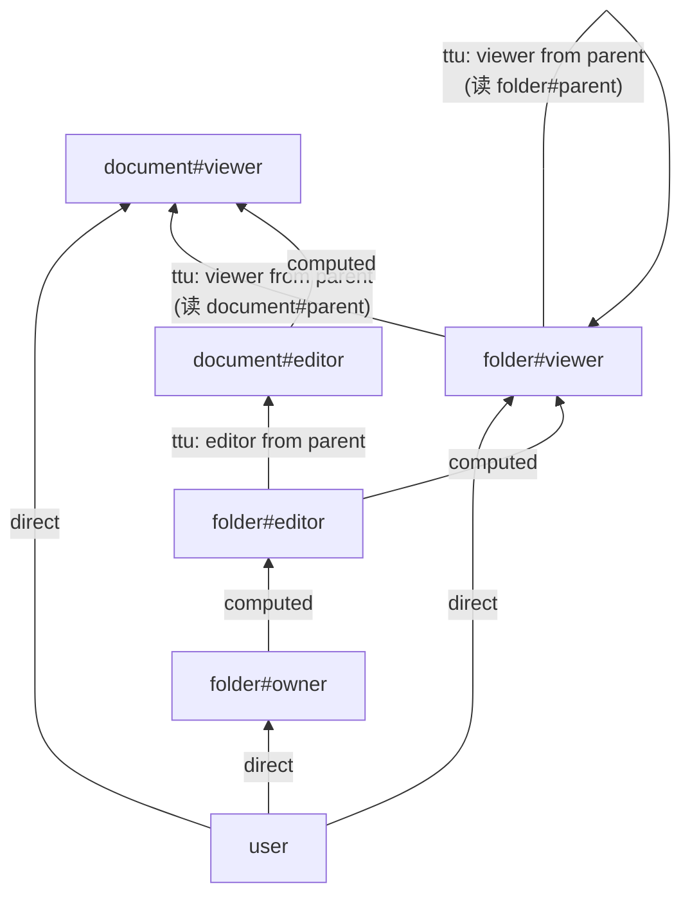
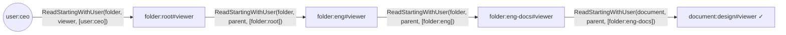

# 第 18 章 ListObjects：沿着授权图反着走 ★★

> 本章目标：理解“列出用户能访问的所有对象”为什么不能用 Check 硬算；读懂 OpenFGA 经典的反向展开（reverse expansion）：模型上的“边”、按用户反查元组、对 `and`/`but not` 下的候选用 Check 复核；实现 mini 的 ListObjects，并在第一次运行时就通过全部 641 条矩阵断言。
> 前置：第 7、11、12 章。对应代码：mini-openfga **v0.4** `pkg/listobjects/edges.go`、`reverse_expand.go`、`listobjects.go`。

## 18.1 问题

“anne 能看哪些文档？”最直接的做法：列出所有 document，逐个 Check。文档有一百万份，就是一百万次 Check，而 anne 可能只能看其中 20 份。

换个方向：**从 anne 出发**。她直接出现在哪些元组里？她所在的组出现在哪些元组里？那些组授权的文件夹下有哪些文档？沿着这条线索走，只会碰到和 anne 有关的数据。这就是**反向展开**。

正向的 Check 问“这个对象的这个关系里有没有这个用户”，按 `object#relation` 读元组；反向展开问“这个用户（或用户集）出现在哪里”，按 user 读元组，用的是第 7 章的第四种读法 `ReadStartingWithUser`。

## 18.2 先在模型上找路，再在数据上走

反向展开分两层：

1. **模型层**：从“用户的类型”到“目标 type#relation”，模型里有哪些路径？每一步是什么类型的边？
2. **数据层**：沿着这些边，用 `ReadStartingWithUser` 找到具体的对象，再从这些对象继续往上走。

以第 3 章云盘模型为例，问 `ListObjects(user:ceo, viewer, document)`。在模型上，`user` 可以通过这些边到达 `document#viewer`：



在数据上，从 `user:ceo` 出发：



每一步得到一个新的 userset（`folder:root#viewer`、`folder:eng#viewer`……），再以它为新的“用户”继续反查。当某一步得到的 userset 正好是目标 `document:X#viewer` 时，`document:X` 就是一个结果。

## 18.3 模型层：RelationshipEdge

OpenFGA 用 `internal/graph/graph.go` 计算模型上的边（`GetPrunedRelationshipEdges`，:134）。一条边（`RelationshipEdge`，:76）有三种类型：

| 类型 | 含义 | 下一步怎么读 |
|---|---|---|
| `DirectEdge` | 目标关系的类型限制直接允许这种用户（`[user]`、`[user:*]`、`[group#member]`） | `ReadStartingWithUser(目标类型, 目标关系, [用户])` |
| `TupleToUsersetEdge` | 目标关系是 `X from parent`，用户是父类型上的 `X` | `ReadStartingWithUser(目标类型, parent, [父对象])` |
| `ComputedUsersetEdge` | 目标关系是 `define viewer: editor`，用户是同一类型上的 `editor` | 不读存储，把用户改写成同一对象上的 `viewer` |

边的计算（`getRelationshipEdgesWithTargetRewrite`，:166）按重写规则递归：

- `This`：如果类型限制允许这种 source，加一条 `DirectEdge`；类型限制里的每个 userset（`group#member`）还要**递归**问“source 怎样到达 `group#member`”；
- `ComputedUserset`：如果 source 正好是被引用的关系，加一条 `ComputedUsersetEdge`；然后递归到被引用的关系；
- `TupleToUserset`：对 tupleset 允许的每种父类型，如果 source 正好是父类型上的被计算关系，加一条 `TupleToUsersetEdge`；然后递归到父类型上的被计算关系；
- `Union`：所有子节点的边的并集；
- `Intersection`：**只取第一个子节点**的边，并把它们标记为 `TargetReferenceInvolvesIntersectionOrExclusion = true`；
- `Difference`：**只取 base** 的边，同样标记。

最后两条是“剪枝”（pruned）的含义。`a and b` 的结果一定是 `a` 的子集，所以从 `a` 出发找到的对象是**候选**，覆盖了所有可能的结果，但不一定都对；`a but not b` 同理。被标记的边上得到的对象，必须再用 Check 确认。用一个 `visited` 集合防止在模型的环上无限递归。

## 18.4 数据层：ReverseExpandQuery

`pkg/server/commands/reverseexpand/reverse_expand.go` 的 `execute`（:306）处理一个“用户”：

```go
if userset, ok := req.User.(*UserRefObjectRelation); ok {
	...
	if req.edge != nil {
		key := fmt.Sprintf("%s#%s", sourceUserObj, req.edge.String())
		if _, loaded := c.visitedUsersetsMap.LoadOrStore(key, struct{}{}); loaded {
			return nil
		}
	}
	if tuple.UsersetMatchTypeAndRelation(userset.String(), req.Relation, req.ObjectType) {
		c.trySendCandidate(ctx, intersectionOrExclusionInPreviousEdges, sourceUserObj, resultChan)
	}
}
```

用户有三种形态（:74 起）：`UserRefObject`（`user:anne`）、`UserRefTypedWildcard`（`user:*`）、`UserRefObjectRelation`（`group:eng#member`、`folder:root#viewer`）。展开过程中产生的都是第三种。对 userset 有两个检查：

1. **防环**：同一个 userset 沿同一条边来过，就不再处理（`visitedUsersetsMap`）。数据里的环（a 组包含 b 组、b 组包含 a 组）在这里被截断；
2. **命中目标**：userset 的类型和关系正好是要找的 `document#viewer`，就把它的对象作为候选发出去。

然后计算从这个用户到目标的边，按边的类型分别处理（:306 起）：

```go
for _, edge := range edges {
	innerLoopEdge := edge
	intersectionOrExclusionInPreviousEdges := intersectionOrExclusionInPreviousEdges || innerLoopEdge.TargetReferenceInvolvesIntersectionOrExclusion
	r := &ReverseExpandRequest{..., edge: innerLoopEdge, ...}
	switch innerLoopEdge.Type {
	case graph.DirectEdge:
		pool.Go(func(ctx context.Context) error {
			return c.reverseExpandDirect(ctx, r, resultChan, intersectionOrExclusionInPreviousEdges, resolutionMetadata)
		})
	case graph.ComputedUsersetEdge:
		r.User = &UserRefObjectRelation{ObjectRelation: &openfgav1.ObjectRelation{
			Object:   sourceUserObj,
			Relation: innerLoopEdge.TargetReference.GetRelation(),
		}}
		err = c.dispatch(ctx, r, resultChan, intersectionOrExclusionInPreviousEdges, resolutionMetadata)
		...
	case graph.TupleToUsersetEdge:
		pool.Go(func(ctx context.Context) error {
			return c.reverseExpandTupleToUserset(ctx, r, resultChan, intersectionOrExclusionInPreviousEdges, resolutionMetadata)
		})
	}
}
```

“是否经过了 `and`/`but not`”这个标志沿路径累积：一旦经过，之后找到的所有对象都需要复核。

`readTuplesAndExecute`（:551）是读存储的地方：

```go
switch req.edge.Type {
case graph.DirectEdge:
	relationFilter = req.edge.TargetReference.GetRelation()
	targetUserObjectType := req.User.GetObjectType()
	publiclyAssignable, err := c.shouldCheckPublicAssignable(req.edge.TargetReference, req.User)
	...
	if publiclyAssignable {
		userFilter = append(userFilter, &openfgav1.ObjectRelation{Object: tuple.TypedPublicWildcard(targetUserObjectType)})
	}
	if val, ok := req.User.(*UserRefObject); ok {
		userFilter = append(userFilter, &openfgav1.ObjectRelation{Object: tuple.BuildObject(val.Object.GetType(), val.Object.GetId())})
	}
	if val, ok := req.User.(*UserRefObjectRelation); ok {
		userFilter = append(userFilter, val.ObjectRelation)
	}
case graph.TupleToUsersetEdge:
	relationFilter = req.edge.TuplesetRelation
	if val, ok := req.User.(*UserRefObjectRelation); ok {
		userFilter = append(userFilter, &openfgav1.ObjectRelation{Object: val.ObjectRelation.GetObject()})
	}
	...
}
iter, err := c.datastore.ReadStartingWithUser(ctx, req.StoreID, storage.ReadStartingWithUserFilter{
	ObjectType: req.edge.TargetReference.GetType(),
	Relation:   relationFilter,
	UserFilter: userFilter,
}, ...)
```

注意通配符：查 anne 能看什么时，不仅要找 `document:X#viewer@user:anne`，还要找 `document:X#viewer@user:*`，所以如果目标关系允许 `user:*`，`user:*` 也加进反查的用户列表。

读到的每条元组先过滤不合法的、求值条件（求值出错时记下错误、继续），然后以 `元组的对象#新关系` 作为新的 userset 继续 dispatch：直接边的新关系是元组的关系，TTU 边的新关系是目标关系。例如沿 `viewer from parent` 读到 `document:design#parent@folder:eng-docs`，下一个 userset 就是 `document:design#viewer`，它命中目标，于是 `document:design` 成为候选。

`trySendCandidate`（:704）用一个 map 保证每个对象只发一次，并带上“是否需要复核”的标志。

## 18.5 ListObjectsQuery：收集候选、复核、限制

`pkg/server/commands/list_objects.go` 的 `evaluate`（:314）在一个 goroutine 里运行反向展开，主循环消费候选：

```go
case res, channelOpen := <-reverseExpandResultsChan:
	...
	if (maxResults != 0) && objectsFound.Load() >= maxResults {
		cancel() // cancel any inflight work if we already found enough results
		break ConsumerReadLoop
	}
	if res.ResultStatus == reverseexpand.NoFurtherEvalStatus {
		trySendObject(ctx, res.Object, &objectsFound, maxResults, resultsChan)
		continue
	}
	pool.Go(func(ctx context.Context) error {
		resp, err := NewCheckCommand(q.datastore, q.checkResolver, typesys, ...).
			Execute(ctx, &CheckCommandParams{
				StoreID:  req.GetStoreId(),
				TupleKey: tuple.NewCheckRequestTupleKey(res.Object, req.GetRelation(), req.GetUser()),
				...
			})
		...
		if resp.Allowed {
			trySendObject(ctx, res.Object, &objectsFound, maxResults, resultsChan)
		}
		return nil
	})
```

- 不需要复核的候选直接算结果；需要复核的，用**完整的 Check**（第 3 章那条链）确认；
- 找够 `maxResults`（默认 1000，`--listObjects-max-results`）就取消剩下的工作；
- 整个查询有一个截止时间（默认 3 秒，`--listObjects-deadline`）。**到截止时间时返回已经找到的部分结果，而不是报错**。这是 ListObjects 和 Check 的一个重要区别：Check 超时是错误，ListObjects 超时返回不完整的列表。调用方要知道这一点。

## 18.6 一个重要的背景：v1.22 默认走流水线

本章讲的是 OpenFGA **经典**的反向展开。在 v1.22 里，当模型的带权图存在、用户是一个具体对象（不是 userset，也不是 `*`）、并且流水线是开启的（`--listObjects-pipeline-enabled` 默认为 true，实验特性 `pipeline_list_objects` 也在默认的实验特性列表里）时，`Execute`（:576）会改走一个基于带权图的**流水线**实现（`internal/listobjects/pipeline/`，第 19 章）。经典实现仍然用于 userset 和通配符作为用户的查询，以及关闭流水线的部署。

两者对正常请求的结果相同（本章 18.8 节的对照就是和流水线比的）。第 19 章会讲一个在“条件缺参数”时两者行为不同的地方。

## 18.7 mini-openfga 的实现

### 18.7.1 边

`pkg/listobjects/edges.go` 是 `graph.go` 的移植，约 150 行。一个细节：OpenFGA 对 `This` 的判断是 `directlyRelated || publiclyAssignable`，当 source 本身是通配符（`user:*`）时，“直接相关”只匹配 `[user:*]`。mini 的 `IsDirectlyRelated` 不处理通配符，所以单独写了出来：

```go
case model.This: // define viewer: [user, group#member]
	var res []*Edge
	// OpenFGA: directlyRelated || publiclyAssignable; a wildcard source
	// (user:*) is only directly related to a [user:*] restriction.
	directly := ts.IsDirectlyRelated(target.Type, target.Relation, source.Type, source.Relation)
	if source.Wildcard {
		directly = ts.IsPubliclyAssignable(target.Type, target.Relation, source.Type)
	}
	if directly || ts.IsPubliclyAssignable(target.Type, target.Relation, source.Type) {
		res = append(res, &Edge{Type: DirectEdge, Target: target})
	}
	for _, ref := range ts.DirectTypes(target.Type, target.Relation) {
		if ref.Relation != "" { // [group#member]: how does source reach group#member?
			sub, err := edges(ts, model.RelationRef{Type: ref.Type, Relation: ref.Relation}, source, visited)
			...
			res = append(res, sub...)
		}
	}
	return res, nil
...
case model.Intersection, model.Difference:
	// first operand of `and`, base of `but not`
	sub, err := rewriteEdges(ts, target, source, rw.Children[0], visited)
	...
	for _, e := range sub {
		e.InvolvesIntersectionOrExclusion = true
	}
	return sub, nil
```

“经过 TTU 到达的关系本身是否包含 `and`/`but not`”需要一个 TypeSystem 的辅助函数 `RelationInvolvesIntersectionOrExclusion`（移植自 OpenFGA 的 `relationInvolves`）。

### 18.7.2 反向展开

`pkg/listobjects/reverse_expand.go` 约 220 行，结构和 OpenFGA 一致：`execute` 处理一个 `UserRef`（防环、命中目标、计算边、按边类型分派），`readTuplesAndExecute` 调用 `ReadStartingWithUser`、过滤、求值条件、对每条元组并发地继续展开，`trySendCandidate` 去重。为了简单，mini 在每次读取后把迭代器读完（`storage.Collect`），没有流式处理。

### 18.7.3 ListObjects

`pkg/listobjects/listobjects.go`：一个 goroutine 跑反向展开，主循环消费候选；需要复核的交给调用方传进来的 `CheckFunc`（Server 传入的是它自己的 `Check` 方法）；达到 `MaxResults` 就 `cancel()`；截止时间到了返回部分结果：

```go
err := errors.Join(<-expandErr, checkErr)
// When we stopped on purpose (max results) or hit the deadline, the
// errors are cancellations: return the partial result instead.
if err != nil && ctx.Err() == nil {
	return nil, err
}
```

Server 层负责校验：类型不存在 2021、关系不存在 2022、用户不合法 2000，上下文元组按写入校验。

## 18.8 运行与验证

用第 3 章的云盘数据分别请求 OpenFGA（v1.22，默认走流水线）和 mini-openfga：

| ListObjects | OpenFGA | mini |
|---|---|---|
| `user:ceo viewer folder` | folder:eng, folder:eng-docs, folder:root | 相同 |
| `user:ceo viewer document` | document:design | 相同 |
| `user:alice editor folder` | folder:eng, folder:eng-docs | 相同 |
| `user:dave can_view document` | （空） | 相同：document:design 是候选，经过 `but not`，复核为 false |
| `user:bob can_share document` | document:design | 相同：经过 `and`，复核为 true |

命令行：

```bash
cd code/mini-openfga && git checkout v0.4
go run ./cmd/minifga list-objects -model examples/drive/model.fga -tuples examples/drive/tuples.txt user:ceo viewer folder
```

```json
{
  "objects": [
    "folder:eng",
    "folder:eng-docs",
    "folder:root"
  ]
}
```

矩阵测试：

```bash
go run ./cmd/minifga matrix -api ListObjects
```

```text
ListObjects  assertions: 641 passed, 0 failed, 0 skipped (100.0%); tests: 255/255 fully passed
```

这是 v0.4 第一次运行矩阵时的结果，没有任何调试。原因是移植时没有自作主张：边的计算、标志的累积、防环的键、通配符的反查，全部照搬，而复核用的是已经被 939 条断言验证过的 Check。

## 18.9 小结

- ListObjects 从用户出发反着走：先在模型上找边，再用 `ReadStartingWithUser` 在数据上一步步找到对象；
- 三种边：直接（读目标关系）、TTU（读 tupleset 找子对象）、computed（不读存储，改写关系）；
- `and`/`but not` 只沿第一个操作数/base 走，得到的是候选，必须用 Check 复核；
- 防环以“userset + 边”为键；结果按对象去重；
- 达到上限或截止时间就停止，返回部分结果。

## 18.10 练习

1. （巩固）手工推导 `ListObjects(user:alice, editor, document)` 在云盘数据上的展开过程，列出每一步的 `ReadStartingWithUser` 参数。
2. （扩展）mini 的 `readTuplesAndExecute` 把迭代器一次读完。改成流式处理，并在达到 `MaxResults` 后停止读取。用一个有 10 万份文档的文件夹测一测差别。
3. （读源码）OpenFGA 的 `GetRelationshipEdges`（:114）和 `GetPrunedRelationshipEdges`（:134）有什么区别？在非测试代码里搜索一下，哪里用到了非剪枝的版本？

## 18.11 延伸阅读

- `docs/list_objects/example/example.md`：OpenFGA 官方的反向展开示例
- Zanzibar 论文没有 ListObjects，相关讨论可以看 *Leopard indexing*（论文 3.2.4 节）
- `pkg/server/commands/reverseexpand/reverse_expand_test.go`
