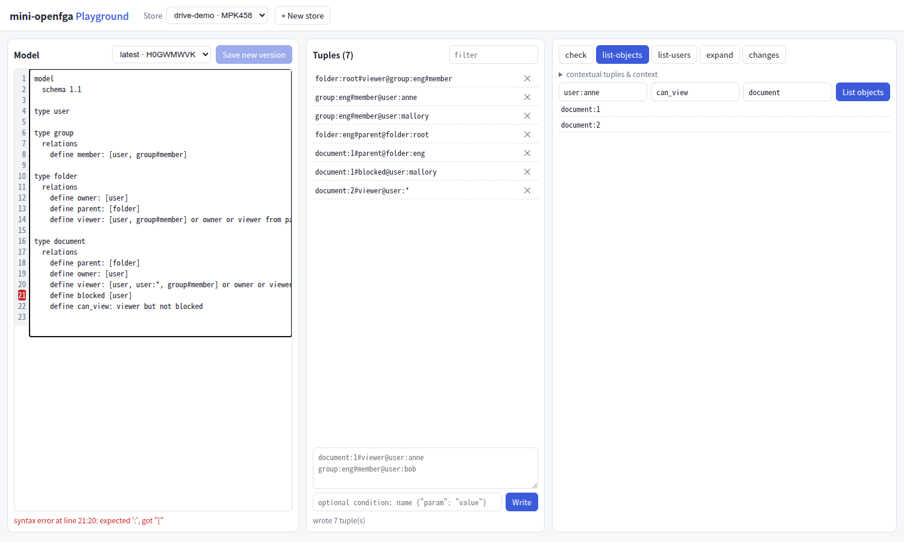
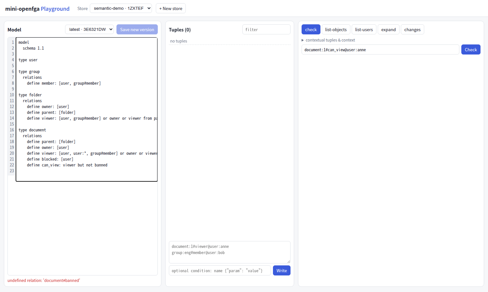

# 第 25 章 Playground（上）：模型编辑器与元组管理

> 本章目标：理解授权 Playground 解决什么问题、OpenFGA 自带的 Playground 是什么；搭起 mini 的前端：Vite + React + TypeScript、打包进 Go 二进制、开发时代理；实现模型编辑器（边输入边校验、版本列表）和元组面板；记录两处在浏览器里才发现的问题和修复。
> 前置：第 4、5、22–24 章。对应代码：mini-openfga **v0.6** `web/`（v1.0 修复了分页和语义校验）。

## 25.1 为什么需要 Playground

授权模型的错误很少是语法错误，更多是“写出来的规则和心里想的不一样”：`viewer from parent` 漏了一层、`but not` 放错了位置、通配符让所有人都能看到。发现这类错误最快的办法是：改一行模型，写几条元组，立刻 Check，看结果和**为什么**是这个结果。

这就是 Playground 的用途：

- 编辑模型，即时发现语法和语义错误；
- 管理元组；
- 运行 Check / ListObjects / ListUsers / Expand，**看到求值过程**（第 26 章）；
- 用断言把“我期望的行为”固定下来（第 23 章）。

## 25.2 OpenFGA 的 Playground

OpenFGA 的 Playground 是一个独立的托管产品（play.fga.dev），不在这个仓库里。`openfga run --playground-enabled` 可以在本地 3000 端口提供一个“本地 Playground”（默认关闭，`config.go:931`），但它只是一个嵌入托管版本的页面，`assets/playground/index.html` 的全部内容就是一个 iframe：

```html
<iframe title="Embedded Playground"
  src="https://play.fga.dev/sandbox/?fga_api_host={{.HTTPServerURL}}&fga_api_scheme=http&fga_api_token={{.PlaygroundAPIToken}}" ...></iframe>
```

托管的页面在浏览器里运行，通过 URL 参数拿到本地 API 的地址，直接调用你本机的 OpenFGA。`runPlaygroundServer`（`cmd/run/run.go:844`）渲染这个模板，并在启动时打出一行警告：内置 Playground 已经弃用，将在后续版本中移除（`config.go:272` 的 `Deprecated` 注释也这样写）。

读这段代码时有一个小发现：函数开头要求认证方式必须是 `none`，否则直接返回错误（:851）；可是后面又有一段“如果认证方式是 `preshared`，就把第一个密钥作为令牌传给页面”的代码（:881），它永远不会被执行。这是演进中留下的死代码，不影响行为。

## 25.3 mini 的前端：结构与打包

`web/` 是一个最小的 Vite + React + TypeScript 项目，没有 UI 库，没有状态管理库，约 900 行（含 CSS）：

| 文件 | 内容 |
|---|---|
| `src/api.ts` | 薄 API 客户端：OpenFGA 兼容路由 + mini 独有的 `/dsl/parse`、`/explain` |
| `src/App.tsx` | 顶栏（选择/新建 store）+ 三栏布局 |
| `src/ModelEditor.tsx` | 模型编辑器 |
| `src/TuplesPanel.tsx` | 元组列表、写入、删除 |
| `src/QueryPanel.tsx` | 查询面板与解析树（第 26 章） |
| `embed.go` | 把构建产物嵌入 Go 二进制 |

**打包进二进制**。`web/embed.go` 用 `//go:embed all:dist` 嵌入 `npm run build` 的产物，`minifga serve` 把它挂在 `/playground/` 下：

```go
//go:embed all:dist
var dist embed.FS

// Handler serves the Playground under prefix (e.g. "/playground/").
func Handler(prefix string) http.Handler {
	sub, _ := fs.Sub(dist, "dist")
	files := http.FileServer(http.FS(sub))
	return http.StripPrefix(strings.TrimSuffix(prefix, "/"), http.HandlerFunc(func(w http.ResponseWriter, r *http.Request) {
		if _, err := fs.Stat(sub, strings.TrimPrefix(r.URL.Path, "/")); err != nil {
			r.URL.Path = "/" // unknown path: let the single-page app handle it
		}
		files.ServeHTTP(w, r)
	}))
}
```

`dist/` 提交在仓库里，所以只有 Go 工具链的读者也能直接 `go build` 得到带界面的服务。改前端的人需要 Node，构建后提交新的 `dist/`。

> **踩坑**：“提交在仓库里”这句话，在写 Lab 6 之前其实不成立。为了跑 Lab 6，我从 v0.6 标签检出一份干净的代码，`go build` 立刻失败：`web/embed.go:12:12: pattern all:dist: no matching files found`。原因是根目录 `.gitignore` 里为 `./dist/minifga` 二进制写的 `dist/`，同时匹配了 `web/dist/`，构建产物从来没有被提交。我自己的所有测试都通过，是因为我的工作目录里一直有构建好的 `web/dist`；Docker 部署也通过，因为 Dockerfile 的 Node 阶段会重新构建前端。修复：把规则改成 `/dist/`（只匹配根目录），提交构建产物，并重建了 v0.6 之后的提交历史，让 v0.6 和 v1.0 两个标签都能在干净的克隆里构建（已验证：`go build ./...` 和 `go test ./...` 均通过）。
>
> 同一次检查还发现：这台机器的全局 git 配置是 `core.autocrlf=true`，新检出的文件是 CRLF 换行，`examples/lab5/load.sh` 运行时报 `/usr/bin/env: 'bash\r': No such file or directory`。仓库加了 `.gitattributes`（`* text=auto eol=lf`），无论客户端怎样配置，检出的文本文件都是 LF。
>
> 教训：**“在我的机器上能跑”要用一份干净的克隆来验证**。

**同源**。页面和 API 由同一个服务提供，浏览器请求 `/stores/...` 不跨域，不需要 CORS。开发时 Vite 在 5173 端口，`vite.config.ts` 把 API 路径代理到 `minifga serve`：

```ts
export default defineConfig({
  base: '/playground/',
  plugins: [react()],
  server: {
    port: 5173,
    proxy: { '/stores': api, '/dsl': api, '/healthz': api },
  },
})
```

**认证**。服务开启预共享密钥（第 29 章）时，`api.ts` 遇到 401 会弹窗要一次密钥，存进 `localStorage`，之后每个请求带 `Authorization: Bearer`。读写 `localStorage` 都包在 `try/catch` 里：隐私模式下它可能抛异常，这时密钥只对本次请求有效。

**刷新**。三个面板共享一个 `version` 计数器：任何写操作（保存模型、写/删元组）后加一，各面板的 `useEffect` 依赖它重新加载。比引入状态管理库简单，对这个规模足够。

## 25.4 模型编辑器

`ModelEditor.tsx` 是一个带行号的 `<textarea>`：

- **边输入边校验**：每次输入后等 300 毫秒（防抖），把 DSL 发给 `POST /dsl/parse`。语法错误的响应带 `line`/`column`，行号栏把那一行标红；
- **保存即新版本**：按钮叫 “Save new version” 而不是 “Save”，因为模型不可修改（第 22 章）。下拉框按从新到旧列出所有版本，选中一个旧版本会把它的 DSL 载入编辑器；
- **模型以 DSL 显示**：API 返回的模型带一个 mini 独有的 `dsl` 字段，由 `model.Model.DSL()` 从 JSON 结构**重新生成**。所以编辑器里看到的永远是格式化后的版本，自己的缩进和注释不会保留，和 `fga model transform` 的行为类似。



*图 25-1：把 `define blocked: [user]` 改成 `define blocked [user]`，状态栏显示 `syntax error at line 21:20: expected ':', got "["`。*

### 25.4.1 踩坑：语法正确不等于模型正确

最初 `/dsl/parse` 只调用解析器（第 4 章）。写本章时试了一个模型：

```text
define viewer: [user] or editor
```

`editor` 没有定义。解析器接受它（语法没错），编辑器显示 “syntax OK”，Save 按钮可用；点了 Save 才看到 `undefined relation: 'document#editor'`。这是第 4 章和第 5 章的分界：**解析器只管形式，类型系统管含义**。模型里最常见的错误恰恰是后一类（拼错关系名、TTU 的 tupleset 不是直接关系、没有入口的关系……）。

修复：`/dsl/parse` 在解析成功后再跑一遍保存时的校验（`server.ValidateModel`，和 `WriteAuthorizationModel` 用的是同一个 `compile` 函数），语义错误也作为 400 返回，只是没有行号：

```go
// Syntax is not enough: `viewer: [user] or editor` parses, but saving it
// fails with "undefined relation". Run the save-time validation too, so
// the editor can report it while typing.
if err := server.ValidateModel(m); err != nil {
	writeJSON(w, http.StatusBadRequest, map[string]any{"code": "invalid_authorization_model", "message": err.Error()})
	return
}
```



*图 25-2：把 `but not blocked` 改成 `but not banned`，编辑器立刻显示 `undefined relation: 'document#banned'`，Save new version 不可点。*

## 25.5 元组面板

`TuplesPanel.tsx`：

- 文本框里每行一条 `object#relation@user`（和 CLI、本书的写法一致），以 `#` 开头的行是注释；
- 可选的条件输入 `name {"param": value}`，附加到这一批的每条元组上；
- 一次 Write 写入所有行（第 22 章：一个事务，最多 100 条）；
- 每条元组后面的 × 发送一个只含 `deletes` 的 Write；
- 过滤框按子串过滤。

### 25.5.1 踩坑：只读了第一页

这个问题是在浏览器里看到的。为了验证面板在数据较多时的表现，往一个 store 写了 150 条元组，用无头 Chrome 打开页面：

```text
panel heading: Tuples (100)
rows shown: 100
document:149 visible: false
changes shown: 100 | first: WRITE document:99#viewer@user:u99 | last: WRITE document:0#viewer@user:u0
```

两个问题：

1. 元组面板只发了一次 `Read`（`page_size: 100`），却把这一页的长度当作 store 的元组总数显示；
2. 第 26 章的 changes 标签页也只读了一页。ReadChanges 按时间**从旧到新**返回（第 23 章），界面把这一页倒过来显示，看上去是“最新在上”，实际上**最近的 50 条变更根本没有出现**，而调试时最想看的正是最近的变更。

修复：`api.ts` 增加一个按续读令牌翻页的函数，带上限，防止一个巨大的 store 让页面卡住：

```ts
// pages follows continuation tokens until the end, or until max items.
// A single page is not enough: Read and ReadChanges return at most
// page_size items, and ReadChanges returns the oldest first.
async function pages<T>(
  fetchPage: (token: string) => Promise<{ items: T[]; token: string }>,
  max: number,
): Promise<Paged<T>> {
  const items: T[] = []
  let token = ''
  for (;;) {
    const page = await fetchPage(token)
    items.push(...page.items)
    // end: no token (Read), or no items / the same token back (ReadChanges)
    if (!page.token || page.token === token || page.items.length === 0) return { items, complete: true }
    if (items.length >= max) return { items, complete: false }
    token = page.token
  }
}
```

注意结束条件有两种：Read 读完时返回空令牌；ReadChanges 读到末尾时返回**同一个令牌**和空列表（第 23 章）。元组最多加载 1000 条，超过时标题显示 `Tuples (1000+)`；变更最多加载 10000 条，显示最新的 100 条。修复后：

```text
panel heading: Tuples (150)
rows shown: 150
document:149 visible: true
changes header: newest 100 of 150 changes
changes shown: 100 | first: WRITE document:149#viewer@user:u149 | last: WRITE document:50#viewer@user:u50
```

再写一个 1100 条元组的 store，标题是 `Tuples (1000+)`，加载了 1000 行。

这两个问题和第 21 章的 `ORDER BY` 一样，所有测试都通过，只有换一种方式使用（更多的数据、真实的浏览器）才暴露出来。

## 25.6 运行与验证

```bash
cd code/mini-openfga && git checkout v1.0
go build -o dist/minifga ./cmd/minifga
./dist/minifga serve -addr 127.0.0.1:8080
# 浏览器打开 http://127.0.0.1:8080/playground/
```

改前端时：

```bash
cd web && npm install && npm run dev      # http://localhost:5173/playground/，API 代理到 :8080
npm run build                             # 更新 web/dist，再 go build
```

本书的截图都由一个 Playwright 脚本驱动无头 Chrome 生成：新建 store、写入 7 条元组、Check、ListObjects、制造语法错误。脚本在 v1.0 上的输出：

```text
anne: ALLOWED3 dispatches · 16 datastore queries
mallory: DENIED0 dispatches · 1 datastore queries
anne can_view: document:1, document:2
HTTP 400 POST /dsl/parse
syntax: syntax error at line 21:20: expected ':', got "["
```

唯一的 HTTP 错误是故意制造的语法错误对应的 `/dsl/parse` 400，浏览器控制台没有其他错误。

## 25.7 小结

- Playground 的价值是缩短“改模型 → 看结果 → 理解原因”的循环；OpenFGA 的本地 Playground 只是嵌入托管版的 iframe，并且已弃用；
- mini 的前端是一个约 900 行的 Vite + React 应用，构建产物嵌入 Go 二进制，与 API 同源；
- 编辑器边输入边校验，校验要同时覆盖语法和语义；
- 列表类 API 都是分页的，客户端要跟随续读令牌，并在截断时如实告诉用户。

## 25.8 练习

1. （巩固）为什么编辑器里显示的 DSL 不保留你的注释？如果要保留，模型需要以什么形式存储？OpenFGA 的 `WriteAuthorizationModel` 能做到吗？
2. （扩展）语义错误目前没有行号。给 `ValidateModel` 的错误加上“类型名 + 关系名”，在前端根据它们在 DSL 里找到 `define <relation>` 所在的行并标红。
3. （读源码）`openfga run` 的 `--playground-enabled` 默认是什么？`runPlaygroundServer` 为什么要先 `net.Dial` 一次 HTTP 地址（带指数退避）？

## 25.9 延伸阅读

- OpenFGA Playground：<https://play.fga.dev>
- OpenFGA 文档 *Modeling Guides*：常见的建模错误
- Vite 文档：`server.proxy` 与 `base`
