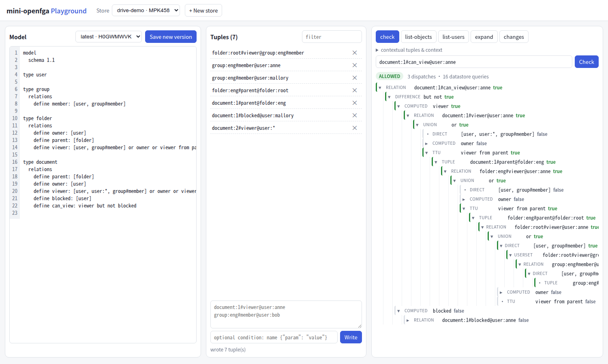
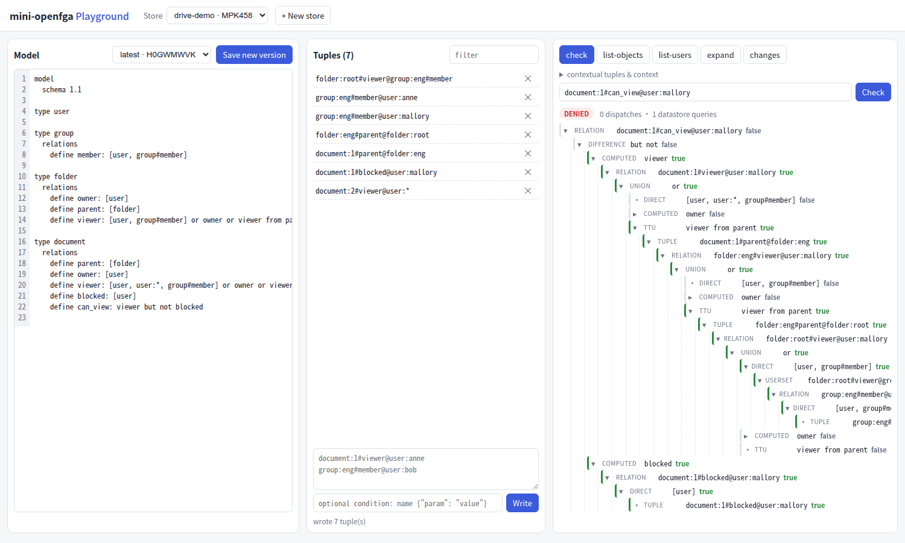

# 第 26 章 Playground（下）：查询面板与解析树

> 本章目标：回答“为什么是这个结果”。了解 OpenFGA 在这方面提供了什么（Expand、追踪），以及为什么 mini 要另写一个 Explainer；理解它“不短路、记录每一步”的设计和代价，以及怎样用矩阵测试保证它和 Check 永远一致；学会读解析树。
> 前置：第 9–12、16 章，第 25 章。对应代码：mini-openfga **v0.6** `pkg/check/explain.go`、`web/src/QueryPanel.tsx`、`internal/matrix/explain_test.go`。

## 26.1 “为什么”这个问题

Check 只回答 `allowed: true/false`。调试授权问题时真正需要的是：

- 为 true 时：**通过哪条路径**得到的权限？（比如“alice 能看是因为她是 eng 文件夹的 editor”）
- 为 false 时：**每一条可能的路径分别断在哪里**？或者是哪条 `but not` 把它排除了？

OpenFGA 在这方面提供的东西：

- **Expand**（第 16 章）：展开一个 `object#relation` 的**一层**用户集合树。要看完整路径，需要调用方自己沿着叶子上的 userset 和 TTU 继续调用；而且它不针对某个具体用户，也不求值条件和排除；
- **OpenTelemetry 追踪**（第 30 章）：每次分派、每次存储查询都是一个 span，可以在 Jaeger 里看到一次 Check 的调用树。它面向运维，而且受采样率影响；
- `CheckResponse` 里有一个 `resolution` 字段，protobuf 注释写着 “For internal use only”，服务端代码里没有任何地方给它赋值；
- 对应地，`CheckRequest` 里有一个 `trace` 字段，注释是 “Defaults to false. Making it true has performance implications.”，但服务端代码里没有任何地方读取它（`GetTrace()` 没有调用者）。写第 30 章时在 OpenFGA 的请求日志里看到了 `"trace": false`，于是专门试了一下：对云盘数据的同一个 Check，`"trace": false` 和 `"trace": true` 的响应都是 `{"allowed":true,"resolution":""}`。这两个字段看起来是早期为解释功能预留的接口。

所以 OpenFGA 本身**没有“解释一次 Check”的 API**。托管的 Playground 有可视化功能，但不在这个仓库里。mini 为 Playground 加了一个：`POST /stores/{id}/explain`。

## 26.2 Explainer：第二个求值器

最直接的想法是在 `LocalChecker` 里加记录。但 LocalChecker 是为速度设计的：并发执行、短路、取消。union 里第一个 true 返回后，其他分支被取消，记录下来的树取决于调度，每次都可能不同（第 10 章，Lab 5 里同一个 Check 一次 5 次分派、一次 7 次）。这样的树用来解释并不合适。

所以 `pkg/check/explain.go` 是一个**独立的、顺序的求值器**：

```go
// Explainer evaluates a check sequentially and records every step. It does
// not short-circuit, so the tree shows all the ways access is (not) granted;
// the result follows the same rules as LocalChecker. mini-openfga only:
// OpenFGA exposes Expand, which shows one level of the model, and traces
// via OpenTelemetry, but no per-check explanation API.
```

每个节点是一个 `TraceNode{Kind, Label, Result, Error, Children}`，`Result` 是 `true`、`false`、`cycle`、`error` 之一。集合运算先算出**所有**子节点，再按和 LocalChecker 相同的规则合并（第 10–12 章）：

```go
// butNot: exclusion semantics.
func butNot(base, sub *TraceNode) (string, string) {
	if base.Result == resFalse || base.Result == resCycle || sub.Result == resTrue || sub.Result == resCycle {
		return resFalse, ""
	}
	if base.Result == resError {
		return resError, base.Error
	}
	if sub.Result == resError {
		return resError, sub.Error
	}
	return resTrue, ""
}
```

`anyOf`（union）：有 true 就是 true，否则有错误就是错误，否则有环就是环；`allOf`（intersection）：有 false 或环就是 false，否则有错误就是错误。条件错误按 OpenFGA 的“只要有一条可用就忽略错误”的规则处理（第 7 章的 `readGroup`）。

**代价**。不短路、不缓存，意味着同一个子问题可能被求值多次，节点数可能很大。下面 dave 的例子完整展开有 107 行，`folder:eng#editor@user:dave` 被求值了三次。用 `MaxTraceNodes = 5000` 限制树的大小，深度限制和 Check 一样是 25。它只用于交互式调试，不用于生产路径。

### 26.2.1 两个求值器怎样保持一致

两份实现最大的风险是**语义漂移**：Check 说 true，解释树说 false。mini 的做法是让 Explainer 也接受矩阵测试的约束：`internal/matrix/explain_test.go` 定义了一个 `explainClient`，它的 `Check` 方法调用 Explain，取根节点的结果：

```go
// explainClient answers Check with the Playground's Explain endpoint, so
// the explanation tree is held to the same matrix as Check itself.
type explainClient struct{ Local }

func (e explainClient) Check(ctx context.Context, q *CheckQuery) (bool, error) {
	tree, err := e.S.Explain(ctx, &server.CheckRequest{...})
	...
	ok, err := tree.Allowed()
	...
}
```

```bash
go test -run TestMatrixExplain -v ./internal/matrix/
```

```text
explain_test.go:40: assertions: 939 passed, 0 failed, 0 skipped (100.0%); tests: 298/298 fully passed
--- PASS: TestMatrixExplain (0.07s)
```

939 条 Check 断言，包括环、条件、错误码，全部和 LocalChecker 一致。v1.0 移植 OpenFGA 的条件错误规则时（第 7 章），Explainer 也同步修改了，这个测试保证没有漏改。

## 26.3 查询面板

`QueryPanel.tsx` 有五个标签页：check、list-objects、list-users、expand、changes。前三个共享一个折叠区，可以填上下文元组（每行一条）和条件参数（JSON）。

Check 标签页同时发两个请求：

```ts
const [r, t] = await Promise.all([
  api.check(store, k, ex.ctxTuples, ex.context),
  api.explain(store, k, ex.ctxTuples, ex.context),
])
```

结论徽章（ALLOWED/DENIED）和“几次分派、几次存储查询”来自真正的 Check，下面的树来自 Explain。这样徽章上的数字反映的是生产路径的工作量，而不是解释器的。

树由一个递归组件 `Trace` 渲染。一棵完整的树往往很大，默认展开规则是：

```ts
const [open, setOpen] = useState(depth < 3 || node.result === 'true')
```

前三层总是展开，更深的只展开结果为 true 的节点。效果是：**为 true 的路径自动展开到底，失败的分支折叠成一行**，点击可以展开。



*图 26-1：anne 通过 group:eng 的成员关系、沿文件夹链得到 can_view。true 的路径一直展开到具体的元组。*



*图 26-2：mallory 同样在 group:eng 里，但 `blocked` 为 true，`but not` 的结果是 false。*

## 26.4 读解析树

用第 3 章的云盘数据（`examples/lab5/load.sh` 加载），按界面的默认展开规则输出为文本（▾ 展开，▸ 折叠，· 叶子）。

**dave 为什么不能看 design？**

```text
▾ relation   document:design#can_view@user:dave  false
  ▾ difference but not  false
    ▾ computed   viewer  true
      ▾ relation   document:design#viewer@user:dave  true
        ▾ union      or  true
          · direct     [user]  false
          ▸ computed   editor  false
          ▾ ttu        viewer from parent  true
            ▾ tuple      document:design#parent@folder:eng-docs  true
              ▾ relation   folder:eng-docs#viewer@user:dave  true
                ...（eng-docs → eng → root，每层都是 viewer from parent）
                              ▾ relation   folder:root#viewer@user:dave  true
                                ▾ union      or  true
                                  ▾ direct     [user]  true
                                    · tuple      folder:root#viewer@user:dave  true
                                  ▸ computed   editor  false
                                  · ttu        viewer from parent  false
    ▾ computed   blocked  true
      ▾ relation   document:design#blocked@user:dave  true
        ▾ direct     [user]  true
          · tuple      document:design#blocked@user:dave  true
```

读法：根节点 false；它是一个 `but not`；base（viewer）是 **true**，路径是 design → eng-docs → eng → root，最终落在元组 `folder:root#viewer@user:dave`；subtract（blocked）也是 **true**，来自元组 `document:design#blocked@user:dave`。结论：dave 本来能看（root 文件夹的 viewer），被拉黑了。两个答案都能直接指向**具体的元组**，删掉哪一条会改变结果一目了然。

**alice 为什么能看？**她的树有 **三条**独立的授权路径，因为 Explainer 不短路：

1. `viewer ← editor ← editor from parent`（eng-docs）`← editor from parent`（eng）`← folder:eng#editor@user:alice`；
2. `viewer from parent`（eng-docs）`← editor ← ...` 同一个元组；
3. `viewer from parent`（eng-docs）`← viewer from parent`（eng）`← editor ← ...` 同一个元组。

三条路径最终都落在同一条元组 `folder:eng#editor@user:alice` 上。这正是模型的意思（editor 蕴含 viewer，权限沿父文件夹继承），也说明了一个实践要点：要撤销 alice 的访问，只需要删这一条元组；而 LocalChecker 只会走到其中一条就停下（哪一条取决于调度）。

## 26.5 其他标签页

- **list-objects / list-users**：结果列表（第 18–20 章）；
- **expand**：把 Expand 的 JSON 原样显示（第 16 章），可以和解析树对照：Expand 是“这个关系由哪些用户集合组成”，解析树是“这个用户为什么在 / 不在里面”；
- **changes**：最近的 100 条变更（第 25 章修复后）。

## 26.6 踩坑记录

三个都是用无头 Chrome 驱动界面时发现的，单元测试没有覆盖到：

- **Explain 路由没有注册**（v0.6 开发中）：浏览器控制台出现 `undefined endpoint POST /stores/<id>/explain`（404），徽章永远不出现。原因是我用脚本按 `/dsl/parse` 那一行做字符串替换来插入路由，而 gofmt 已经重新对齐了那一行的行尾注释，替换没有匹配到任何内容，静默失败。`Server.Explain` 方法本身有测试，但没有一个 HTTP 测试请求过这个路由。修复：注册路由，并在 `TestEndToEnd` 里加了对 `/explain` 的请求；
- **展开状态串到了下一次查询**（Lab 6 的截图里发现）：先查 alex，再查 sara，sara 的树里决定结果的那个节点 `editor from space  true` 却是折叠的。`Trace` 把“展开/折叠”放在组件状态里，子节点用下标做 key；两次查询的树形状相同，React 复用了同一位置上的组件，新树继承了旧树的展开状态。用一个小脚本复现（v0.6）：先 alex 后 sara，sara 的 `editor from space` 是 `▸ true`。修复：每次得到新结果时给树换一个 key（`<Trace key={answer} .../>`），整棵树重新挂载，每个节点都从默认规则开始。v1.0 上同一个脚本输出 `▾ true`。本章的两张截图是修复后重新生成的；
- **分派次数不确定**：同一个 store、同一个 `document:1#can_view@user:mallory`，一次显示 “DENIED 2 dispatches · 14 datastore queries”，另一次是 “DENIED 0 dispatches · 6 datastore queries”。不是 bug：`but not` 的两侧并发执行，`blocked` 是一次直接读取，它先返回时 base 一侧还没分派就被取消了。这也是不用 LocalChecker 生成解释树的原因（26.2）。

## 26.7 小结

- OpenFGA 提供 Expand（一层、不针对用户）和追踪（面向运维），没有解释单次 Check 的 API；
- mini 的 Explainer 是一个顺序、不短路、记录每一步的第二求值器，树的内容是确定的，能直接指向决定结果的元组；
- 两个求值器靠同一套矩阵测试保持一致（939/939）；
- 界面默认只展开为 true 的路径，失败分支折叠，兼顾完整性和可读性。

## 26.8 练习

1. （巩固）在 dave 的树里，如果删掉 `folder:root#viewer@user:dave`，根节点会变成什么？`blocked` 子树还重要吗？
2. （扩展）给 Explainer 加记忆化：同一个 `object#relation@user` 在一次解释中只求值一次，后续出现时显示为一个指向第一次结果的引用节点。注意环检测（`visited`）和记忆化的交互：一个因为环而返回 `cycle` 的结果能被复用吗？（提示：第 15 章，OpenFGA 不缓存带环的结果。）
3. （读源码）OpenFGA 的 `internal/graph/check.go` 里，每次分派都会创建一个 span。启动 OpenFGA 时开启追踪（`--trace-enabled`），在 Jaeger 里看一次 Check，和本章的解析树对照：多了什么？少了什么？

## 26.9 延伸阅读

- 第 16 章：Expand
- 第 30 章：追踪与指标
- OpenFGA Playground 的 “Tree” 视图：<https://play.fga.dev>
