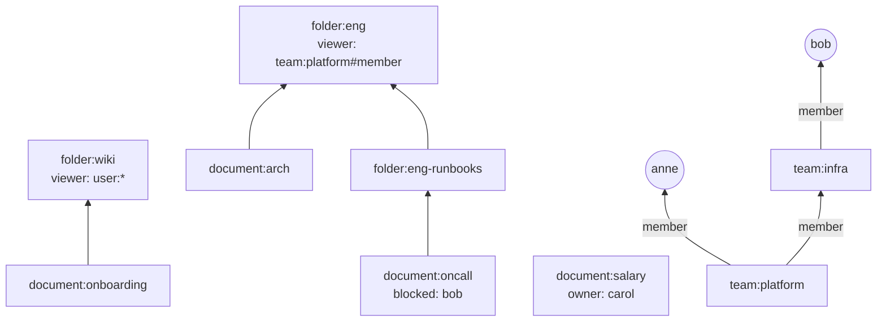

# Lab 4：mini-openfga v0.4：“我能看哪些文档”与“谁能看这份文档”

> 目标：在一个有嵌套团队、公开文件夹、拉黑规则的小公司模型上，用 ListObjects 和 ListUsers 回答两个方向的问题；对照 Check 理解结果；跑通三类查询的全部矩阵测试。
> 前置：第 18–20 章。对应代码：mini-openfga **v0.4**（本 Lab 的数据在 v1.0 的 `examples/company/`，在 v0.4 上照抄这两个文件即可）。

## 1. 模型与数据

`examples/company/model.fga`：

```text
type user
type team
  relations
    define member: [user, team#member]
type folder
  relations
    define parent: [folder]
    define viewer: [user, user:*, team#member] or viewer from parent
type document
  relations
    define parent: [folder]
    define owner: [user]
    define viewer: [user, team#member] or owner or viewer from parent
    define blocked: [user]
    define can_view: viewer but not blocked
```

`examples/company/tuples.txt`：

```text
team:platform#member@user:anne
team:platform#member@team:infra#member      # platform 包含 infra
team:infra#member@user:bob

folder:wiki#viewer@user:*                   # wiki 对所有人公开
folder:eng#viewer@team:platform#member
folder:eng-runbooks#parent@folder:eng

document:onboarding#parent@folder:wiki
document:arch#parent@folder:eng
document:oncall#parent@folder:eng-runbooks
document:oncall#blocked@user:bob            # bob 不能看值班手册
document:salary#owner@user:carol
```



## 2. 我能看哪些文档

```bash
cd code/mini-openfga && git checkout v0.4
M="-model examples/company/model.fga -tuples examples/company/tuples.txt"
for u in user:anne user:bob user:carol user:zoe; do
  go run ./cmd/minifga list-objects $M $u can_view document
done
```

整理后的结果：

| 用户 | can_view 的文档 | 解释 |
|---|---|---|
| anne | arch, onboarding, oncall | platform 组 → eng 文件夹（及子文件夹）；wiki 公开 |
| bob | arch, onboarding | 经 infra → platform 同样能到 eng，但被 oncall 拉黑 |
| carol | onboarding, salary | 公开文档 + 自己拥有的 |
| zoe | onboarding | 没有任何关系，只有公开的 |

几个值得注意的地方：

- bob 在 oncall 上：反向展开沿 `viewer`（`but not` 的 base）找到了 oncall 作为候选，因为经过了 `but not`，用 Check 复核，结果为 false，被剔除（第 18 章）；
- 公开的 onboarding 出现在每个人的结果里：反向展开时，`folder#viewer` 允许 `user:*`，所以反查用户列表里同时放了 `user:zoe` 和 `user:*`（第 18 章的 `readTuplesAndExecute`）；
- zoe 这个用户在数据里根本不存在，但查询是合法的。ReBAC 里“用户”不需要注册。

## 3. 谁能看这份文档

```bash
go run ./cmd/minifga list-users $M document:oncall#can_view user
go run ./cmd/minifga list-users $M document:onboarding#can_view user
go run ./cmd/minifga list-users $M document:salary#can_view user
go run ./cmd/minifga list-users $M document:arch#viewer team#member
```

| 查询 | 结果 |
|---|---|
| oncall 的 can_view，过滤 user | user:anne |
| onboarding 的 can_view，过滤 user | user:* |
| salary 的 can_view，过滤 user | user:carol |
| arch 的 viewer，过滤 team#member | team:infra#member, team:platform#member |

- oncall：bob 通过 infra 是 viewer，但被拉黑，所以只有 anne；
- onboarding：结果是 `user:*`，**而不是**一个具体用户列表。“所有人都能看”没法列举，ListUsers 就如实返回通配符，由调用方解释；
- arch 按 `team#member` 过滤：两个团队的成员整体上都能看。infra 也在里面，因为 infra 嵌套在 platform 里。

## 4. 与 Check 对照

```bash
go run ./cmd/minifga check $M document:oncall#can_view@user:bob document:oncall#viewer@user:bob document:onboarding#can_view@user:zoe
```

```text
document:oncall#can_view@user:bob                  false
document:oncall#viewer@user:bob                    true
document:onboarding#can_view@user:zoe              true
```

三种查询必须互相一致：ListObjects(u) 里有 o，当且仅当 Check(o@u) 为 true；ListUsers(o) 里有 u（或 `user:*`），当且仅当 Check(o@u) 为 true。第 31 章的差分测试就是在随机数据上大量检验这种一致性。

## 5. 矩阵测试

```bash
go run ./cmd/minifga matrix
```

```text
Check        assertions: 939 passed, 0 failed, 0 skipped (100.0%); tests: 298/298 fully passed
ListObjects  assertions: 641 passed, 0 failed, 0 skipped (100.0%); tests: 255/255 fully passed
ListUsers    assertions: 730 passed, 0 failed, 0 skipped (100.0%); tests: 255/255 fully passed
```

v0.4 的运行器增加了 ListObjects 和 ListUsers 断言的支持（`internal/matrix/matrix.go` 的 `Run`），比较时把结果当作集合（排序、去重）。

## 6. 动手改

1. **嵌套更深**：再加一个 `team:sre`，包含在 infra 里，加一个用户。ListObjects 的结果怎样变化？
2. **公开但排除**：给 onboarding 加一条 `document:onboarding#blocked@user:zoe`。ListUsers(onboarding#can_view, user) 返回什么？为什么里面看不到“zoe 除外”？用 Check 确认 zoe 确实不能看。（第 20 章：API 的结果列表无法表达“除外”。）
3. **结果上限**：生成 2000 份放在 wiki 下的文档，ListObjects 默认最多返回 1000 个（`listobjects.DefaultMaxResults`）。验证一下，再想想调用方应该怎样处理“结果被截断”的情况。

## 7. 本版小结

v0.4 加入了反向查询的两个方向：ListObjects（经典反向展开 + 候选复核，第 18、19 章）和 ListUsers（候选超集 + Check 确认，第 20 章）。三类查询的全部 2310 条矩阵断言通过。代码量 6167 行（非测试）。

到这里，授权引擎的“语义”部分已经完整。Part VI 把它变成一个真正的服务：持久化存储、模型版本、变更日志、HTTP API。
