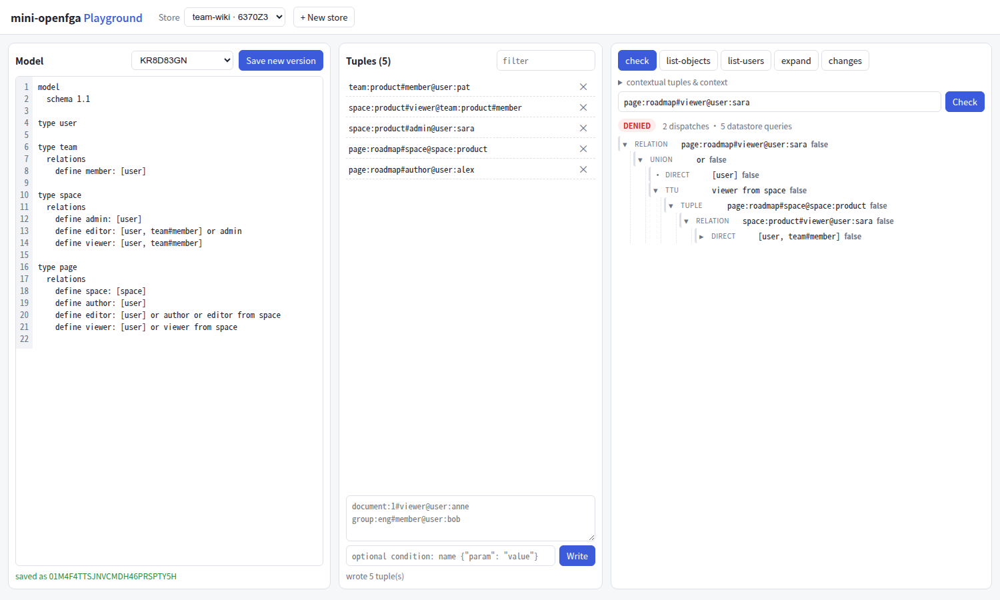
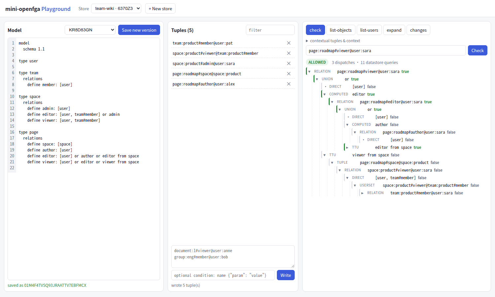

# Lab 6：mini-openfga v0.6：在浏览器里找出模型的错误

> 目标：用 Playground 完成一次完整的调试：建 store、写一个**有错误**的模型和几条元组，通过 Check 发现异常，用解析树定位原因，修改模型、保存为新版本，再确认修复。
> 前置：第 25、26 章。对应代码：mini-openfga **v0.6**（本 Lab 的文件在 v1.0 的 `examples/lab6/`）。

## 1. 启动

```bash
cd code/mini-openfga && git checkout v0.6
go build -o minifga ./cmd/minifga
./minifga serve -addr 127.0.0.1:8080
# 浏览器打开 http://127.0.0.1:8080/playground/
```

点 “+ New store”，起名 `team-wiki`。新 store 会带一个示例模型。

## 2. 一个团队 wiki 的模型（有一个错误）

把编辑器的内容换成 `examples/lab6/model-buggy.fga`：

```text
model
  schema 1.1

type user

type team
  relations
    define member: [user]

type space
  relations
    define admin: [user]
    define editor: [user, team#member] or admin
    define viewer: [user, team#member]

type page
  relations
    define space: [space]
    define author: [user]
    define editor: [user] or author or editor from space
    define viewer: [user] or viewer from space
```

意图是：页面属于一个空间；空间管理员是空间的编辑者；页面的作者和空间的编辑者能编辑页面；**能编辑的人当然也能看**。状态栏显示 OK，点 “Save new version”。

在元组面板里写入 `examples/lab6/tuples.txt` 的 5 条：

```text
team:product#member@user:pat
space:product#viewer@team:product#member
space:product#admin@user:sara
page:roadmap#space@space:product
page:roadmap#author@user:alex
```

## 3. 发现异常

在 check 标签页里依次查询：

| 查询 | 结果 |
|---|---|
| `page:roadmap#viewer@user:pat` | ALLOWED |
| `page:roadmap#editor@user:sara` | ALLOWED |
| `page:roadmap#viewer@user:sara` | **DENIED** |
| `page:roadmap#viewer@user:alex` | **DENIED** |

sara 是空间管理员，能编辑 roadmap，却**不能看**；作者 alex 也一样。“能改不能看”几乎总是模型写错了。

## 4. 用解析树定位

查询 `page:roadmap#viewer@user:sara`，看下面的树：



*图 L6-1：有错误的模型下，`page:roadmap#viewer@user:sara` 为 DENIED。*

```text
▾ relation  page:roadmap#viewer@user:sara  false
  ▾ union   or  false
    · direct  [user]  false
    ▾ ttu     viewer from space  false
      ▾ tuple   page:roadmap#space@space:product  false
        ▾ relation  space:product#viewer@user:sara  false
          ▸ direct  [user, team#member]  false
```

读法：`viewer` 的 union 只有**两个**分支，直接赋值和 `viewer from space`。沿着空间往上找，`space:product#viewer` 只认直接的用户和团队成员，sara 都不是。树里**根本没有一个分支经过 editor**，这就是答案：模型里 `viewer` 没有包含 `editor`。

这也是解析树和“只看结果”的区别：DENIED 本身不能告诉你是数据缺了一条，还是模型少了一条路径；树把所有尝试过的路径都列了出来，缺的那条路径一眼就能看出来。

## 5. 修复并确认

把最后一行改成：

```text
    define viewer: [user] or editor or viewer from space
```

保存为新版本，再查一遍：

| 查询 | 修复前 | 修复后 |
|---|---|---|
| `page:roadmap#viewer@user:pat` | ALLOWED | ALLOWED |
| `page:roadmap#editor@user:sara` | ALLOWED | ALLOWED |
| `page:roadmap#viewer@user:sara` | DENIED | **ALLOWED** |
| `page:roadmap#viewer@user:alex` | DENIED | **ALLOWED** |



*图 L6-2：修复后的模型，sara 通过 editor ← editor from space ← space admin 获得 viewer。注意 `editor from space  true` 这一行是折叠的（▸），这是下面第 6 节说的第二个界面问题，点开它能看到 `space:product#editor` ← `admin` ← `space:product#admin@user:sara`。*

切到 list-users 标签页，查 `page:roadmap` 的 `viewer`、过滤 `user`：

```text
user:alex, user:pat, user:sara
```

不需要改任何元组，旧的元组在新模型下自动有了新的含义（第 22 章：元组不属于任何模型版本）。

以上结果都是用 Playwright 脚本驱动无头 Chrome 在 v0.6 上实际跑出来的，整个过程没有任何 HTTP 错误。

## 6. 本 Lab 发现的界面问题

这两张截图里有两个问题，都在 v1.0 修复了。

**版本下拉框过时**。模型版本下拉框显示的是 `KR8D83GN`，也就是新建 store 时的示例模型，而编辑器里是刚保存的新模型。原因是 `<select>` 没有绑定 `value`（非受控组件）：保存后列表刷新了，浏览器仍然选着原来那个选项，而它已经不是第一项，也就没有 “latest” 标记。v1.0 改成了受控组件。同一个脚本对比：

```text
v1.0:  model: saved as 01M4F4VNHCHBVEVPYWANNZ7CXX | dropdown: latest · ANNZ7CXX
v0.6:  model: saved as 01M4F4VRY740ZDE0MEZ9BW6G5V | dropdown: WAEM8X3X
```

**解析树的展开状态串了**。图 L6-2 里，决定结果的 `editor from space  true` 是折叠的，而默认规则是“为 true 的节点展开”。原因是上一次查询（alex）的树形状相同，那个位置的节点是 false、折叠的，React 复用了组件，折叠状态被继承了下来（第 26 章 26.6 节）。复现脚本先查 alex 再查 sara：

```text
v0.6:  page:roadmap#viewer@user:sara    "editor from space": ▸ true
v1.0:  page:roadmap#viewer@user:sara    "editor from space": ▾ true
```

这个问题对调试工具是致命的：它恰好藏起了你要找的那条路径。

## 7. 动手改

1. **用断言固定行为**：用第 23 章的 `PUT /stores/{id}/assertions/{model_id}` 给修复后的模型写 4 条断言（上面表格的“修复后”一列），再用 `POST .../assertions/{model_id}/run` 执行。然后对**修复前**的模型 ID 写同样的断言并执行，看哪些失败。
2. **另一个常见错误**：把 `space` 的 `editor` 改成 `define editor: [user, team#member]`（去掉 `or admin`），哪些查询会变？先预测，再用解析树验证。
3. **上下文元组**：不写入元组，在 check 的 “contextual tuples” 里填 `space:product#admin@user:zoe`，查 `page:roadmap#viewer@user:zoe`。这种用法适合什么场景？（第 13 章）

## 8. 本版小结

v0.6 给 mini-openfga 加上了浏览器界面：模型编辑器（边输入边校验、版本列表）、元组面板、五种查询，以及 Check 的解析树。它和 HTTP API 打包在同一个二进制里。

Part VIII 进入平台化：带权图与策略选择、规划器、认证、可观测性、部署，以及怎样系统地验证正确性。
